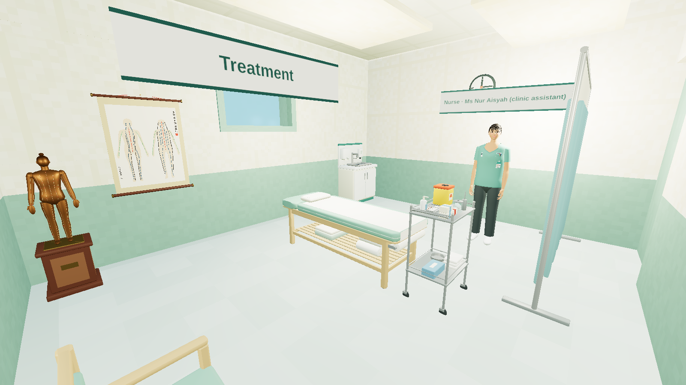
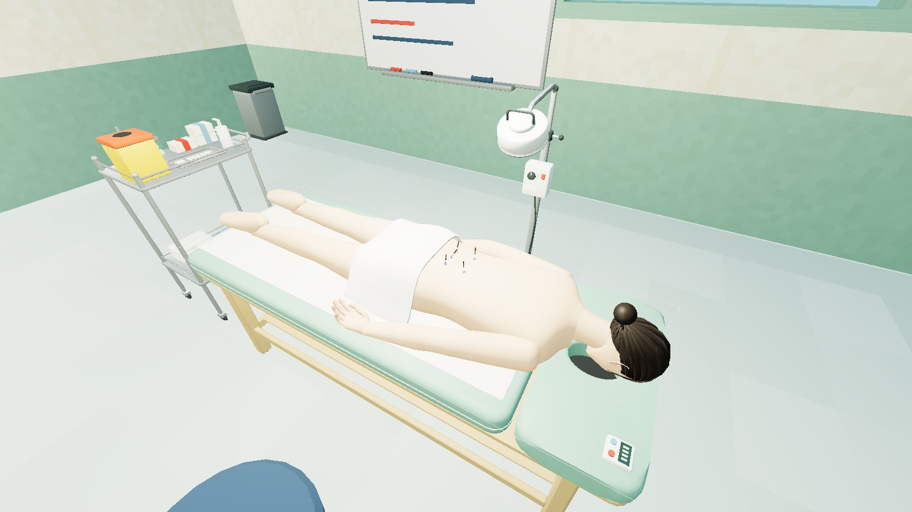
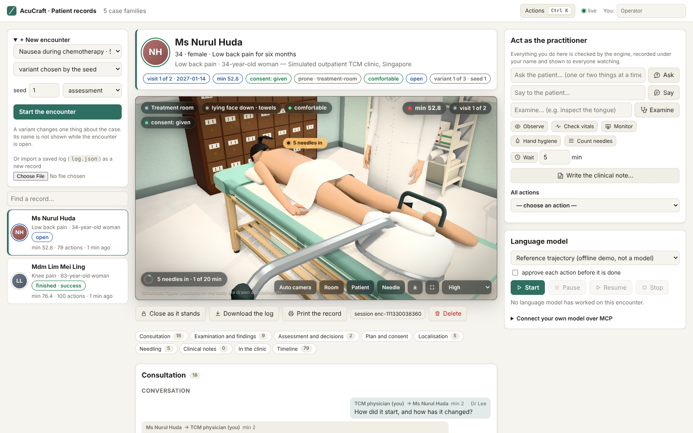

# AcuCraft · Singapore

**An acupuncture simulation and evaluation environment built on [ClinicalCraft](https://github.com/psknlr/ClinicalCraft).**
A practitioner — a human learner or an AI agent — conducts a whole encounter in a simulated outpatient TCM clinic in
Singapore: consultation, examination, records, pattern differentiation, evidence, a clinical decision (treatment,
deferral and referral are all valid outcomes), consent, localisation on this patient, virtual needling, monitoring,
completion, documentation and a follow-up visit. An independent evaluator scores the complete trajectory.

Two things make the encounter more than a transcript:

- **The clinic is a place.** Its floor plan is a ClinicalCraft facility; the practitioner has a body in it, walks along
  planned paths, and can only do what is within reach of where they stand — a point on the far side of the couch means
  walking round it ([docs/WORLD.md](docs/WORLD.md)).
- **Conclusions rest on evidence.** A pattern differentiation names the findings it rests on and is read from what
  those findings show; a recorded deqi names what was observed at that needle and is compared with what the tissue did.
  Nothing can be cited that was not obtained, and stronger stimulation is never rewarded
  ([docs/EVIDENCE.md](docs/EVIDENCE.md)).



*The clinic as ClinicalCraft's own 3D world draws it: every piece of the pack's equipment is a model built in Blender,
and the people are the world's own figures ([docs/MODELS.md](docs/MODELS.md)). AcuCraft's engine is headless: it
reasons about the same building — where one can stand, walk and reach — without drawing it.*



*A needling station of the skills room, while its needles are retained. The body is one of the world's figures; the
marks and the needles are layers of the station's model that follow its state.*

**Patient records in the browser, live.** `npm run acu -- serve` opens a workspace where a person and a language
model keep the same patient records at once — the operator from the page, a model run by the server (Claude, or the
reference trajectory offline; supervised if wanted), any MCP client over HTTP — every action checked by the engine,
recorded under who did it, kept on disk and shown in every browser as it happens, around a live 3D view of the
encounter ([docs/WEB.md](docs/WEB.md)).



> **Status: first implementation milestone of the design proposal.** The engine, the evaluator and a pilot content pack
> (5 case families × 3 variants) are implemented and tested. **All clinical, anatomical and regulatory content is
> AI-assisted and unreviewed**: the regional anatomy is schematic for the head and limbs and derived from one reference body for the trunk, the Singapore rule encodings have not been checked
> against the source documents, and no institution is involved. Scores are teaching-script measures for simulation
> research — not validated competency scores and not evidence of clinical effectiveness.

## Quick start

Node 22. The ClinicalCraft engine is fetched at the pinned revision (`tools/clinicalcraft.rev`) into `.deps/`.

```bash
npm install
```

```bash
npm run bootstrap
```

```bash
npm test
```

```bash
npm run validate
```

Run one encounter with the rule-based baseline agent, then replay it:

```bash
npm run acu -- run sg-knee-oa/base --agent protocol --verbose
```

```bash
npm run acu -- replay runs/sg-knee-oa--base--protocol--s1/log.json
```

Play the practitioner yourself (`help` inside: `go`, `where`, `map`, `feel`, `evidence`; `--mode teaching` shows
reference locations and how each differentiation reads):

```bash
npm run acu -- play sg-knee-oa/base --mode teaching
```

The clinic's floor plan, and what each pattern is recognised by:

```bash
npm run acu -- map sg-knee-oa/base
```

```bash
npm run acu -- vocabulary
```

An HTML view of a run — the floor plan with every walk, the charts, the evidence links and the timeline:

```bash
npm run acu -- view runs/sg-knee-oa--base--protocol--s1/log.json
```

Browse the point library: counts by channel, one channel, body area or region, or one point in full:

```bash
npm run acu -- points
```

```bash
npm run acu -- points forearm
```

```bash
npm run acu -- points ST36
```

Run the pilot benchmark (dev and held-out splits, Wilson and family-cluster intervals):

```bash
npm run bench -- --agent protocol
```

Run it with a live model (needs Anthropic API credentials; default `claude-opus-5-5`, effort `high`, server-side refusal
fallback on). The model acts through one typed tool for each action, reads the clinic's skills when it needs them,
and its transcript and token usage are kept in the log ([docs/AGENT.md](docs/AGENT.md)):

```bash
npm run bench -- --agent claude --split dev
```

The same loop with no model and no network — the reference trajectory spoken as tool calls (15/15; CI runs it):

```bash
npm run bench -- --agent scripted-llm
```

Let an agent in another program play the practitioner over MCP, with the same tools (Claude Code shown):

```bash
claude mcp add acucraft -- npm run -s acu -- mcp
```

Keep the records in a browser, with a language model and MCP clients working on the same records live
([docs/WEB.md](docs/WEB.md)) — then open http://127.0.0.1:8787/:

```bash
npm run acu -- serve
```

```bash
claude mcp add --transport http acucraft http://127.0.0.1:8787/mcp
```

See what a model is given — its tools, its standing instructions, the skills:

```bash
npm run acu -- tools
```

```bash
npm run acu -- prompt
```

```bash
npm run acu -- skills
```

## What is in it

| | |
|---|---|
| `packages/core` — `@acucraft/core` | schemas; scenario resolution (family + variant overlays); patient-specific anatomy, proportional (B-cun) localisation and needle path assessment; the deterministic encounter engine over ClinicalCraft's clinical session; the clinic as a walkable world over ClinicalCraft's world layer (stances, planned walks, reach); the evidence ledger, pattern support and the needle's response; needle lifecycle and invariants; roles, versioned rules and the simulation guard; consent; delegation and NPC policies; field events; replay; the agent view |
| `packages/agent` — `@acucraft/agent` | who plays the practitioner: the reference oracle and the rule-based protocol baseline; the runtime of a language-model practitioner — one typed tool per action generated from the engine's schemas, the read-only tools (`lookup`, `view`, `construct_point`, `read_skill`), standing instructions, skills as data, a provider for the Messages API and two offline ones, a loop that carries several calls a turn and stops a batch when the patient needs an answer; the session |
| `packages/bench` — `@acucraft/bench` | content loader; the independent evaluator (primary endpoint, five tracks, critical errors, unsafe attempts executed/blocked, the evidence links, adjudication, STRICTA-informed documentation); runner; suites; statistics; reports; the HTML viewer |
| `packages/mcp` — `@acucraft/mcp` | an MCP server (stdio, and the store the workspace shares): another program's agent plays the practitioner with the same tools, and is served nothing hidden until the encounter is over |
| `packages/server` — `@acucraft/server` | the browser workspace (`serve`): live records an operator, the server's language model and MCP clients work on together — the record hub (attribution, timeline, records kept and restored by replay), an HTTP API, a server-sent event stream, MCP over Streamable HTTP, the language-model runner (approvals, pause, stop), the browser app (the complete record, every tool as a form) and its 3D view of the encounter, drawn with ClinicalCraft's figure kit and the pack's models |
| `packages/cli` — `acucraft` | `validate`, `list`, `points`, `show`, `map` (the floor plan), `vocabulary` (signs, pattern criteria, deqi), `locate`, `run`, `play`, `replay`, `evaluate`, `view` (an HTML encounter viewer: the floor plan with every walk, charts with landmarks, structures, reference locations and entries, the evidence links and the timeline), `bench`, `export-clinicalcraft`, `skills`, `tools`, `prompt`, `mcp`, `serve` (the browser workspace) |
| `content/` | 3 standard editions, the full point library (409: the WHO 2008 standard's 361 meridian points and the WHO 1991 nomenclature's 48 extra points; 399 localised and needleable), 18 regional models covering the whole body (the trunk and front of the neck derived from the HuBMAP Visible Human Male reference body, CC BY 4.0, see THIRD_PARTY.md; the head and limbs schematic) and where each lies on the body, Singapore roles, 3 rule-set series, the clinic and its floor plan (a ClinicalCraft facility with three room templates), a skills room with two needling stations, an equipment catalog of 11 types each with a model built in Blender (`world/assets/models`), the vocabulary (diagnoses, 66 signs, 13 patterns with their criteria, needle sensations, deqi), guideline evidence, 9 skills (how the clinic works, for an agent to read), 5 families, the pilot suite |
| `tools/` | `bootstrap.sh` (the pinned engine), `check.sh` (what CI runs), `locate.ts`, `finish-solutions.ts` (replays the reference trajectories: drops idle walks, writes the needle responses from the evidence), `content/` (authoring scripts: families, the clinic's world, the vocabulary), `blender/` (the equipment models: `build.py`, `models.py`, and each needling station's fit to its body), `figure-fit.mts` (measures that body on the pinned figure kit), `world-shots.mjs` and `preview-sheets.py` (the pictures of `docs/img`) |

### The case families

| family | split | variants |
|---|---|---|
| `sg-knee-oa` — knee pain, 63 | dev | base (a needle starts to burn during retention) · on warfarin with varicose veins over SP9 · hot swollen knee with fever after an injection (emergency referral) |
| `sg-low-back-pain` — 34, office worker | dev | base (dated 2027: the newer TCMPB advisory version is in force) · cauda equina (emergency referral) · 24 weeks pregnant (no prone positioning, cautioned points) |
| `sg-tension-headache` — 29, accountant | dev | base · declines to lie face down, hasn't eaten, faints when treated sitting · very slim build (the pleura under GB21 within 2 cm) |
| `sg-chemo-nausea` — 52, on chemotherapy | held-out | base · lymphoedematous left arm · neutropenia and thrombocytopenia on the latest count (defer, liaise with oncology) |
| `sg-insomnia` — 54, taxi driver | held-out | base · withdraws consent after two needles · low mood with suicidal thoughts (same-day urgent help) |

Every variant has a reference trajectory that reaches an acceptable pathway, and each family's base course fails every
other variant of the family (both are tested).

## Design proposal coverage

| proposal | implemented | not yet |
|---|---|---|
| §2 built on ClinicalCraft, content-pack structure | each scenario's consultation is a ClinicalCraft case run by `@clinicalcraft/core` (pinned); the clinic is a ClinicalCraft facility, and the encounter runs on `@clinicalcraft/world`'s collision, navigation and sight — people stand somewhere, walk planned paths and act within reach ([WORLD.md](docs/WORLD.md)); `.clinicalcraft/settings.json` and `export-clinicalcraft` for ClinicalCraft's front-ends; an agent runtime and an MCP server after ClinicalCraft's design ([AGENT.md](docs/AGENT.md)); the clinic drawn by ClinicalCraft's 3D world with the pack's own Blender-built models, its people as the world's figures, and two needling stations whose model follows the steps of a drill ([MODELS.md](docs/MODELS.md)) | the encounter played inside ClinicalCraft's 3D renderer (the engine is headless: the renderer shows the building it reasons about, and the needling stations are a drill of their own, not an evaluated encounter) |
| §3 Singapore roles, consent, records, rule versions with effective dates | role permissions incl. supervised learners; consent to plan versions, refusal, withdrawal; investigation access by role; rule series with versions in force by visit date ([SINGAPORE.md](docs/SINGAPORE.md)) | verification of the TCMPB texts; encoding of the 2027 advisory; Mandarin dialogue |
| §4 the complete encounter | consultation (one or two questions at a time), assessment, decision, planning, preparation, procedure, observation, completion, follow-up; pattern differentiation and deqi linked to evidence — a ledger with stable ids, conclusions that name what they rest on, read from the field and never from the claim ([EVIDENCE.md](docs/EVIDENCE.md)) | expert review of the signs, the criteria of each pattern and the needle-response model |
| §5 versioned definitions; definition / patient instance / actual entry; cun per patient; regional models; separate localisation and path assessment | yes ([ANATOMY.md](docs/ANATOMY.md)); WHO 2008 vs GB/T 12346-2021 recorded; the whole body modelled in 18 regions, the trunk imaging-derived (HuBMAP Visible Human Male) | expert review; imaging-derived limbs and head (open data with attribution-only licences lacks nerves and limb vessels); per-patient imaging |
| §6 needle identity, lifecycle, contamination, invariants, lost and broken needles, distinct sensation records | yes; invariants checked after every step in tests and CI | |
| §7 shared action system for all characters; observable delegation; deterministic control; seeded events; replay from recorded outputs; four records per request | yes ([ARCHITECTURE.md](docs/ARCHITECTURE.md)) | LLM-voiced patient and assistant (the patient answers from authored facts) |
| §8 fixed case state, investigation sequence, "not provided or not modelled" | yes (ClinicalCraft records and turnaround) | |
| §9 primary endpoint, separate reports, five tracks, multiple pathways, adjudication, family splits, clustering | yes ([EVALUATION.md](docs/EVALUATION.md)) | expert review; the four experiments need live-model runs |
| §10 MVP: ~40 families, 120 instances, 30–40 points, 4–6 regions | 5 families (3 dev, 2 held-out), 15 instances; all 409 standard points defined (399 localised); 18 regions covering the whole body; practitioner, patient and support roles; the clinic; interruptions, abnormal sensations, bleeding, a syncope-like event, consent withdrawn mid-procedure, a dropped needle (tests); UI (CLI, and the browser workspace with its live 3D view: [WEB.md](docs/WEB.md)), action API, case format, replay, reports | 35 more families |
| §13 release acceptance criteria | each one is an executable test (`packages/bench/src/acceptance.test.ts`) | |

Electroacupuncture, moxibustion and haptics are out of scope for this release, as the proposal plans.

## Baseline result

`npm run bench -- --agent protocol` (pilot-v1, seed 1): **14/15** encounters succeed (dev 8/9, held-out 6/6). The one
failure is designed. On the slim-build headache variant the agent's textbook GB21 depth would reach the pleura. The
guard blocks it and the blocked attempt counts as a critical error. The reference oracle succeeds on 15/15.

The evidence links say more than the endpoint. The baseline's keyword differentiation rests on the findings it names
in 9 of 11 encounters (in the knee family it never asks about the weather and settles on a pattern one tender point
cannot carry); it records a response for all 47 needles and none as deqi without evidence of it; it walks about 69 m
an encounter. There are no live-model results: this release was built without API access. The language-model loop is tested against scripted providers and a stand-in for the SDK client, and carries all 15 encounters offline with the reference trajectory in place of a model.

## Documentation

- [docs/ARCHITECTURE.md](docs/ARCHITECTURE.md) — packages, the encounter engine, needles, roles and rules, NPCs, the agent view, replay
- [docs/WORLD.md](docs/WORLD.md) — the clinic as a ClinicalCraft facility, standing and walking, what each act needs within reach, the body on the couch
- [docs/MODELS.md](docs/MODELS.md) — how the clinic is drawn: the equipment models built in Blender, the people, the needling stations whose model follows a drill, the pictures and the checks
- [docs/EVIDENCE.md](docs/EVIDENCE.md) — the evidence ledger, pattern differentiation read from its findings, the needle's response and how a recorded deqi is checked
- [docs/ANATOMY.md](docs/ANATOMY.md) — charts, configurations, patient-specific instances and cun, tissue, needle paths
- [docs/EVALUATION.md](docs/EVALUATION.md) — endpoint, tracks, agents, statistics, the baseline
- [docs/AGENT.md](docs/AGENT.md) — the practitioner's runtime: tools, the loop, what a model is told, skills, providers, sessions, MCP
- [docs/WEB.md](docs/WEB.md) — the browser workspace: live records shared by an operator, a language model and MCP clients; the API, the event stream, MCP over HTTP, security, the 3D view
- [docs/SINGAPORE.md](docs/SINGAPORE.md) — roles, rule sets and versions, what remains to verify
- [docs/CONTENT.md](docs/CONTENT.md) — authoring families, variants, fields, conditions and reference trajectories
- [docs/AUDIT-2026-11.md](docs/AUDIT-2026-11.md) — the November 2026 clinical and gameplay audit: what changed, the regression tests, what remains open

## Licence

Not yet chosen: the package manifests declare MIT (as ClinicalCraft does) and the regional models are marked CC0-1.0
original schematic geometry, but there is no LICENSE file yet — add one to settle it. Point location texts are
paraphrases written for this pack and must be checked against the cited standards.
