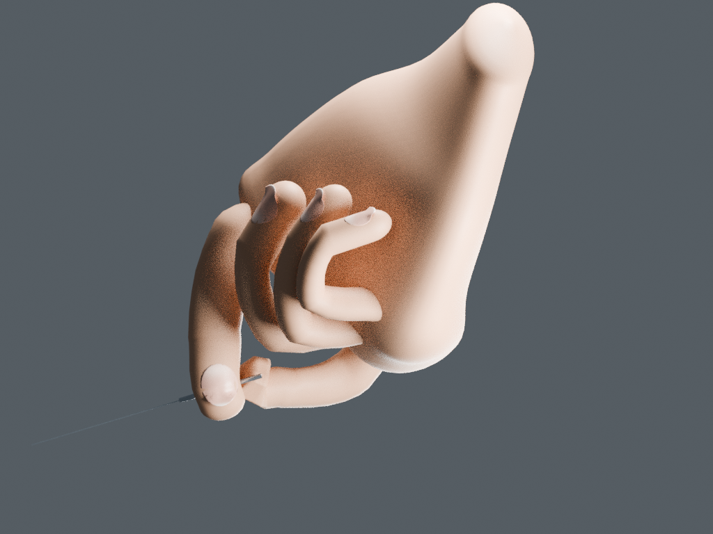

# Practitioner hand asset

`content/world/assets/models/acu-practitioner-hand.glb` is original procedural
geometry generated by `tools/blender/build_hand.py`. Its meshes, authored textures
and animation are CC0-1.0. It contains no downloaded meshes, external textures,
patient data or copies of the supplied reference photographs. This is an authored
visual simulation, without anatomical, motion-capture or clinical validation.



[Reference interpretation, shared controls and inspection views](REFERENCE-POSES.md)
describes how the supplied images inform the implementation.

Rebuild with Blender 4.3 or newer:

```bash
blender -b -P tools/blender/build_hand.py
```

`tools/blender/hand.json` records the actual binary hash, byte and triangle counts,
coordinate frames, skin influences, surface attachments and evaluated clip
contacts. `tools/blender/hand_poses.json` stores the authored quaternion keyframes
and whole-hand presentation transforms. These generated files and the GLB must be
updated together. The separate hand asset is loaded by the encounter renderer,
not the static equipment catalog.

## Shape, frames and skinning

The GLB uses metres and Y up. The outer `acu_practitioner_hand` frame follows the
needle: +Y points outward along its shaft. The raised neutral wrist is
`[0.080, 0.110, 0]`, above and behind the pinch. The source index bends back toward
the shorter thumb, forming a compact C. The fingertips are staggered rather than
ending as two parallel tongs. The other three fingers have adult relative lengths
and graduated bends.

`palm_frame` and `wrist_frame` describe the actual palm, separately from the
needle frame: -X points toward the fingers, -Y is volar and +Z is radial. Their
basis follows the MCP-to-wrist direction. This differs from the origin-to-wrist
bearing used by the wrist-elevation control. Mirroring Z creates the opposite
hand; frame extraction uses transformed axes to preserve the actual dorsal side.

`palm_surface` is one closed connected skin including the thenar region, palm
arch, MCP roots and wrist taper. There is no separate thenar ellipsoid. The thin
thumb metacarpal connector stays inside this palm; the two exposed phalanges
supply the external thumb silhouette. Tests check entire root-cap circumferences
against the actual palm, rather than checking only joint centers.

Each digit is one closed `SkinnedMesh`, without separate knuckle balls or capped
phalanx pieces. Cross-section frames transport a stable lateral axis through the
bend. Neighboring controls blend their weights around joints, while the terminal
contact-bearing surfaces remain rigidly attached to the distal control. The
connected palm blends static and local CMC influence to follow opposition.

The skin has sixteen influences: fifteen legacy digit controls and static
`palm_root`. Anatomical parents carry the corresponding joint translations:

| Digit | Anatomical parents | Legacy skin controls |
| --- | --- | --- |
| Thumb | `thumb_CMC`, `thumb_MCP`, `thumb_IP` | `thumb_proximal`, `thumb_middle`, `thumb_distal` |
| Index/middle/ring/little | `<digit>_MCP`, `<digit>_PIP`, `<digit>_DIP` | `<digit>_proximal`, `<digit>_middle`, `<digit>_distal` |

The legacy children have zero translation and carry clip rotations. Anatomical
parents can add independent adjustments without moving the pivots. The thumb
names do not imply three interphalangeal joints. These control landmarks and
motion bounds are authored, not calibrated anatomical limits.

Blender generates geometry and clips; a deterministic export step adds standard
glTF skin attributes and inverse bind matrices. `apply_preview_skin()` evaluates
these same weights in Blender for review. Independent hands **must use
`SkeletonUtils.clone`**; ordinary scene cloning shares bones.

Two recolorable PBR materials, `hand_skin` and `hand_nails`, use embedded original
albedo, normal, packed roughness and nail-bed maps. Nail plates follow the dorsal
side through the finger bend; their free edge continues the nail-bed tangent.
The Node test image adapter decodes the actual embedded PNG pixels, so tests
exercise the shipped textured GLB rather than substituting empty textures.

## Real surface attachments

Moving contacts live under their actual phalanx, with local +Y along the outward
surface normal. Pad, side-pulp and nail-edge attachments are fitted to real skin
or nail triangles. Fixed root-level `thumb_contact` and `index_contact` are legacy
bind references, not live articulated contacts.

| Attachment | Role |
| --- | --- |
| `thumb_pad_contact`, `index_pad_contact` | Opposed primary needle hold |
| `index_side_contact` | More proximal index-pulp hold, with the index tip extending below it |
| `middle_side_contact` | Explicit optional third-finger support |
| `middle_nail_edge_contact` | Actual forward free edge used for scraping/flicking |
| `index_volar_contact` | Palmar skin contact for the supporting hand |
| `palm_contact` | Actual static ulnar heel facet used for pressing |
| `support_contact` | Additional static palmar attachment |

The middle nail contact is near the true forward free edge. A side rim halfway
along a nail cannot stand in for it. Likewise, the supporting index uses a true
volar triangle; reusing the needle-bearing side pad turns the palm into the
patient. Manifest surface/feature fields record these distinctions.

## Contact and motion control

Thumb/index is the default primary hold for insertion and retained-needle
techniques. A bounded fixed-length solve places their individual real surfaces
on opposite sides of the rendered handle, with normals pointing inward. Matching
their midpoint alone is insufficient. The solve changes joint rotations without
scaling fingers, translating joints or changing phalanx lengths. Optional
three-finger support adds a separate middle-pulp contact.

The operator and LLM share `wristElevationDeg`, `gripStyle`, `idleFingerPose`, grip,
opening and support controls. Wrist elevation changes the actual palm around its
contact line while preserving the recorded needle angle. Ordinary holds expose
35–70° (default 55°); optional middle support uses a low-twist tip-only variant
at 44–51° (default 48°). These combinations appear in `handProfiles`. The authored
Gua/Tan nail variant exposes 50–60° through its `parameterBounds`. The engine
rejects unsupported executed angles or grip combinations explicitly.
`gripApertureMm` affects
approach/release; an engaged hold fits the actual tapered handle. An insertion
approaches with the needle already held, follows a hover arc above the skin,
then begins the recorded insertion trajectory.

Twirling migrates the material contact over actual terminal skin triangles and
solves the corresponding finger hinges. This produces visible local opposition
instead of a rotation that the contact solve later overwrites. Explicit
unidirectional rotations use staggered rolling/release/reset phases so at least
one primary pad remains engaged. Axial techniques share a small bounded part of
the already approved movement with the fingers; the remaining travel follows the
wrist. Neither presentation mechanism changes clinical needle displacement.

Gua/Tan retain primary thumb/index stabilization while the middle nail works and
releases. Contact-space trajectories must be checked against whole finger skin
and the handle volume: a correct attachment point does not prove that adjacent
pulp clears the needle. Unused fingers use graduated curled or relaxed poses.
Separate supporting hands have their own skeleton and palpation, stretch and
heel-press postures.

The asset also supplies five independently sampled clips: `hand_open`,
`hand_support`, `hand_three_finger`, `hand_scrape` and `hand_flick`. The internal
`hand_pose_frame` carries each standalone clip's whole-hand presentation. Runtime
sampling resets this carrier before applying the live needle/palm transform, so
it is not applied twice. Legacy clip rotations are canceled consistently when
runtime contact solutions replace them. Manifest samples permit source/runtime
comparisons.

## Patient clearance, arms and inspection

The scene checks posed skin, nails and palm against the patient's actual body
triangles. A bounded whole-wrist pronation search can provide clearance without
changing contacts or the needle trajectory. Cached triangle hierarchies avoid
repeating unchanged surface checks. A pose that cannot fit is hidden with a
specific hand-space message; an unsolved grip is reported separately from an
unreachable arm. These visual guards never change an accepted clinical needle
path or recommend a depth to fit the model.

Both arm targets are registered before either hand is drawn. The actual wrist
orientation drives gradual distal-forearm pronation while bone lengths, elbow
and wrist positions remain fixed. Two-bone reach clamps unreachable targets.
A temporary turn and bounded shared torso lean help reach the working area;
feet stay at their authorized floor positions, and walking cancels the pose.

The **手部 Grip** camera cycles three-quarter, side and palmar views and fits the
complete hand, wrist and nearby needle. Local shadows and restrained depth of
field preserve contact readability. Review continuous approach, insertion,
rotation, axial motion and release as well as still images. Offline frame
exports and real-time recordings are labeled separately.

Catalogue playback supports pause and speed. Local preview additionally permits
deterministic seeking, restores the recorded needle when stopped and cannot
replace accepted actions already playing or queued. All skeleton, material,
texture and image resources are released when the scene is disposed.

Historical performance logs retain their original 13-field motion payload when
no new hand control was requested. Current viewers resolve presentation defaults
separately, including 48° for optional middle support. Explicit new hand requests
record the complete resolved presentation. A golden old-engine log verifies
strict restoration without rewriting its original digest.

Soft-tissue compression, measured pressure, friction and tissue response remain
unmodeled. Static photographs do not establish the hidden 3D joint configuration
or motion timing. The geometry and contact checks support visual review; they do
not establish clinical validity or an AAA production-quality certification.
