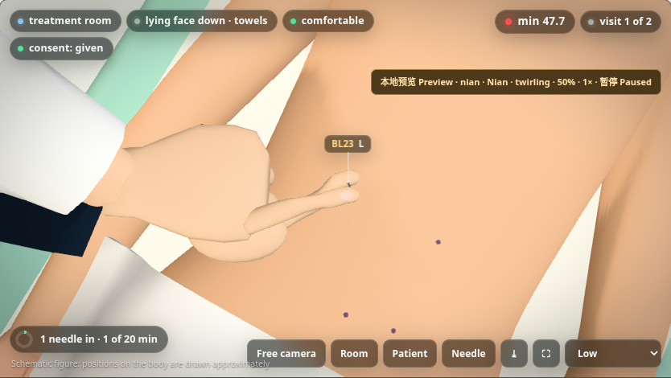
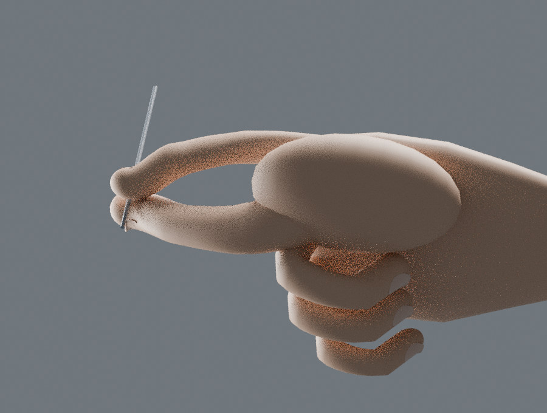

# Practitioner hand asset

`content/world/assets/models/acu-practitioner-hand.glb` is original procedural
geometry generated in Blender by `tools/blender/build_hand.py`. The geometry and
its animation are dedicated to the public domain under CC0-1.0; there are no
downloaded meshes, textures, external add-ons or patient data. It is a schematic
animation asset, without anatomical or clinical validation.



The same asset in Blender, with the radial thumb origin, thenar mound and its two
exposed phalanges visible independently of the supporting hand:



Rebuild with Blender 4.3 or newer:

```bash
blender -b -P tools/blender/build_hand.py
```

The builder also writes `tools/blender/hand.json`, including the binary's hash,
triangle count, dimensions, joint names, moving contact anchors, and measured
contact positions in each authored pose. `tools/blender/hand_poses.json` stores
the authored quaternion keyframes used to reproduce the contact choreography.
The exported hand
has 7,984 triangles, 12 mesh primitives and two PBR materials, `hand_skin` and
`hand_nails`. The renderer can recolor them to match a practitioner's appearance.
The asset is separate from the static equipment catalog because its articulated
nodes are animated by the encounter renderer.

## Coordinate and animation contract

The GLB uses metres and Y up. Its root is `acu_practitioner_hand`; +Y follows the
needle's outward shaft, and +X runs from the pinch toward the wrist. Align this
root with the needle's frame, then place its origin at the desired grip point
on the handle. `pinch` is an empty at the origin and `wrist` is an empty at
`[0.162, 0.004, 0]`. The parent may mirror Z to use the other hand.

The neutral pose is a thumb/index precision pinch. The fingertip centers are
`thumb_tip = [-0.004, 0, -0.006]` and `index_tip = [-0.004, 0, 0.006]`.
The broad facing pads are part of each continuous finger skin mesh, four
millimetres behind the fingertip, and leave 1.4 mm for the rendered needle
handle. Their contacts are `[0, 0, -0.0007]` and `[0, 0, 0.0007]`; the pad
normals point directly toward one another across the shaft, and the two nails
follow each digit's dorsal surface, including the opposed thumb. This avoids the former pointed, separated-finger
appearance caused by small added fingertip spheres and a shared dorsal axis.
`thumb_contact` and `index_contact` mark these same fixed rest positions. Each
finger has three nested rotation nodes:

| Digit | Nodes, from palm toward fingertip |
| --- | --- |
| Thumb | `thumb_proximal`, `thumb_middle`, `thumb_distal` |
| Index | `index_proximal`, `index_middle`, `index_distal` |
| Middle | `middle_proximal`, `middle_middle`, `middle_distal` |
| Ring | `ring_proximal`, `ring_middle`, `ring_distal` |
| Little | `little_proximal`, `little_middle`, `little_distal` |

The legacy names remain available for saved clips. Each has an anatomically named
parent at the same joint pivot: thumb `CMC`, `MCP`, `IP`; the other fingers `MCP`,
`PIP`, `DIP` (for example `thumb_CMC` and `index_PIP`). The anatomical parent carries
the joint translation; its legacy child has zero translation and carries the base
clip rotation. This allows independent joint adjustments above a clip without
moving the rotation pivot or overwriting its sampled motion. The thumb names do
not imply three interphalangeal joints. These are schematic control landmarks,
not a calibrated model of each anatomical joint's degrees of freedom.

Each digit is a single closed `SkinnedMesh` from its base to its rounded tip,
with gently tapered cross sections and a small joint contour. There are no
separate knuckle balls or capped phalanx pieces that can split apart during
flexion. Adjacent controls blend their vertex weights across each joint; the
contact-bearing terminal region remains rigidly attached to its distal control.
The thumb's CMC segment is a metacarpal within the broad thenar mound on the
index/radial side of the palm, so its external silhouette shows two phalanges
rather than three bead-like segments. Its opposing chain passes below the
index instead of originating beside the little finger. Thumb flexion follows
its own opposed volar frame; it does not inherit the other digits' global
palmar sign. Each digit's rest joints bend consistently within its own flexion
plane; distal joints do not reverse direction. The remaining
digits use comfortable moderate flexion in their own palmar planes. Their
cross-section frames transport a stable lateral axis through the bend, and
authored clips inherit the preceding segment's frame before adding a minimum
swing. This prevents a frame flip or axial twist from collapsing the skin into
a narrow neck as a supporting hand unfolds.

Blender generates the geometry and clips. A deterministic export step adds
standard glTF skin attributes and inverse bind matrices using the same fifteen
legacy controls as the actual skin joints. No second armature or per-frame
transform copying is required. Independent hands **must use
`SkeletonUtils.clone`**, because an ordinary scene clone shares skeleton bones.
`apply_preview_skin()` evaluates these same weights in Blender for visual review.

Every distal node has a `<digit>_tip`, `<digit>_pad_contact`, and
`<digit>_nail_contact` attachment. The pad and nail contacts are fitted to the
actual mesh surfaces and move with their phalanx. Their local **+Y axis points
along the outward contact normal**. `<digit>_pad` is a compatibility alias for the
pad contact. `palm_contact` and `support_contact` provide palmar attachment frames.
The old root-level `thumb_contact` and `index_contact` remain fixed reference
points; controllers should use the moving contacts for articulated poses.
`middle_side_contact` is the actual soft lateral pulp for three-finger holding;
the ordinary middle pad remains available for skin contact. Its 6.3096 mm lateral
radius is fitted to the slightly tapered handle by a small MCP adjustment.
Three-finger holding places the primary pair 12 mm below the handle midpoint and
the auxiliary contact 6 mm above it, so the real finger skins have separate space.
`index_volar_contact` is a separate real triangle on the rounded palmar tip for
surface support. A side pad chosen for needle pinching cannot stand in for this
contact without rolling the palm into the patient.

Nails are thin closed curved plates fitted to the real distal skin, rather than
floating flattened ellipsoids. Their rigid free edge continues the nail-bed
tangent instead of wrapping around the soft fingertip. Each nail attachment
is at its distal free edge, approximately 93% of the distal bone's length,
with the actual smoothed surface normal. `middle_nail_edge_contact` lies on a
real lateral free-edge triangle and supplies the active scraping/flicking contact;
the dorsal nail attachment remains available separately.

The asset contains five independently sampled clips, each running from 0 to 1
second. Scraping and flicking retain their own stable thumb/index holding pose:

| Clip | Pose and timing |
| --- | --- |
| `hand_open` | Releases the thumb/index pinch without reverse bending or axial twisting of downstream joints. |
| `hand_support` | Stable supporting pose with a naturally flexed thumb; the scene supplies continuous approach and retreat. |
| `hand_three_finger` | Stable thumb/index hold with a real middle-finger side contact on a separate handle segment. |
| `hand_scrape` | Keeps the thumb/index precision hold while the middle nail supplies the active contact. |
| `hand_flick` | Keeps the thumb/index hold while loading and releasing the middle nail, then returning it to the contact position. |

Sample one base clip per hand, then apply bounded anatomical-parent adjustments.
Unchanged neutral channels may be omitted by the glTF exporter. None of the clips
moves the root or wrist. The renderer aligns the selected actual contact anchor
with its target, and the other hand can supply stabilization during nail contact.
The manifest records the evaluated contact positions for pinch, open, support,
tripod, scraping, and both flick phases. These attachments make contact observable
without pretending that a rendered fingertip supplies measured force.

The mesh is sized for a roughly 17 cm adult hand. Model scale, finger shape and
pad compression are rendering choices and do not prescribe needling technique.
Asset checks probe a 3×3 patch on each real pad surface, verify opposed contact
normals and outward-facing nails, and sample real posed skin contact across all
five clips. They also verify connected finger topology, normalized joint
weights, blended joint regions, and independent deformation after skeleton
cloning. A matching pair of named empties alone is insufficient to establish a
believable grip.

Soft-tissue compression remains unmodelled. In the long Gua stroke, adjacent
near-nail pulp can overlap the visual handle by about 0.21 mm even though the
nail-edge attachment fits its surface. This limits the demonstration's use for
contact-mechanics or pressure validation.

## Contact control in the encounter renderer

Each hand samples its own base clip and independent anatomical joint adjustments.
During needle holding, a bounded fixed-length finger solve places the thumb
and index pads separately on opposite sides of the actual 1.4 mm rendered handle,
with their outward surface normals pointing toward it. The line joining their
contacts is perpendicular to the shaft. Matching their midpoint alone is not a
valid grip. The solver adjusts joint rotations without scaling the hand,
translating a finger or changing a phalanx length.

Thumb/index is the default primary hold for insertion and all retained-needle
catalogue entries. The index is never silently exchanged for the middle finger.
Three-finger support is an explicit option, including in Fei and compound phases.

`gripApertureMm` controls opening during approach and release, rather than allowing
an engaged grip to float around the handle. Even zero opening leaves 1.5 mm
clearance on each side when letting go; a held grip fits the actual diameter.
The three-finger pose adds an independent middle-finger side-pad
contact on a separate handle segment, keeping the central palmar pad free
for surface support instead of rotating it onto the handle. These are rendering dimensions, not
clinical needle or grip specifications. Scene-graph tests cover both mirrored
hands, two/three-finger grips, 0/2/12 mm opening, rotation through ±π, and all
motion phases. They check individual surface distances, opposed normals,
perpendicular contact lines, and unchanged bone lengths.

Scraping and flicking retain the thumb/index stabilizing frame; only the middle
nail moves along the handle surface or flicks away. Scraping travel follows the
sampler's contact signal, so the timing control also changes nail travel. The
primary pair holds at the lower handle segment while the middle nail works
6–12 mm above the midpoint, avoiding an overlapping third fingertip.
Approach/release timing is applied once; the local `gripEngagement` signal only
adds intentional thumb/index release in Fei. Its middle finger remains relaxed
unless three-finger support was explicitly selected. Unused digits retain a
stable curled pose instead of cycling with the active pair or hanging through
the patient. The downstream finger joints use fixed flexion hinges, with bounded bends
and coordinated interphalangeal motion; contact does not authorize twisting a
distal joint around its bone. When a grip cannot be solved within the pose
constraints, the detail hand is hidden and playback reports the pose problem
separately from arm reach.

The scene also checks the posed finger skins, nails, palm and thenar against the
patient's actual body triangles. A small whole-wrist rotation around the needle
axis can provide clearance without changing the finger contacts or needle path;
the search is bounded to 45° and refines a successful interval to avoid coarse
15° steps. Triangle bounding hierarchies and pose caches avoid repeating unchanged
surface checks. If this authored hand still intersects the patient, it is hidden
with a specific schematic-space message. This does not reject an accepted clinical
action or recommend changing the needle specification or clinical depth to fit a
visual model. The normal 18 mm reference grip remains visible across the tested
needle angles; a deeply inserted reference configuration exercises this guard.

Supporting-hand stabilization, stretching, pinching and pressing
use a separate hand and target. Skin contacts align the selected moving pad or
nail outward normal against the skin normal, with the wrist direction fixing
the remaining orientation. Needle grips retain their shaft-aligned frame. Both
arm targets are registered before either
wrist attachment is drawn, so both hands use the same final torso pose.

The encounter renderer joins each wrist to the practitioner's own sleeve with
two-bone inverse kinematics. A target outside the arm's reach is clamped rather
than stretching either bone. A presentation-only turn on the spot faces the work,
then a shared hip hinge shifts the upper body only as far as needed, up to 30 cm
forward and 20 cm down in the figure's metre frame. The feet stay at the
engine-authorized floor position; walking cancels these temporary targets.
These bounds are authored choreography, not validated anatomical limits.

The low-back reference is tested with its actual 160 cm patient figure and the
practitioner's recorded stance: both hands reach their contacts, the pad midpoint
meets the needle handle, and the supporting pad stays beside the entry while the
feet remain fixed. An unreachable target hides the affected detail hand and emits
a playback message asking the operator to move closer, rather than drawing a hand
separated from its sleeve.

Catalogue performances support local pause and speed control. A labelled local
preview also supports deterministic seeking; recorded actions cannot be sought
backwards or replaced by a draft preview. Preview is refused while accepted
actions are queued or playing. Stopping it restores the needle's recorded visual
state, and a newer authoritative encounter update cancels it.
