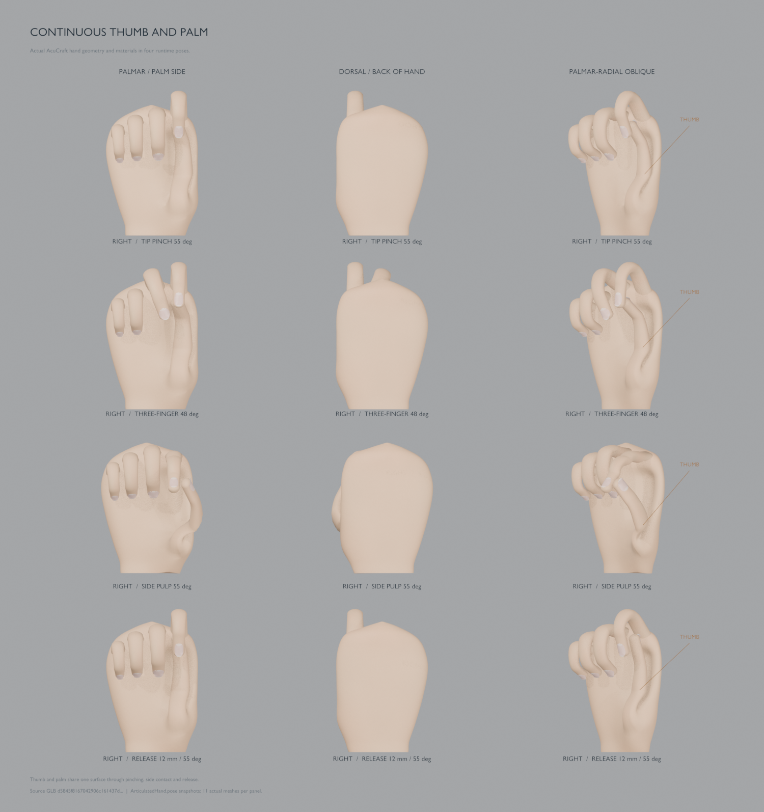
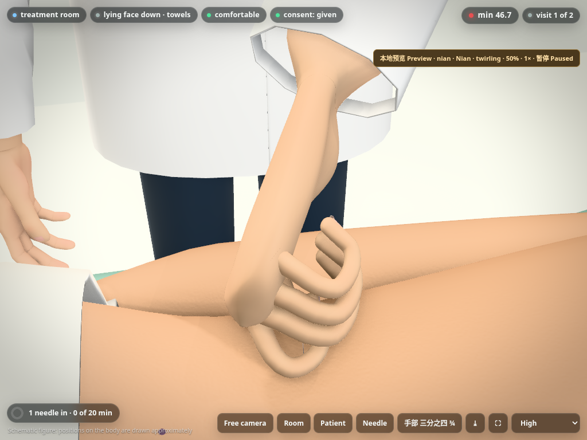
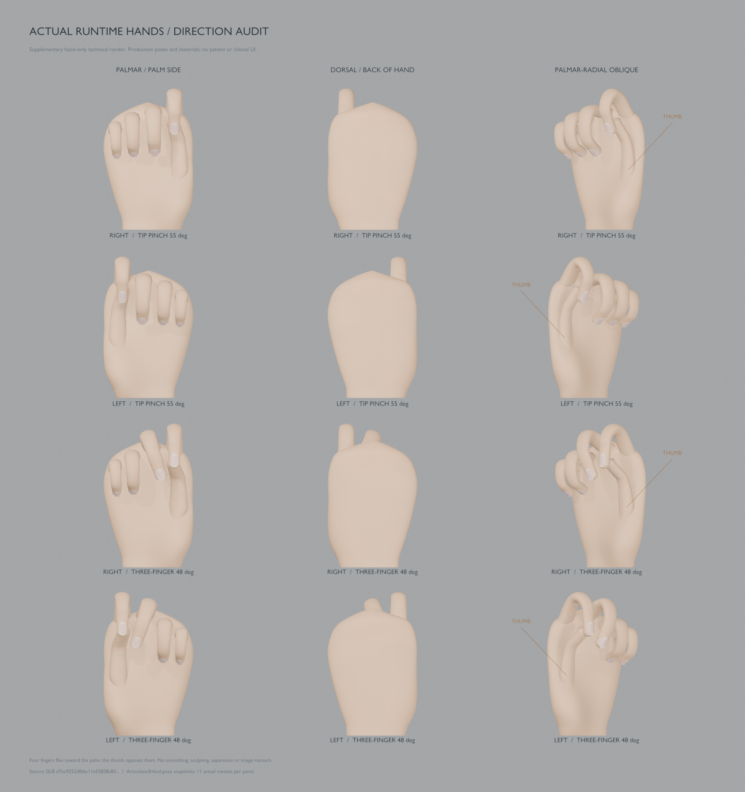
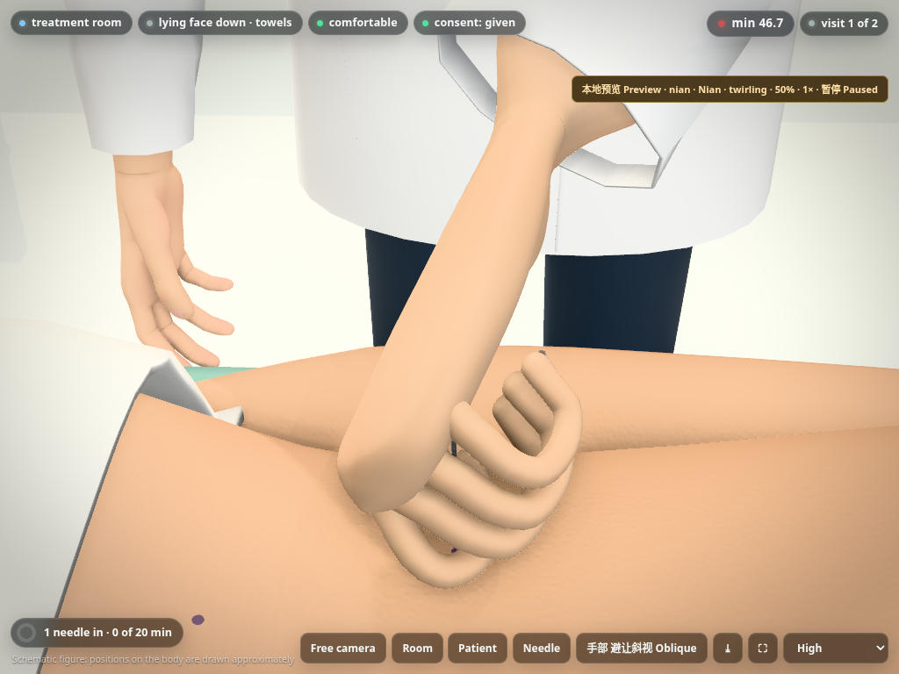
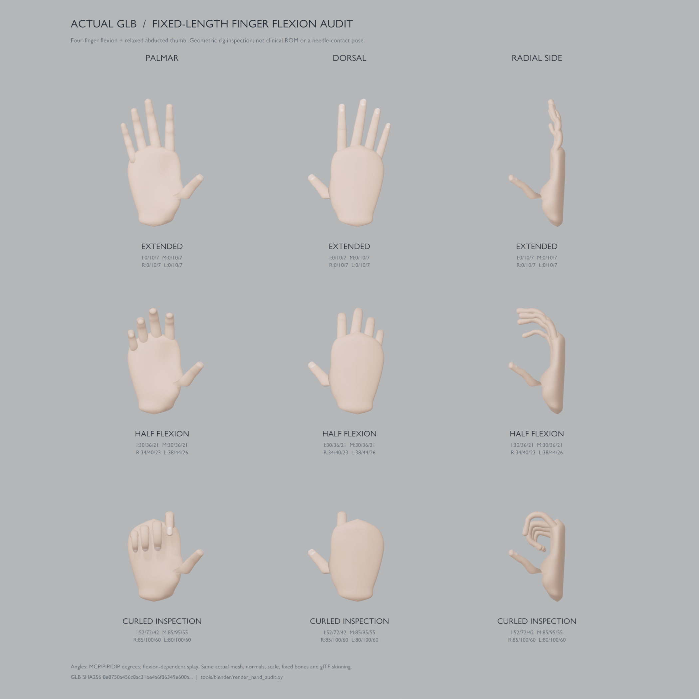

# Practitioner hand asset

`content/world/assets/models/acu-practitioner-hand.glb` is original procedural
geometry generated by `tools/blender/build_hand.py`. Its meshes, authored textures
and animation are CC0-1.0. It contains no downloaded meshes, external textures,
patient data or copies of the supplied reference photographs. This is an authored
visual simulation, without anatomical, motion-capture or clinical validation.

[Reference interpretation, shared controls and inspection views](REFERENCE-POSES.md)
describes how the supplied images inform the implementation.

## Thumb and palm skin

The palm and thumb meet at a low, broad thenar mound and a shallow
first web. The generated `palm_surface` and `thumb_skin` meshes are two charts
of one closed surface. Their shared vertices carry the same positions, normals,
texture coordinates and named bone weights. The thumb collar narrows into the
metacarpal and blends into the thenar mound. The UV field extends the palm chart
across the join so that the normal map follows the same direction on both sides.

During posing, local thumb joint rotations drive position and normal corrections
around the first web and thenar skin. The live pose controller computes the same
weights that the exporter samples for the five glTF clips. The shape targets
keep distal thumb skin and wrist interface vertices fixed relative to their bones.

The production export contains 17,788 triangles, eleven meshes, six embedded
images and five clips. The validation record ties the mesh and the sampled motions
to the renderer and build inputs. [Thumb and palm validation](THUMB-PALM-VALIDATION.json)



Both views use the same cameras, lighting and runtime pose settings. Side pulp
still produces a tight crease at the base of the thumb. [Previous mesh at the same angles](img/thumb-web-junction-before.png)

## Earlier direction and thumb opposition checkpoint

The `d7ec9252…` export contains 16,990 triangles, 1,321,988 bytes, eleven
meshes, six embedded images and five clips. It matches `hand.ts d8f681d6…` and
`hand-physiology.ts 221ca74a…`. The [direction validation record](HAND-DIRECTION-VALIDATION.json)
identifies its exact sources, finite checks and actual captures. The recorded
[tip three-quarter](img/hand-direction-tip-three-quarter.png),
[tip side](img/hand-direction-tip-side.png),
[three-finger](img/hand-direction-tripod.png) and supplementary
[hand-only anatomy](img/hand-direction-anatomy.png) images belong to this export; the older galleries below retain their original identities.





The source is a right hand, recorded as `sourceHandedness: "right"` in the
anatomy, asset root and `palm_frame`. Its actual wrist/MCP/dorsal triad measures
`+0.984174`, opposite the independently pinned left-hand reference `−1`.
Mirroring supplies the left hand. The four fingers already curled toward the
palm and the nails already faced away from the volar pulp on both hands.

Two separate defects affected the earlier view and thumb silhouette. The side
camera used source-model Z instead of anatomical `palm_frame` Z, making its
radial hint 90° wrong. The thumb solve could raise the metacarpal toward the
dorsal palm while satisfying the pad contact, leaving much of the proximal
thumb buried. The correction uses the actual palm axes for inspection and a
volar/radial thumb route with a real acquired pulp point. In the measured
three-finger working pose, thumb MCP Y changes from `+7.57 mm` dorsal to
`−11.734 mm` palmar. These are authored fixture measurements, not clinical joint
limits.

| Working mode | Index reference MCP/PIP/DIP | Thumb acquisition, tipward / lateral | Holding planes along needle +Y |
| --- | --- | --- | --- |
| Ordinary tip | 50° / 100° / 60° | 0 / −3.2 mm | Thumb and index +5 mm |
| Three-finger | 45° / 90° / 40° | +3.5 / −3.0 mm | Thumb/index −5 mm; middle +12 mm |
| Side pulp | 90° / 35° / 10° | Existing +2 mm tipward surface acquisition | Thumb and index 0 mm |

These are solver references; actual joint angles vary with contact, rolling and
opening. The ordinary tip reference is shared across its 35–70° elevation range.
Tipward follows the source distal phalanx. The lateral direction is
`source volar normal × tipward`, before ray projection onto real terminal skin.
For ordinary tip and three-finger modes, the acquired thumb normal must retain
a dot product of at least 0.5 with the source volar normal. Their authored thumb
envelope keeps MCP at least 5 mm into the palmar half and prevents a large ulnar
retreat from CMC. Ordinary tip opening follows a smooth palmar route; side-pulp
acquisition retains its separate constraints. Holding-plane changes preserve
the accepted needle axis, body entry and clinical displacement.

The supplementary hand-only image uses the actual runtime-posed mesh and PBR
materials, with the patient and practitioner outside this technical inspection
scene. Full scene captures retain their original occlusions. In the measured
production default poses, 70/204 proximal thumb-skin samples still lie within
the palm in ordinary tip and 20/204 in three-finger holding; these separate
procedural surfaces do not form a validated anatomical tissue union.

Every mesh attribute/index payload, embedded PBR image/material, raw bone and
contact transform, and inverse-bind payload remains identical to the historical
`0777d310…` source. The update changes runtime opposition, camera framing,
source-side metadata and matching sampled choreography. The original 25/50 µm
geometry, 5 µm material-attachment and 4° motion tolerances remain unchanged. Finite geometric
checks and selected scene views do not establish tissue mechanics, a universally
comfortable posture or clinical validity.

Rebuild with Blender 4.3 or newer:

```bash
blender -b -P tools/blender/build_hand.py
```

After changing runtime choreography, first sample it from the actual source
GLB, then rebuild the asset with those matching poses:

```bash
npx tsx tools/blender/export_hand_poses.ts --input content/world/assets/models/acu-practitioner-hand.glb
blender -b -P tools/blender/build_hand.py
```

The input supplies real geometry and attachment frames; existing animation is
ignored. Its recorded SHA identifies the calibration input, not the subsequently
rebuilt output, so the provenance does not require a circular output hash. A
checkout can use its shipped source GLB for the next sampling run. The validation
snapshot retains this iteration's original calibration-input identity.

When anatomical geometry changes, export an isolated geometry-only calibration
before sampling the controller. This mode consumes no older choreography and
cannot overwrite either production artifact:

```bash
blender -b -P tools/blender/build_hand.py -- --calibration-only \
  --output /tmp/acu-hand-calibration.glb --manifest /tmp/acu-hand-calibration.json
npx tsx tools/blender/export_hand_poses.ts --input /tmp/acu-hand-calibration.glb
blender -b -P tools/blender/build_hand.py
```

The anatomy records the hash of the authored correction data. The exporter
checks the calibration's builder, anatomy and correction hashes. Normal builds
check those hashes and the exporter and recursively imported controller sources
before creating the matching five clips.

## Wrist and sleeve transition

This section preserves the historical `0777d310…` wrist/sleeve checkpoint.
The current asset uses the same wrist interface to join the new palm skin to
the practitioner arm.



The detail hand declares its actual 48-point lateral palm boundary and a second
distal row for its surface tangent. The proximal palm is cropped at canonical
`u=104 mm`; its internal closure preserves a solid collision volume. The carpal
joint and distal contact geometry retain their positions.

At runtime, a short skin loft joins this posed, skinned boundary to the source
figure's actual forearm ring. Endpoint positions, smooth normals, UVs and finish
are sampled from those two surfaces. The transition blends avatar skin colour,
roughness, warm glow and specular response into the detail hand's embedded PBR
textures. A duplicated UV seam avoids stretched texture interpolation. Shallow
skin microstructure and restrained nail-bed, lunula and free-edge details remain
procedural rather than scanned tissue.

The coat's flat end disk becomes an annular rolled hem with an inner cloth wall.
Its outer edge stays at the original sleeve boundary; thickness extends inward.
The transition removes entire explicitly tagged stock-hand, exposed-forearm and
sleeve-cap triangles. It does not collapse stock fingers or forearm vertices.
Each arm switches independently at the detail hand's actual visibility threshold;
cancel, release and walking restore the original source topology. Older hand
assets without the interface retain their source forearm and sleeve.

One index buffer serves all ownership states, with a draw range for the active
triangles. Inspection cameras respect that same draw range. Source clothing
parts receive one limb owner from their immutable triangle connectivity, then
retain their own per-vertex joint blending. This prevents outer-thigh trouser
vertices near a resting hand from following the arm and stretching into sheets
when both hands reach. No clothing faces are hidden to fix this binding error.
The loft owns its geometry and cloned skin material; avatar materials
and hand textures remain borrowed. Scene disposal releases these resources.

Historical public bimanual views show the
[trouser-binding defect before correction](img/wrist-join-before-trouser-binding.png)
and the [corrected scene](img/wrist-join-bimanual.png). The same public camera
preset remains free to adjust around visible geometry; these are not a fixed-eye
pixel comparison. Other views from that checkpoint include
[left side](img/wrist-join-tip-side.png),
[right side](img/wrist-join-tip-right.png), [middle support](img/wrist-join-tripod.png)
and [index-nail work](img/wrist-join-gua.png). The
[approach](img/wrist-join-approach.png), [held](img/wrist-join-held.png) and
[release](img/wrist-join-release.png) frames use one unchanged public camera.

[The historical wrist validation](WRIST-JOIN-VALIDATION.json) records that checkpoint's
source, asset and actual public-scene captures. The earlier anatomy validation and
`hand-anatomy-*` gallery retain their original asset identities. The 85° authored
forearm-roll bound remains in place. A connected visual surface does not prove
anatomical wrist tracking, pressure, cloth simulation or AAA production quality.
A fine circumferential shading trace remains visible in the optional three-finger
close-up, and some chronological left-wrist poses retain small creases. The
captures preserve these remaining limits.

`tools/blender/hand_anatomy.json` is the explicit source for the carpal/palm basis,
joint positions, fixed segment lengths, hinges and distal skin/nail directions.
`tools/blender/hand.json` records the actual binary hash, byte and triangle counts,
coordinate frames, skin influences, surface attachments and evaluated clip
contacts. `tools/blender/hand_poses.json` stores the quaternion keyframes and
whole-hand transforms sampled from the matching runtime. Source, sampled poses,
manifest and GLB must be updated together. A new source fixture with older clips
is a geometry diagnostic, not a matching runtime animation export. The encounter
renderer loads the separate hand asset directly.

## Shape, frames and skinning

The GLB uses metres. The outer `acu_practitioner_hand` frame follows the needle:
+Y points outward along its shaft. The manifest records the actual source wrist,
carpal landmarks and palm basis. Wrist elevation is the angle to the needle's
transverse plane, `atan2(y, hypot(x, z))`; the source wrist need not lie in XY.
The source index bends toward the shorter thumb, forming a compact C. The active
crest source has index MCP/PIP/DIP flexion of 45°/100°/60°: these describe its
authored bind posture, not the operator's current solved working angles, a
relaxed hand or a general comfort limit. Runtime contact solving uses separate
working references. The other three fingers have adult relative lengths and
graduated bends.

`palm_frame` and `wrist_frame` describe the actual palm, separately from the
needle frame: -X points toward the fingers, -Y is volar and +Z is radial. This
unmirrored source basis has canonical +X wristward, +Y dorsal and +Z radial,
with determinant +1. It is distinct from the wrist-elevation bearing. The actor
uses the actual wrist azimuth to approach the shoulder. Mirroring includes the
presentation rotation and translation as well as the skin, so a three-dimensional
source frame remains a true opposite hand. Frame extraction uses transformed
axes to preserve the actual dorsal side.

The palm chart includes the thenar region, palm arch, MCP roots and wrist taper.
The thumb CMC lies near the carpus, and the skin over its metacarpal continues
into the palm arch. Cross-section frames transport a stable lateral axis
through the bend. Neighboring controls blend their weights around the joints.
The terminal contact-bearing surfaces follow the distal controls rigidly.

The palm has a proximal radial thenar cushion, an ulnar hypothenar cushion, a
shallow central hollow and a first-web recess. The carpal origin, index flexion
and pulp/nail directions are fitted together in one complete three-dimensional
basis. Each motion keeps the rebuilt source's segment lengths fixed; it does
not scale a finger or translate its joints to satisfy contact. The precision
fingers' terminal skin follows the actual three-dimensional distal bone, avoiding an extra sharp
turn toward a global axis. Distal depth blends through the index DIP, and rounded
tips close with small caps instead of broad flat end disks.

The skin has sixteen influences: fifteen legacy digit controls and static
`palm_root`. Anatomical parents carry the corresponding joint translations:

| Digit | Anatomical parents | Legacy skin controls |
| --- | --- | --- |
| Thumb | `thumb_CMC`, `thumb_MCP`, `thumb_IP` | `thumb_proximal`, `thumb_middle`, `thumb_distal` |
| Index/middle/ring/little | `<digit>_MCP`, `<digit>_PIP`, `<digit>_DIP` | `<digit>_proximal`, `<digit>_middle`, `<digit>_distal` |

The legacy children have zero translation and carry clip rotations. Anatomical
parents can add independent adjustments without moving the pivots. The thumb
names do not imply three interphalangeal joints. These control landmarks and
motion bounds are authored, not calibrated anatomical limits.

Blender generates geometry and clips; a deterministic export step adds standard
glTF skin attributes and inverse bind matrices. `apply_preview_skin()` evaluates
these same weights in Blender for review. Independent hands **must use
`SkeletonUtils.clone`**; ordinary scene cloning shares bones.

Two recolorable PBR materials, `hand_skin` and `hand_nails`, use embedded original
albedo, normal, packed roughness and nail-bed maps. Nail plates follow the dorsal
side through the finger bend; their free edge continues the nail-bed tangent.
The Node test image adapter decodes the actual embedded PNG pixels, so tests
exercise the shipped textured GLB rather than substituting empty textures.

## Physiological interpretation

Joint activity is measured from the actual posed bone directions in the palm
frame. An animation control's quaternion relative to an already bent bind pose
is not an anatomical flexion angle. The middle, ring and little fingers use the
shared `RESTING_POSTURES` table in
[`hand-physiology.ts`](../packages/server/web/stage/hand-physiology.ts) for the
operator's `curled` and `relaxed` choices. These unused-finger settings are
separate from the active crest source's index 100°/60° PIP/DIP bends.
The `curled` setting is an authored closed-fist posture with PIP bends of
95–100°; it is not a neutral or universally comfortable resting position.
The `relaxed` setting has its own milder angles.

MCP abduction is applied in the extended palm plane, followed by flexion about
that digit's radial hinge. The shared extension fan progresses toward the ulnar
digits and narrows by `0.2 + 0.8*cos(MCP flexion)^2`; the diagnostic reads the
same exported table and verifies it against the runtime output. Complete frame
alignment keeps the proximal ray and PIP/DIP flexion plane together. Contacting
fingers retain independent PIP/DIP solutions for their real surface targets.

The pose choices follow these anatomical principles, rather than treating a
maximum range of motion as a precision-grasp target:

- [Normal active joint motion, 390 hands (2024)](https://pmc.ncbi.nlm.nih.gov/articles/PMC11436331/)
  shows substantial individual variation in maximum motion.
- [Functional range of motion (Hume et al.)](https://pubmed.ncbi.nlm.nih.gov/2324451/)
  distinguishes functional use from maximum joint excursion; it does not define
  acupuncture-specific angles.
- [PIP–DIP linkage in manipulation (2022)](https://pmc.ncbi.nlm.nih.gov/articles/PMC9541616/)
  supports task-dependent coordination, rather than a fixed ratio for every hold.
- [MCP collateral ligament mechanics (2024)](https://pubmed.ncbi.nlm.nih.gov/38428155/)
  describes increased ligament tension in flexion. The software's narrowing
  spread curve is an engineering choice, not a measured clinical envelope.
- [The Puzzle of the Thumb](https://pmc.ncbi.nlm.nih.gov/articles/PMC4397810/)
  describes compound CMC opposition; MCP/IP twisting cannot substitute for it.
- [Thumb metacarpal anatomy](https://pubmed.ncbi.nlm.nih.gov/26228383/) and
  [CMC functional anatomy](https://pubmed.ncbi.nlm.nih.gov/3595013/) inform the
  distinction between segment scale and a basal joint's placement near the
  carpus. Plausible lengths alone cannot validate an incorrectly placed CMC.
- [University of Oklahoma hand biomechanics](https://www.ouhsc.edu/bserdac/dthompso/web/namics/hand.htm)
  describes palm arches and the distinct roles of radial and ulnar metacarpals.

The historical flexion sheet evaluates its recorded GLB's skin weights with
fixed-length MCP/PIP/DIP hinges, without interpolating animation-clip quaternions. It compares
three explicit inspection poses—extended, half flexion and curled inspection—from
palmar, dorsal and radial-side views. The third row is labelled **Curled
inspection** and reads the shared closed-fist M/R/L table. Its independent index
example remains 52°/72°/42°, rather than representing the operator's actual
working index. The thumb has a separate, mildly flexed
abducted inspection pose. Actual angles, bone-length errors, helper hash and
asset hash are recorded with the result.

The three recorded diagnostics report zero digit-skin triangle boundary
intersections, including the previously intersecting first web. This is a finite
deformation check. It does not exercise every thumb direction, needle-grip
variant, movement phase, patient contact or complete enclosure case. Actual
needle-volume clearance and runtime motion require their separate checks.
The report also compares thumb-root material-ring perimeters, centre spacing
and geometric normals between adjacent bands before and after deformation,
excluding closed caps. These local shape measurements and the actual images
expose a stretched or pointed skin bridge even when separate surfaces do not
intersect; zero intersections alone cannot establish a natural silhouette.
Neither photographs nor passing mesh checks establish patient-specific
physiology, tissue mechanics, clinical technique or AAA production quality.



Reproduce the actual-GLB inspection with:

```bash
blender -b -t 4 -P tools/blender/render_hand_audit.py -- --report /tmp/hand-audit.json
```

Add `--no-render` to measure bone lengths, actual joint angles and digit-skin
boundary intersections without rendering. The script exports the current
runtime physiology table through the repository's `tsx`; `--physiology-table`
accepts a saved export with a matching helper hash. Use `--asset` and
`--expected-asset-sha256` to inspect a particular immutable source fixture.
[The historical anatomy validation snapshot](HAND-ANATOMY-VALIDATION.json) records
the inspected asset, measured sections, finite runtime checks and image scope.
`hand-morphology.test.ts` measures real triangle sections and terminal surface
axes. `hand-physiology.test.ts` measures posed bones in the palm frame for both
hands, rather than accepting control values as proof of the resulting pose.

## Real surface attachments

Moving contacts live under their actual phalanx, with local +Y along the outward
surface normal. Pad, side-pulp and nail-edge attachments are fitted to real skin
or nail triangles. Fixed root-level `thumb_contact` and `index_contact` are legacy
bind references, not live articulated contacts.

Ordinary thumb/index skin attachments and runtime fitting sample the same
exported smooth vertex-normal field barycentrically on the actual triangles.
Index-nail work instead uses the declared normal cone of the adjacent keratin
facets at the actual leading free edge. Each contact point stays on its real
surface. These orientation fits are checked separately from the clearance of
neighboring pulp, nails and the whole needle volume.

| Attachment | Role |
| --- | --- |
| `thumb_pad_contact`, `index_pad_contact` | Opposed primary needle hold |
| `index_side_contact` | More proximal index-pulp hold, with the index tip extending below it |
| `middle_pad_contact` and the exported middle-pulp field | Volar-pulp reference and material contacts for optional third-finger support |
| `index_nail_edge_contact` | Actual index-keratin free edge used for Gua/Tan |
| `index_volar_contact` | Palmar skin contact for the supporting hand |
| `palm_contact` | Actual static ulnar heel facet used for pressing |
| `support_contact` | Additional static palmar attachment |

The active index nail contact is near the true forward free edge. A side rim halfway
along a nail cannot stand in for it. Likewise, the supporting index uses a true
volar triangle; reusing the needle-bearing side pad turns the palm into the
patient. Manifest surface/feature fields record these distinctions.

## Contact and motion control

Thumb/index is the default primary hold for insertion and ordinary retained-needle
techniques. A bounded fixed-length solve places their individual real surfaces
on opposite sides of the rendered handle, with normals pointing inward. Matching
their midpoint alone is insufficient. The solve changes joint rotations without
scaling fingers, translating joints or changing phalanx lengths. Optional
three-finger support adds a separate middle-pulp contact.

The operator and LLM share `wristElevationDeg`, `gripStyle`, `idleFingerPose`, grip,
opening and support controls. Wrist elevation changes the actual palm around its
contact line while preserving the recorded needle angle. Ordinary holds expose
35–70° (default 55°); optional middle support uses a low-twist tip-only variant
at 44–51° (default 48°). These combinations appear in `handProfiles`. The authored
Gua/Tan nail variant exposes 50–60° through its `parameterBounds`. The engine
rejects unsupported executed angles or grip combinations explicitly.
`gripApertureMm` affects approach/release; an engaged ordinary hold fits the
actual tapered handle. In Gua it requests the index nail's gap from the handle
when letting go, with a minimum 1.5 mm air gap even for a zero request. The
thumb's separate release clears the needle tail by 1.5 mm. The held thumb-tail
and index-nail contacts are already 14.5–20.5 mm apart along the needle axis;
the opening value is neither that axial separation nor a command to spread
every finger by the requested amount. Both Gua working contacts still meet
their actual surfaces while engaged. An insertion
approaches with the needle already held, follows a hover arc above the skin,
then begins the recorded insertion trajectory.

Twirling migrates the material contact over actual terminal skin triangles and
solves the corresponding finger hinges. This produces visible local opposition
instead of a rotation that the contact solve later overwrites. Explicit
unidirectional rotations use staggered rolling/release/reset phases so at least
one primary pad remains engaged. Axial techniques share a small bounded part of
the already approved movement with the fingers; the remaining travel follows the
wrist. Neither presentation mechanism changes clinical needle displacement.

Gua uses thumb support at the needle tail while the index nail edge scrapes the
handle. Tan has an index cocking, contact and release sequence, with separately
timed thumb preparation/support. These authored roles use the index keratin edge,
separately from the ordinary index-pulp hold. Contact-space trajectories must be
checked against whole finger skin, keratin and the needle volume: a correct
attachment point does not prove that adjacent pulp clears the needle. Unused
fingers use the shared curled or relaxed poses.
Separate supporting hands have their own skeleton and palpation, stretch and
heel-press postures.

The asset also supplies five independently sampled clips: `hand_open`,
`hand_support`, `hand_three_finger`, `hand_scrape` and `hand_flick`. The internal
`hand_pose_frame` carries each standalone clip's whole-hand presentation. Runtime
sampling resets this carrier before applying the live needle/palm transform, so
it is not applied twice. Legacy clip rotations are canceled consistently when
runtime contact solutions replace them. Manifest samples permit source/runtime
comparisons.
The exporter records nine poses and open/scrape/flick sequences with 31/31/34
samples. Flick includes the actual 0.08, 0.28, 0.5 and 0.58 cycle events so that
preparation, nail contact and recoil are retained between the uniform samples.

## Patient clearance, arms and inspection

The scene checks posed skin, nails and palm against the patient's actual body
triangles. A bounded whole-wrist pronation search can provide clearance without
changing contacts or the needle trajectory. Cached triangle hierarchies avoid
repeating unchanged surface checks. A pose that cannot fit is hidden with a
specific hand-space message; an unsolved grip is reported separately from an
unreachable arm. These visual guards never change an accepted clinical needle
path or recommend a depth to fit the model.
In the low-back inspection fixture, palpation and stretching are reachable;
heel pressing remains beyond the supporting arm's reach and is hidden with a
move-closer warning. Passing its geometry checks does not make that pose visible
or reachable from the same stance.

Both arm targets are registered before either hand is drawn. The actual wrist
orientation drives gradual distal-forearm pronation while bone lengths, elbow
and wrist positions remain fixed. Two-bone reach clamps unreachable targets.
Forearm roll is bounded at 85°, so a target frame can retain residual wrist
misalignment even though the sampled skin transition connects both surfaces.
Sleeves can still obscure part of the palm in an actual inspection view.
A temporary turn and bounded shared torso lean help reach the working area;
feet stay at their authorized floor positions, and walking cancels the pose.

The **手部 Grip** camera cycles three-quarter, side and palmar views using the
actual transformed palm axes. The three-quarter choice begins on the opposed
thumb's nail side, and contact/active-digit sightlines receive priority during
occlusion adjustment. A requested view can be labelled **Oblique** when adjusted;
patient geometry and sleeves can still obscure part of the hand or cuff. Local
shadows and restrained depth of field preserve contact readability. Review
continuous approach, insertion, rotation, axial motion and release as well as still images. Offline frame
exports and real-time recordings are labeled separately.

Catalogue playback supports pause and speed. Local preview additionally permits
deterministic seeking, restores the recorded needle when stopped and cannot
replace accepted actions already playing or queued. All skeleton, material,
texture and image resources are released when the scene is disposed.

Historical performance logs retain their original 13-field motion payload when
no new hand control was requested. Current viewers resolve presentation defaults
separately, including 48° for optional middle support. Explicit new hand requests
record the complete resolved presentation. A golden old-engine log verifies
strict restoration without rewriting its original digest.

Soft-tissue compression, measured pressure, friction and tissue response remain
unmodeled. Static photographs do not establish the hidden 3D joint configuration
or motion timing. The geometry and contact checks support visual review; they do
not establish clinical validity or an AAA production-quality certification.
