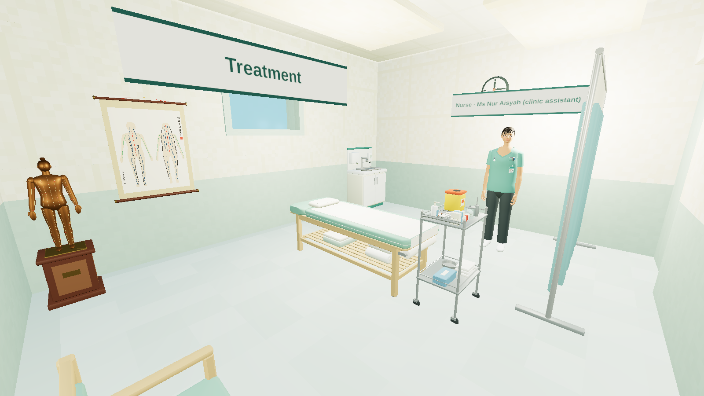
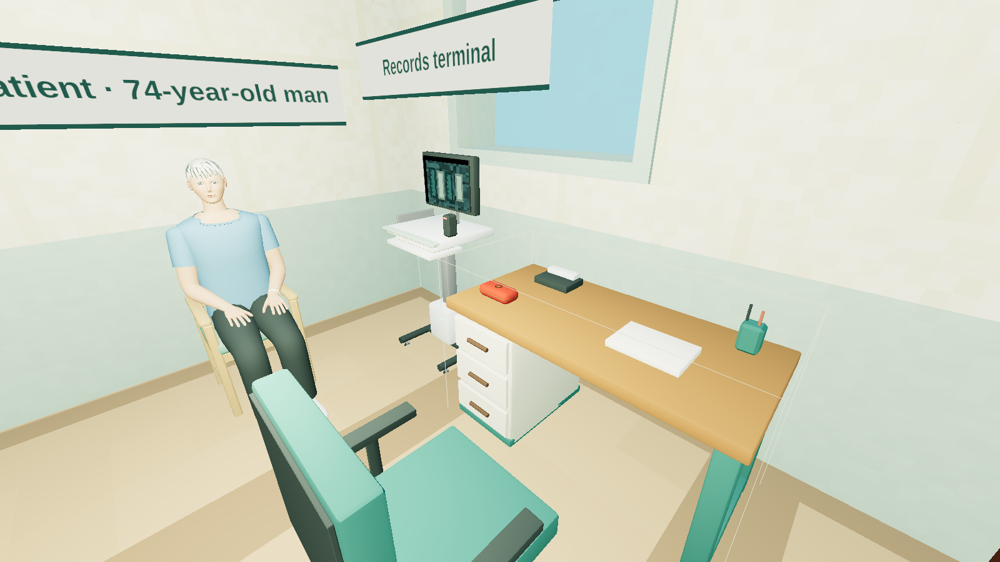
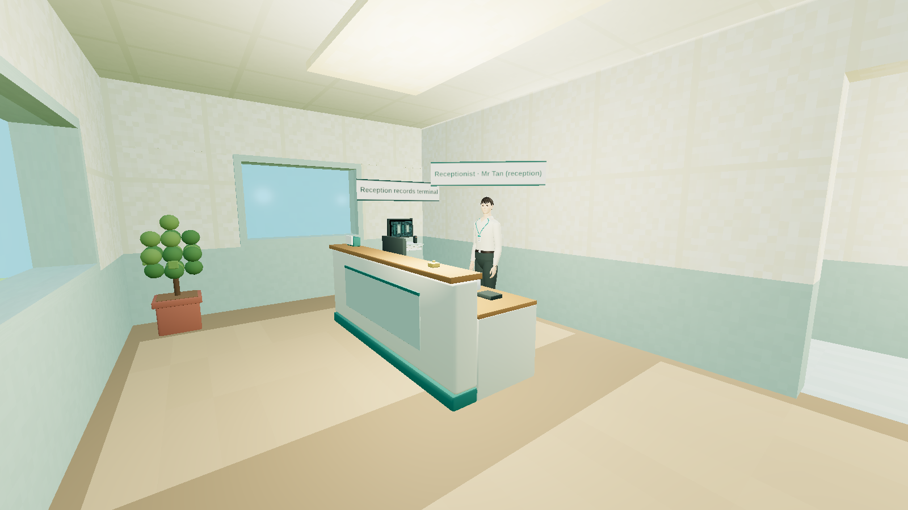
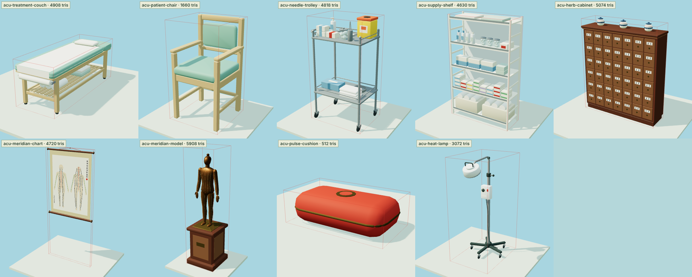
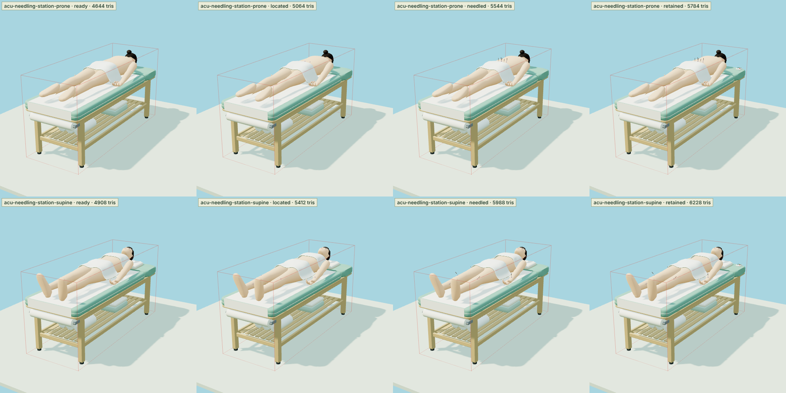
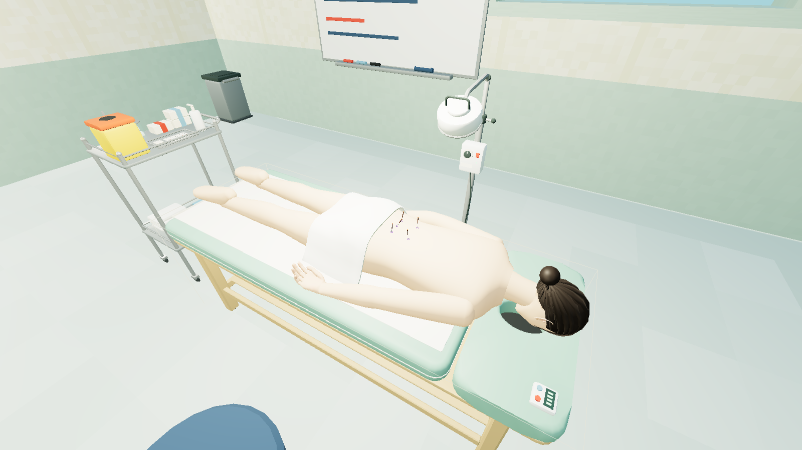
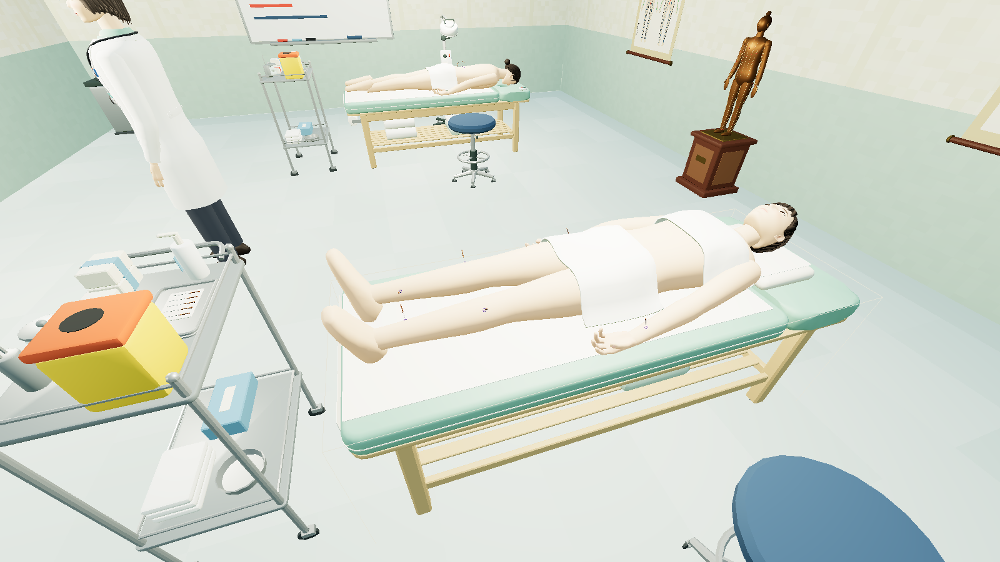
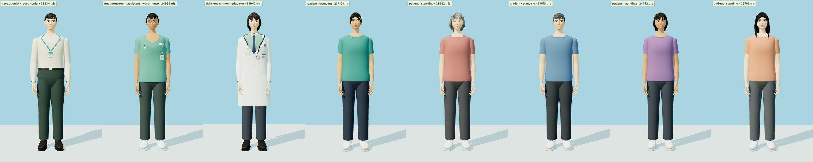
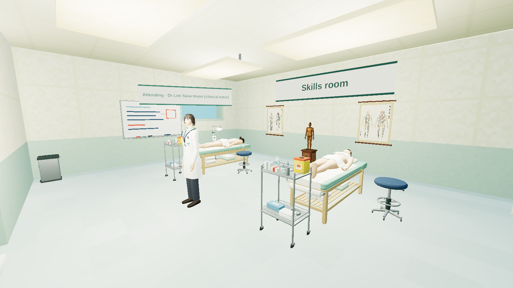
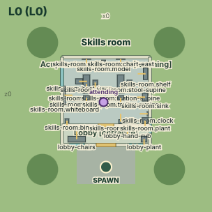

# How the clinic is drawn

> Status: the contract for `content/world/assets`, `tools/blender/`, `tools/figure-fit.mts` and the looks of the
> people. If the code and this page disagree, fix one of them in the same change. Like all content of this release,
> what is drawn here is unreviewed: a clinic for simulation, not a survey of a real one.

AcuCraft's engine is headless: it reasons about the clinic as a floor plan ([WORLD.md](WORLD.md)) and draws nothing.
What a person sees is drawn by **ClinicalCraft's own 3D world**, from the same files — the facility, the room
templates and the equipment catalog of `content/world`. This page is about making that picture good: every piece of
equipment as a model built in Blender, the people as the world's own figures, and two needling stations whose
simulator lies under towels with the marks and the needles of each step on its skin.



*The treatment room as ClinicalCraft's world draws it: its own canvas at a pose, with the player's hand hidden
(`tools/world-shots.mjs`, §6).*

## 1. What is drawn by whom

| | drawn by | from |
|---|---|---|
| walls, floors, doors, windows, lights, signs | ClinicalCraft's world | the facility and the room templates; the finishes are materials of the pack's catalog (a painted dado, cream walls, pale ceiling tiles, a timber floor where people talk, lino where needles are handled) |
| the pack's 11 equipment types | ClinicalCraft's world, from **AcuCraft's models** | `content/world/assets/models/<type>.glb`, referenced by the catalog (`model`: file, SHA-256, offset, licence, source, use status) |
| ClinicalCraft's own equipment in the clinic (desk, office chair, sink, records terminal, curtain, waiting chairs …) | ClinicalCraft's world, from its built-in models | the pinned engine |
| the people — the clinic assistant, the receptionist, the tutor, a case's patient | ClinicalCraft's figure kit: bodies of real proportions sculpted in code, the uniform of a role | a staff member's `role`, `position` and `appearance`; a case's `patient.appearance` |
| the body on a needling station | ClinicalCraft's figure kit (the type's `manikin`) | the catalog: face down or on its back, under towels, breathing |
| what stands on that body's skin — marks, needles, a timer | AcuCraft's model, in **layers** the station's state shows | `behavior.states.<id>.look.layers` |

Each type keeps its voxel parts: they are the fallback when a model does not load, what ClinicalCraft's floor-plan
tools read, and where a body lies or sits (the part named `mattress` or `seat`).



*The consultation room's desk. The seated man is the stand-in patient of ClinicalCraft's QA page, drawn by the same
figure kit as a case's patient.*



## 2. The models



| type | what it is | triangles |
|---|---|---|
| `acu-treatment-couch` | a padded couch 0.7 × 1.9 m on a beech frame: the head section with its breathing hole, a paper sheet off the roll at the foot end, a small pillow, a shelf of rolled towels | 4 908 |
| `acu-patient-chair` | an upright beech armchair with a padded seat (0.50 m) and back | 1 660 |
| `acu-needle-trolley` | a stainless trolley: the tray with an opened blister of needles, sealed packs, a jar of cotton balls, a forceps jar, hand rub, the sharps box at the point of use | 4 818 |
| `acu-supply-shelf` | open shelving: boxes of needles by gauge, gloves, swabs, bottles, jars, paper rolls | 4 630 |
| `acu-herb-cabinet` | a rosewood herb cabinet of 42 labelled drawers with brass pulls, jars on top | 5 074 |
| `acu-meridian-chart` | a hanging scroll: the body from the front and from the back, channels in colour, points as dots | 4 720 |
| `acu-meridian-model` | a bronze figure, half life-size, on a pedestal: channels inlaid, points picked out | 5 908 |
| `acu-pulse-cushion` | the pulse cushion on the physician's desk | 512 |
| `acu-heat-lamp` | a heat lamp on a wheeled stand (furniture: nothing of its heat is simulated) | 3 072 |
| `acu-needling-station-prone` | a couch with a simulator face down; BL23 and BL25 on both sides, GV3 | 4 644, and 5 784 in its busiest state |
| `acu-needling-station-supine` | a couch with a simulator on its back; PC6, ST36 and SP6 on both sides | 4 908, and 6 228 in its busiest state |

They are written as code — `tools/blender/models.py`, one builder per type, in the type's own frame (metres, x right,
y up, z front, the origin at the footprint centre on the floor) — with ClinicalCraft's shape kit
(`scripts/blender/clinicalcraft_shapes.py` in the pinned checkout: boxes, tubes, lathes, slabs, hoses; one mesh and
one material a model — a second where there is glass — colours as vertex colours) and three shapes of this pack's
own: a skin over rings (`loft`: the bronze figure's trunk and limbs), a flat piece with a hole through it
(`plate_with_hole`: the couch's head section) and the point of a limb's surface a line or a dot is drawn at. The
chart and the figure are **drawings**: where a channel runs on them is schematic and locates nothing.

Rules a builder keeps (ClinicalCraft docs/BLENDER.md has the engine's): the footprint is the collider, so a model
fills it and stays inside it; the couch's padding is 0.67 m up and a chair's seat 0.50 m, where the voxel part of
that name says a body lies or sits; a colour that is a code is one (a sharps box is yellow with an orange lid); a
model aims at 5 000 triangles, and none exceeds the 10 000 of a centrepiece.

### Building them

```bash
python3 tools/blender/build.py
```

```bash
python3 tools/content/clinic_world.py
```

The first needs a Python with Blender's `bpy` module (Blender 4.1 or newer; `pip install bpy`), or runs inside
Blender: `blender -b -P tools/blender/build.py`. It builds every type in an empty scene, exports it with
ClinicalCraft's Blender bridge, and writes each model's catalog reference to `tools/blender/models.json`; the second
puts those references into the catalog. A rebuild that changes nothing leaves the tree clean: the same scene gives
the same bytes (checked for all 11 models with Blender 5.0.1).

`.mcp.json` registers [blender-mcp](https://github.com/hsaigroup/blender-mcp) 1.8.7 with telemetry off, as
ClinicalCraft's does, so that an agent can drive a running Blender — load a type with the bridge, model over its
blockout, look at the viewport. The models in this repository were built headless with the `bpy` module, with the
same bridge and kit; no model here was made through a Blender window. Never put case text or patient data into a
Blender prompt: model geometry needs none of it.

## 3. A model round a body



A needling station is a treatment couch with a full-body patient simulator on it. The body is **not** part of the
model: the world draws it (the type's `manikin`) with the same figure kit as the people — face down under one towel,
or on its back under two, breathing. It is nobody: not a patient of a case, nothing to examine or talk to.

The model is everything else, and it has to fit that body. `tools/figure-fit.mts` asks the pinned ClinicalCraft's own
code: it builds the manikin as the world does and casts a ray at each site onto the meshes that are drawn. What it
finds — where the skin is, the way out of it, the way up the body — goes to `tools/blender/fit/<type>.json`, which
the builder reads.

```bash
npx tsx tools/figure-fit.mts
```

| station | sites | placed on the simulator by |
|---|---|---|
| lower back (prone) | BL23 left and right, BL25 left and right, GV3 — the lumbar points the low-back-pain family's reference course uses, each on both sides | the fourth lumbar spinous process 12.5 cm above the hip joint; two vertebrae 7.2 cm; 1.5 cun from the midline 3.75 cm |
| limbs (supine) | PC6, ST36 and SP6, left and right — limb points the nausea and insomnia families' reference courses use | shares of a bone's length: 2 of 12 cun above the wrist crease, 3 of 16 cun below the knee, 3 of 13 cun above the inner ankle |

**These placements are a drawing aid.** They put a needle of the model where a point this pack's courses use would
be on a body of the figure kit's proportions; they are not the localisation the engine scores
([ANATOMY.md](ANATOMY.md)), they are unreviewed, and they are no guide to locating a point on a person.

What the fit refuses: a site that is not on bare skin (under a towel, on hair), a site on an edge of the body's
meshes, a look that moves the body (the model is built round one body in one position). `--check` writes nothing and
fails when the file on disk is not what the engine says now — a figure that changes shape upstream must not leave a
model fitted to the old one.

### What each step shows

A station has a drill of six steps, each an operation of its behaviour, each with a look:

| state | reached by | layers shown |
|---|---|---|
| `ready` | `reset` | — |
| `located` | `locate_points` | `marks`: a ring of skin marker round each site |
| `prepared` | `prepare` (hands, pack, skin) | `marks` |
| `needled` | `insert_needles` | `marks`, `needles`: a needle in each site, square to the skin (GV3 tilted 20° towards the head), as deep as the families' reference courses needle that point |
| `retained` | `check_response` | `marks`, `needles`, `timer` |
| `removed` | `remove_needles` (from `needled` or `retained`) | `marks` |

The look follows the state and decides nothing: whoever moves the station on — a learner at it, a colleague, an
agent through ClinicalCraft's `interact_object` — does it by the same operation. A station cannot be reset with
needles in, and only a practitioner's role may needle: the clinic's assistants do not (`content/sg/roles.json`).
The drill rehearses a sequence and its safety points — one needle to a site, every needle counted out — not the feel
of tissue; nothing of AcuCraft's evaluator is attached to it.

A needle is 40 mm of shaft below a 24 mm handle; what stands above the skin is the shaft less the depth, then the
handle. Its lengths are true and it is drawn two to four times as thick as life: a shaft of 0.25 mm is under a pixel
at arm's length. A mark lies 1.3 mm above the skin and a needle's shaft starts 4 mm under it, because the skin moves:
a body on a treatment couch breathes a millimetre deep (ClinicalCraft's `breathOf`), and what a model puts on its skin
does not move with it.





## 4. The people



*Left to right: the receptionist, the clinic assistant, the tutor of the skills room; then the patient of each
family as the consultation starts — low back pain, knee pain, insomnia, nausea, tension headache.*

| who | `role`, `position` | what the world draws |
|---|---|---|
| Ms Nur Aisyah, clinic assistant | `nurse`, `ward-nurse` | a tunic and trousers in the clinic's jade, a badge, a fob watch |
| Mr Tan, reception | `receptionist`, `receptionist` | a shirt, a badge on a lanyard |
| Dr Lim Siew Hoon, clinical tutor (skills room) | `attending`, `educator` | a white coat over a shirt and tie, a stethoscope |
| a case's patient | — | their own clothes, an identity band; hair, skin and build from `patient.appearance` |

A `role` is ClinicalCraft's: it picks the uniform and how the world's own front-ends voice that member of staff.
It says nothing about what a person may do in an AcuCraft encounter — that is `content/sg/roles.json`. ClinicalCraft
has no role for a TCM physician, and the practitioner under test has no figure: the learner is the camera.

Each family's case gives its patient an appearance (skin, hair and its style, clothes, how they present). The
engine reads one field of it, `build`, for the depth of tissue; the rest is drawn only, and nothing of it is a
finding — what the practitioner observes is what the case records.

## 5. The skills room

`content/world/facilities/sg-tcm-skills-room.json` is a second facility: a lobby and one room with the two needling
stations, each with a needle trolley and a stool, the heat lamp, the bronze figure and the charts, a supply shelf, a
sink, a whiteboard and a tutor. It is beside the clinic's floor plan, not in it: **no encounter is played there**, the
engine does not load it as a clinic, and nobody in it is a patient.





It is a facility of its own because the clinic's solid furniture is the floor plan every reference walk was planned
on: nothing solid may be added to the clinic's three rooms without planning those walks again. What this change
added there is drawn only (the pulse cushion on the desk, `solid: false`).

## 6. The pictures on these pages

| picture | made by |
|---|---|
| `clinic-3d-*.png`, `skills-3d-*.png` | `node tools/world-shots.mjs` — ClinicalCraft's 3D world (its QA page, run from source) at a pose; the pack's files are copied into the checkout for the run and removed again; the player's own hand, which holds a stethoscope in ClinicalCraft, is hidden |
| `models.png`, `station-states.png`, `clinic-plan-clinicalcraft.png`, `skills-plan-clinicalcraft.png`, `people.png` | `python3 tools/preview-sheets.py` — ClinicalCraft's previewer (`scripts/preview/render.mjs`); the people sheet sets the previewer's own sheets side by side |

Both need a ClinicalCraft checkout at the pinned revision with its dependencies installed (`--cc`, or
`CLINICALCRAFT_DIR`). In the consultation room's pictures the seated patient is ClinicalCraft's own stand-in for its
QA page, not a patient of this pack.

## 7. Checks

| check | where |
|---|---|
| every type has a model, on disk, at the path the catalog names; nothing else lies beside them | `packages/bench/src/models.test.ts` |
| each model against its catalog reference, with the engine's own `parseGlb` and `checkModelReference` — licence, use status, the pinned SHA-256, its size against the footprint, its layers against the looks — and a ceiling of 10 000 triangles | `models.test.ts` |
| the catalog's references are the builder's (`tools/blender/models.json`) | `models.test.ts` |
| a station: a body lying flat under towels on the padding, six states, the layers of each, no look that moves the body, no reset with needles in, needling for a practitioner's role only; its fit names points of this pack, on the body, above the couch | `models.test.ts` |
| the clinic's solid furniture is the floor plan the reference walks were planned on; what was added is not solid | `models.test.ts` |
| the staff of both facilities have a position and an appearance; every patient has an appearance | `models.test.ts` |
| the world content is what `tools/content/clinic_world.py` writes | `tools/check.sh` |
| the stations' fits are what the pinned figure kit says, every site on bare skin | `tools/check.sh` (`tools/figure-fit.mts --check`) |

`tools/check.sh` (what CI runs) needs no Blender and no ClinicalCraft dependencies: the models are committed files,
and the figure kit runs from the pinned checkout's source with AcuCraft's own copy of three.js (a development
dependency for this alone).

## 8. Status

| | implemented | checked by | not |
|---|---|---|---|
| a model for each of the pack's 11 equipment types | yes | `models.test.ts` (the engine's inspection); ClinicalCraft's `assets inspect --type` on each file (2026-11-13: no warning, no error); the previewer's sheet | no review of how a real clinic's equipment looks; three models are a little over the 5 000 triangles a model aims at (the herb cabinet, the bronze figure, the stations with their layers) |
| the needling stations: a body under towels, marks, needles and a timer by state | yes | `models.test.ts`; `figure-fit.mts --check`; the previewer's storyboard; in ClinicalCraft's 3D world (2026-11-13: the lower-back station drawn in `retained`, the limbs station in `located` and `needled`, every model loaded, no page error) | the drill was not played through ClinicalCraft's embodied session (its operations are validated by ClinicalCraft's catalog checks, not exercised by a test here); the sites are schematic and unreviewed; one body in one position per station |
| the people: positions, appearances, patients' looks | yes | `models.test.ts`; the previewer's people sheet; in the 3D world for the staff | no figure for the practitioner; a patient's looks are an author's choice, not case data; no review for how people of the clinic's community are represented |
| the clinic in ClinicalCraft's 3D world | yes — its rooms, models, staff, and a world patient lying on the couch (on the padding, the head on the pillow) or sitting on the chair | `tools/world-shots.mjs` (a run fails when a model does not load) | an AcuCraft encounter is not played in the 3D world: the renderer shows the building the engine reasons about ([WORLD.md](WORLD.md) §8) |
| reproducible builds | yes — a rebuild changes no byte | rebuilt twice with Blender 5.0.1 (`bpy` module) | other Blender versions untried; CI does not run Blender |

## 9. Limits

- The models are procedural and plain: no textures, no worn edges, one material a model (and one for glass).
- The chart and the bronze figure draw channels where they roughly run. They are furniture.
- A station's simulator is one of the figure kit's bodies: an adult of average build. The kit lays a body flat with
  the face straight down and the legs straight; there is no knee bolster and no side-lying position on a couch.
- The patient of an encounter is drawn by ClinicalCraft sitting, standing, or lying in bed under a blanket — not
  prone, and not under towels: those are a manikin's.
- The heat lamp is furniture: no encounter uses it and nothing of its heat is simulated.
