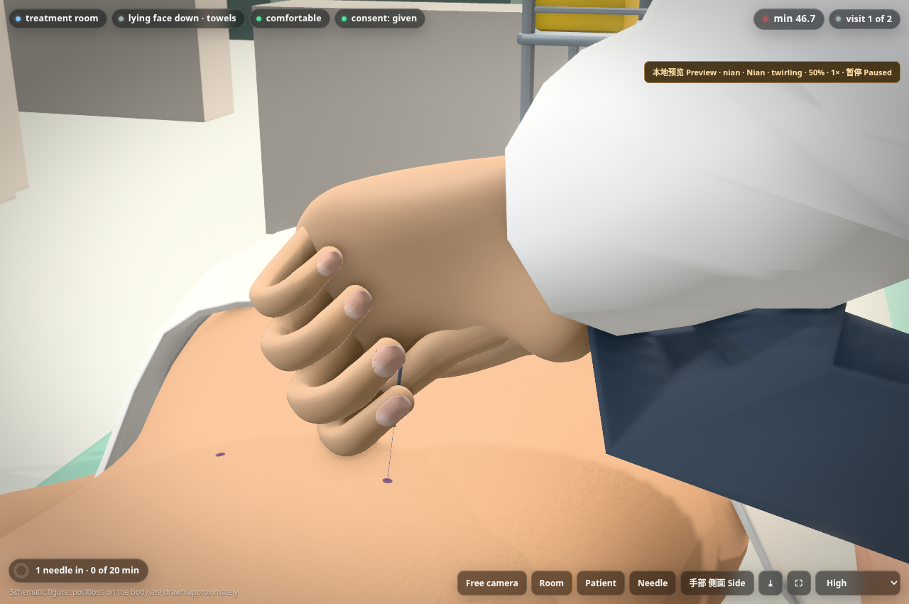
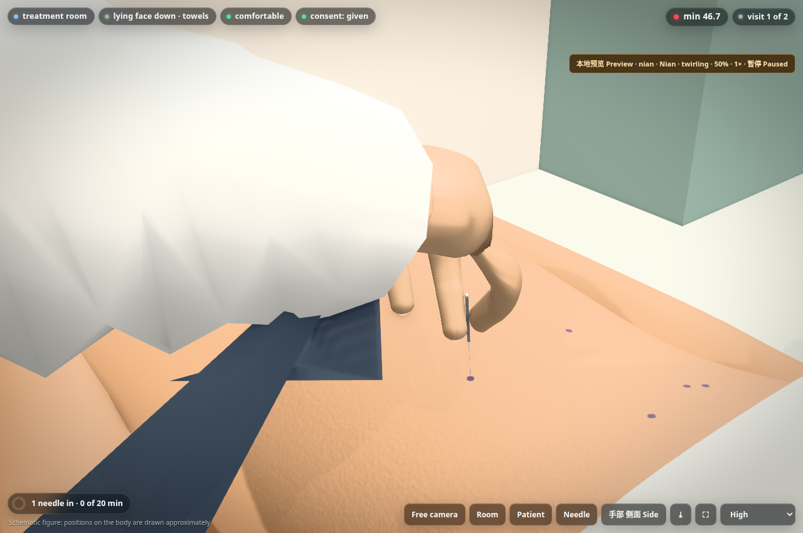
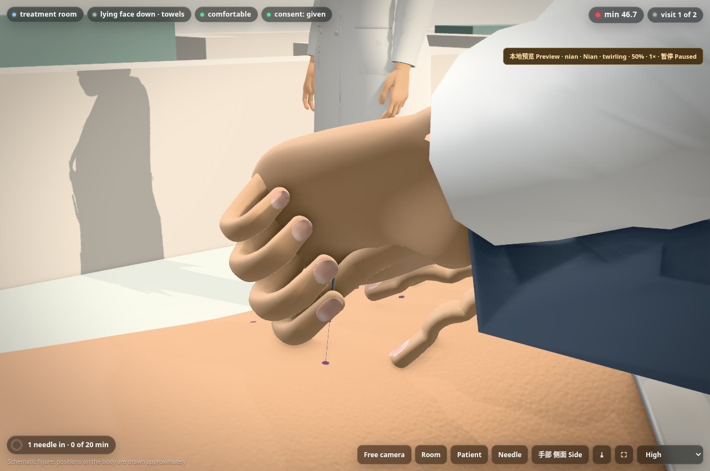

# Reference-based hand poses

The supplied reference images guide the hand silhouette and contact roles. They
show several different poses, rather than one universal acupuncture grip. The
photographs and diagrams are not redistributed with the repository. The third
photograph is visibly labelled AI-generated and is used only for composition,
not as a source of anatomical measurements.

| Reference group | Observable feature | Scene control |
| --- | --- | --- |
| Images 1 and 5 | Compact thumb/index opposition, a bent index and a separate hand near the skin; some contact is occluded | Compare tip/side holds with `support: "stabilize"`; do not infer the hidden contact from a single image |
| Images 2 and 6 | The thumb holds against a more proximal part of the index pulp; the index tip extends below the grip | `gripStyle: "side-pinch"` |
| Image 4 | Two hands perform different roles around an oblique needle | Independently positioned supporting hand; recorded needle angle and azimuth |
| Image 7 | Nail-supported and clasping insertion variants | Separate contact roles; the diagram does not establish a motion trajectory or force |
| Image 8 | Axial and rotational directions | Existing lifting/thrusting and rotational samplers, with explicitly authored timing |

## Shape and motion

The reference pose puts the palm and wrist above and behind the needle handle.
The index curls back toward the shorter, broader thumb. Its distal segment
points back into the grasp, so the outline is a compact C rather than two long,
parallel fingers. The palm arch and thenar region share a continuous surface.
Unused digits have progressively different bends instead of identical fist
angles. Nail beds, joint contours and material detail remain visible in the
complete hand views.

The rebuilt source in `tools/blender/hand_anatomy.json` fits the carpal frame,
near-carpal thumb CMC, finger chains and distal skin/nail directions together.
Its active crest index uses MCP/PIP/DIP bends of 45°/100°/60°. Those are the
authored source-bind angles; the actual operator's working references and
surface-contact solutions are separate. They do not define a relaxed hand or a
universal range of motion. Unused digits obtain their `curled`/`relaxed` settings and
flexion-dependent ulnar fan from the separate shared runtime physiology table.
The `curled` choice is an authored closed-fist posture, including 95–100° PIP
bends; `relaxed` remains a separate, milder choice. Neither the source grasp nor
the closed-fist table should be described as a neutral or universal comfort pose.

The current `d7ec9252…` export uses ordinary tip and three-finger index
references of 50°/100°/60° and 45°/90°/40°, respectively; side pulp retains
90°/35°/10°. Actual solved angles vary with the task. Ordinary thumb acquisition
ray-projects a real volar point at tipward/lateral offsets 0/−3.2 mm; the
three-finger variant uses +3.5/−3 mm. Its normal must remain on the fleshy volar
half of the source surface. The primary holding plane is needle Y=+5 mm for
ordinary tip and −5 mm for three-finger; the third-finger pulp meets Y=+12 mm.
These authored offsets preserve the accepted needle axis, entry and trajectory.

The full hand was not reversed: actual left/right chirality, four-finger volar
curl and opposing nail/pulp directions were already correct. The earlier thumb
solve could carry the knuckle dorsally into the palm. The current volar/radial
opposition route exposes the working thumb while fitting its actual skin point
and smooth normal. Source canonical axes remain +X wristward, +Y dorsal and +Z
radial; `sourceHandedness: "right"` describes the unmirrored source, and the
runtime creates the left hand by reflection.

The renderer distinguishes the needle frame, the actual palm frame and the
forearm frame. Raising the wrist preserves needle contact; it does not change
the clinically recorded needle angle. Forearm pronation follows the actual wrist
orientation while elbow/wrist positions and limb lengths remain fixed. The
palm uses a full three-dimensional basis, and the source wrist can have a nonzero
transverse Z component.

During twirling, the active material contact moves over real terminal skin
triangles. Attachments and runtime fitting use the same exported smooth normal
field. The solver fits each current skin point and its normal to the needle
while the finger joints flex. This produces local thumb/index movement instead
of applying a rotation that a subsequent contact solve immediately overwrites.
Contact migration does not measure friction, pressure or therapeutic efficacy.

## Shared controls

These settings are available to the operator and model tools through the same
schemas. Use `presentation` with `insert_needle`, or `motion` with
`perform_technique`.

| Parameter | Values | Meaning |
| --- | --- | --- |
| `wristElevationDeg` | Two-finger 35–70° / default 55°; three-finger 44–51° / default 48°; Gua/Tan 50–60° / default 55° | Actual hand/wrist elevation; independent of needle insertion angle |
| `gripStyle` | `tip-pinch`, `side-pinch`; three-finger uses tip only | Opposed terminal pulp or a more proximal index-pulp contact with a naturally extending tip |
| `idleFingerPose` | `curled`, `relaxed` | Graduated poses for digits that are not actively holding or manipulating |
| `gripApertureMm` | 0–12 mm requested | Approach/release opening; in Gua, the index nail's release gap from the handle, with at least 1.5 mm clearance |
| `grip` | `two-finger`, `three-finger` | Thumb/index primary holding, optionally with middle volar-pulp support |
| `support` | `none`, `stabilize`, `stretch`, `pinch`, `press` | Role of the separate supporting hand |

Gua uses thumb support at the needle tail and the active index nail edge. Tan
separates the index's cocking, contact and release from the thumb's preparation
and support. Their fixed nail-work variants do not advertise the ordinary grip-style
selector. Their published `parameterBounds` supply the narrower reachable wrist
range to the operator and LLM; out-of-range executed requests are rejected rather
than recorded with a silently substituted wrist angle. `handProfiles.threeFinger`
publishes the optional third-finger range and compatible tip contact. Omitting its
wrist angle resolves to 48°. Switching a UI selector preserves an existing wrist
or contact-style value and displays any incompatibility for correction. Every
exposed control must affect the actual pose; changes to one
setting do not silently overwrite the operator's remaining draft parameters.

Gua's thumb-tail and index-nail working contacts are axially separated by
14.5–20.5 mm. `gripApertureMm` does not specify their total separation: it
controls the index nail's gap from the handle when releasing, while the thumb
has its own 1.5 mm clearance from the tail. A zero opening request still keeps
the minimum 1.5 mm release gap; an engaged Gua retains real surface contact.

For example, the visual portion of an insertion request can contain:

```json
{
  "presentation": {
    "grip": "two-finger",
    "gripStyle": "tip-pinch",
    "wristElevationDeg": 55,
    "idleFingerPose": "curled",
    "support": "stabilize"
  }
}
```

This fragment does not supply or authorize a clinical needle site, path or depth.

## Inspection

The **手部 Grip** camera cycles between three-quarter, side and palmar views.
It uses the actual anatomical palm axes after mirroring; the old side hint used
source-model Z and was 90° away from the intended radial direction. The
three-quarter choice begins on the opposed thumb's nail side. Framing covers
the hand, thumb origin, wrist and nearby needle while prioritizing active
contact sightlines, with the eye outside the patient's local skin plane.
Occlusion adjustment can label a view **Oblique**; sleeves or the patient can
still hide part of the hand or cuff. Use these views while previewing the
approach, first contact, insertion, twirling, axial movement and release. A
cropped image containing only two fingertips cannot establish the hand pose.

Close views use the asset's embedded skin/nail materials and a local shadow
frustum that can resolve small contact relationships. Scene lighting and depth
of field preserve the readability of the active fingers and needle. Automatic
quality includes animation, contact checking and rendering time; an offline
frame export is not a claim about real-time frame rate on a particular device.

Static references cannot determine three-dimensional joint angles, movement
speed, force or tissue deformation. The implementation remains authored
kinematics; clinical motion capture and deformable contact mechanics require
separate validation. Visual quality is assessed from actual scene views and
continuous motion, alongside contact, joint, collision and performance checks.

The separate [flexion diagnostic](HANDS.md#physiological-interpretation) uses the
real GLB's fixed-length hinges and shared runtime posture table. Its three
recorded poses report zero digit-skin triangle boundary intersections; the
earlier free-thumb first-web intersection is absent in those samples. This
unobstructed free-hand probe does not test every runtime grip, needle-volume
clearance, supporting contact or movement phase. Those require the matching
runtime checks and scene captures.

## Actual scene views

The current direction/opposition export is `d7ec9252…`, sampled from
`hand.ts d8f681d6…` and `hand-physiology.ts 221ca74a…`. Its
[validation record](HAND-DIRECTION-VALIDATION.json) and latest
[tip three-quarter](img/hand-direction-tip-three-quarter.png),
[tip side](img/hand-direction-tip-side.png),
[three-finger](img/hand-direction-tripod.png) and supplementary
[hand-only anatomy](img/hand-direction-anatomy.png) captures belong to this
export. The hand-only Blender render is a supplementary geometry inspection;
actual UI views retain the full practitioner and scene occlusions. These current
links are separate from the retained galleries.

### Earlier anatomy and wrist captures

The earlier anatomy/flexion iteration is described in [HANDS.md](HANDS.md) and
its [historical validation snapshot](HAND-ANATOMY-VALIDATION.json). That snapshot
pins the `8e8750a4…` export and each gallery group's original runtime. Its working,
optional-grasp and motion/nail images belong to that anatomy iteration. The
retained ordinary/bimanual comparisons identify the earlier `1bb07096…` /
`5809c719…` checkpoint. The optional-height calibration preserved ordinary motion
at that historical checkpoint; it does not describe the new opposition profile.
A source-only fixture with older clips is not evidence of matching runtime
choreography. Those scene captures used the public controls:







Additional views inspect [optional middle-pulp support at 48°](img/hand-anatomy-three-finger.png)
and [the working index nail in Gua at 55°](img/hand-anatomy-gua-nail.png).
The [Gua release view](img/hand-anatomy-gua-release.png) uses a public 12 mm
opening request after the release envelope completes. It shows the index nail's
release gap alongside the separate, smaller thumb-tail retreat.
The Gua images use the actual public **Palm** preset; its two working digits
are clearer than in the available three-quarter view. The Tan strip uses one
public **Side** view fitted at contact and retained for all three phases.

The [approach-to-release strip](img/hand-anatomy-motion-phases.png) uses five
actual public-seek screenshots from one fixed inspection camera: approach,
partial grasp, engaged hold, release and retreat. Plain resizing and tiling make
the strip; they do not create intermediate animation frames. These sampled
stages complement the unobstructed flexion sheet and finite motion checks,
without measuring real-time rendering speed.

The primary working image is an unchanged copy of that strip's raw engaged
frame, with its complete browser-response provenance. The eight ordinary
hand/style/unused-finger comparison images and the bimanual view retain the
earlier cart stance at floor anchor (0.25, −3.75). The optional-hand and motion
views use the closer working anchor (0.25, −4.25), reached by one recorded public
0.5 m walk before playback. Each motion keeps its own floor anchor fixed. The
gallery therefore contains two explicit stance groups, rather than one common
world pose or camera.

The [Tan phase strip](img/hand-anatomy-tan-motion-phases.png) separately samples
thumb/index preparation, index-nail contact and recoil from the same public
camera. These correspond to actuator cycle phases near 0, 0.28 and 0.5. Public
playback progress includes approach and grasp time, so the report records the
actual slider values and their mapping through the production samplers; the
slider's 0.001 step allows small phase differences. Plain resizing and tiling
preserve the three actual frames.

The revised hand retains a reach limit in this low-back fixture: supporting
palpation and stretching can be shown, while heel pressing is hidden with a
move-closer warning. The model preserves arm lengths rather than displaying an
unreachable supporting hand.
These anatomy captures precede the subsequent
[wrist/sleeve transition](HANDS.md#wrist-and-sleeve-transition) and its
[separate evidence](WRIST-JOIN-VALIDATION.json). That historical change connects
actual skin boundaries and replaces the flat sleeve cap with a hollow hem; it preserved the
authored forearm-roll bound and that checkpoint's hand controls. Some public
side views preserve clear needle contacts while sleeves obscure part of the
palm or unused fingers; the captures retain those actual scene occlusions.

### Earlier reference-pose snapshot

The remaining media below preserve the earlier `9262eb64…` asset snapshot from
commit `3c312cf`. They document that implementation's choreography, camera and
performance; they are not measurements or captures of the revised anatomy.

The main operating hand below uses the public `support: "none"` setting, matching
the single-hand reference compositions. This is an actual High-quality browser
capture of that earlier asset and scene.


The separate default stabilization view retains both hands and the practitioner's
body and sleeves:


Additional actual captures show [side inspection](img/technique-reference-side.png),
[palmar inspection](img/technique-reference-palmar.png),
[side-pulp holding](img/technique-reference-side-pinch.png) and the
[shared parameter studio](img/technique-reference-studio.png). The palmar image
retains partial cuff occlusion of the wrist; the grip and shaft remain visible.
When scene geometry requires a substantially different camera direction, the
camera button labels the result as an adjusted oblique view.

The [main-hand motion detail](img/technique-reference-main-hand-motion.mp4) shows
side-pulp Nian with `support: "none"`, wrist 55°, 120° rotation and two cycles.
Its 130 genuine High-rendered frames provide a 4.33-second local preview,
ending during the final 20 ms of release/retreat.

The [full-scene High motion export](img/technique-reference-motion-offline.mp4) contains
507 actual browser-rendered frames: insertion, side-held Nian and tip-held Ti,
with each segment returning to Ready. Its controlled scene clock produces
**30 output frames per second** over 16.90 seconds. It does not measure device FPS.

The separate [real-time recording](img/technique-reference-motion-realtime.mp4)
preserves actual wall-clock timing and ends during hand release/retreat. Its
25-fps video container includes repeated display frames. A separate quiet Low
test on headless Chromium's **SwiftShader software GPU measured about 1.39 FPS**
(8 frame intervals over 5.77 seconds). The main-thread callback elapsed median was
29.7 ms; this is distinct from the much longer display interval. Real-time
performance on target GPU hardware remains unverified. Neither clip establishes
AAA fidelity.

## Verification and limits

[The earlier validation snapshot](REFERENCE-POSE-VALIDATION.json) pins its runtime
and asset hashes. At `3c312cf`, `bash tools/check.sh` passed 563 tests in 40 files, content and
generator checks, all 11 figure-fit sites and the offline scripted LLM loop
(15/15). Two Blender rebuilds produced that snapshot's same 13,472-triangle,
1,144,328-byte GLB.

For that earlier asset, independent actual-mesh checks covered 216 ordinary and
972 three-finger poses,
including reciprocal and continuous rolling. They check exposed finger surfaces,
terminal skin against the palm, actual clip cancellation and independent
main/stabilizer engagement, using a 50-micrometre geometric tolerance. These are
finite samples, not a proof for every possible posture or clinical motion.

The earlier low-back setup used an authored local skin-plane target with small
visual clearance. Palpation and stretching were reachable; heel pressing from
that stance exceeded the arm's reach and was hidden with explicit feedback.
New sources and stances require their own reach checks. The simulator preserves
bone lengths. Procedural skin junctions, simplified folds and the lack of tissue
compression remain visible limits of the current model.
