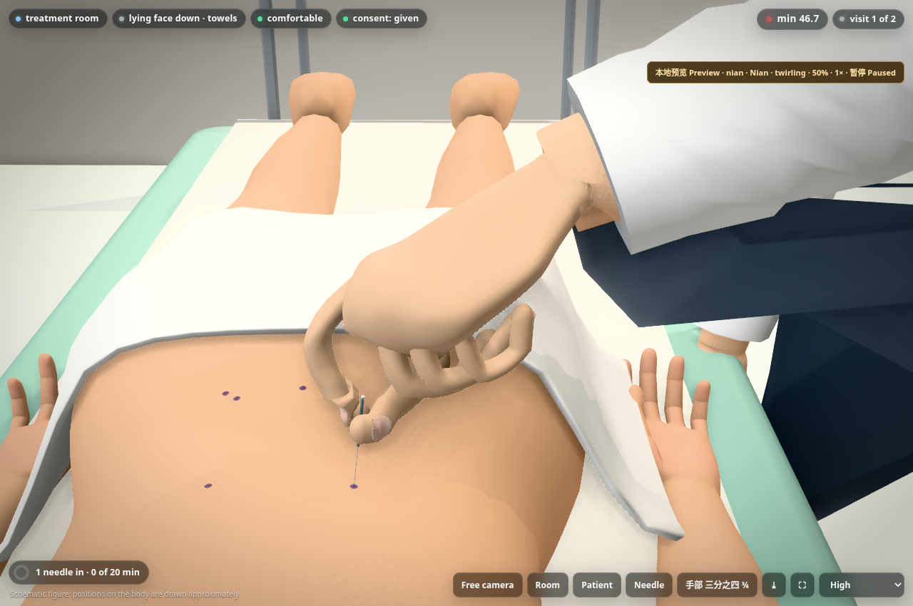
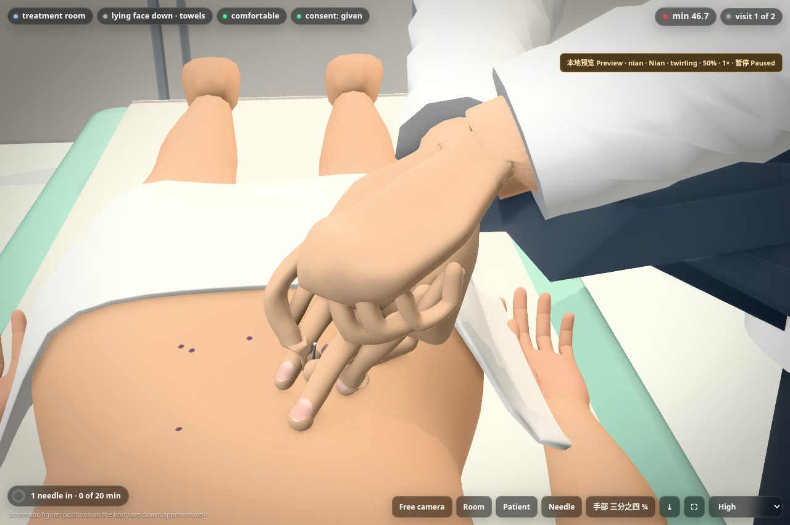

# Reference-based hand poses

The supplied reference images guide the hand silhouette and contact roles. They
show several different poses, rather than one universal acupuncture grip. The
photographs and diagrams are not redistributed with the repository. The third
photograph is visibly labelled AI-generated and is used only for composition,
not as a source of anatomical measurements.

| Reference group | Observable feature | Scene control |
| --- | --- | --- |
| Images 1 and 5 | Compact thumb/index opposition, a bent index and a separate hand near the skin; some contact is occluded | Compare tip/side holds with `support: "stabilize"`; do not infer the hidden contact from a single image |
| Images 2 and 6 | The thumb holds against a more proximal part of the index pulp; the index tip extends below the grip | `gripStyle: "side-pinch"` |
| Image 4 | Two hands perform different roles around an oblique needle | Independently positioned supporting hand; recorded needle angle and azimuth |
| Image 7 | Nail-supported and clasping insertion variants | Separate contact roles; the diagram does not establish a motion trajectory or force |
| Image 8 | Axial and rotational directions | Existing lifting/thrusting and rotational samplers, with explicitly authored timing |

## Shape and motion

The reference pose puts the palm and wrist above and behind the needle handle.
The index curls back toward the shorter, broader thumb. Its distal segment
points back into the grasp, so the outline is a compact C rather than two long,
parallel fingers. The palm arch and thenar region share a continuous surface.
Unused digits have progressively different bends instead of identical fist
angles. Nail beds, joint contours and material detail remain visible in the
complete hand views.

The renderer distinguishes the needle frame, the actual palm frame and the
forearm frame. Raising the wrist preserves needle contact; it does not change
the clinically recorded needle angle. Forearm pronation follows the actual wrist
orientation while elbow/wrist positions and limb lengths remain fixed.

During twirling, the active material contact moves over real terminal skin
triangles. The solver fits each current skin point and its normal to the needle
while the finger joints flex. This produces local thumb/index movement instead
of applying a rotation that a subsequent contact solve immediately overwrites.
Contact migration does not measure friction, pressure or therapeutic efficacy.

## Shared controls

These settings are available to the operator and model tools through the same
schemas. Use `presentation` with `insert_needle`, or `motion` with
`perform_technique`.

| Parameter | Values | Meaning |
| --- | --- | --- |
| `wristElevationDeg` | Two-finger 35–70° / default 55°; three-finger 44–51° / default 48°; Gua/Tan 50–60° / default 55° | Actual hand/wrist elevation; independent of needle insertion angle |
| `gripStyle` | `tip-pinch`, `side-pinch`; three-finger uses tip only | Opposed terminal pulp or a more proximal index-pulp contact with a naturally extending tip |
| `idleFingerPose` | `curled`, `relaxed` | Graduated poses for digits that are not actively holding or manipulating |
| `grip` | `two-finger`, `three-finger` | Thumb/index primary holding, optionally with middle-side support |
| `support` | `none`, `stabilize`, `stretch`, `pinch`, `press` | Role of the separate supporting hand |

Gua/Tan retain their explicit thumb/index stabilization and active middle nail
role. Their fixed nail-work variants do not advertise the ordinary grip-style
selector. Their published `parameterBounds` supply the narrower reachable wrist
range to the operator and LLM; out-of-range executed requests are rejected rather
than recorded with a silently substituted wrist angle. `handProfiles.threeFinger`
publishes the optional third-finger range and compatible tip contact. Omitting its
wrist angle resolves to 48°. Switching a UI selector preserves an existing wrist
or contact-style value and displays any incompatibility for correction. Every
exposed control must affect the actual pose; changes to one
setting do not silently overwrite the operator's remaining draft parameters.

For example, the visual portion of an insertion request can contain:

```json
{
  "presentation": {
    "grip": "two-finger",
    "gripStyle": "tip-pinch",
    "wristElevationDeg": 55,
    "idleFingerPose": "curled",
    "support": "stabilize"
  }
}
```

This fragment does not supply or authorize a clinical needle site, path or depth.

## Inspection

The **手部 Grip** camera cycles between three-quarter, side and palmar views.
It frames the complete hand, thumb origin, wrist and nearby needle, with the eye
outside the patient's local skin plane. Use these views while previewing the
approach, first contact, insertion, twirling, axial movement and release. A
cropped image containing only two fingertips cannot establish the hand pose.

Close views use the asset's embedded skin/nail materials and a local shadow
frustum that can resolve small contact relationships. Scene lighting and depth
of field preserve the readability of the active fingers and needle. Automatic
quality includes animation, contact checking and rendering time; an offline
frame export is not a claim about real-time frame rate on a particular device.

Static references cannot determine three-dimensional joint angles, movement
speed, force or tissue deformation. The implementation remains authored
kinematics; clinical motion capture and deformable contact mechanics require
separate validation. Visual quality is assessed from actual scene views and
continuous motion, alongside contact, joint, collision and performance checks.

## Actual scene views

The main operating hand below uses the public `support: "none"` setting, matching
the single-hand reference compositions. This is an actual High-quality browser
capture of the shipped asset and scene.



The separate default stabilization view retains both hands and the practitioner's
body and sleeves:



Additional actual captures show [side inspection](img/technique-reference-side.png),
[palmar inspection](img/technique-reference-palmar.png),
[side-pulp holding](img/technique-reference-side-pinch.png) and the
[shared parameter studio](img/technique-reference-studio.png). The palmar image
retains partial cuff occlusion of the wrist; the grip and shaft remain visible.
When scene geometry requires a substantially different camera direction, the
camera button labels the result as an adjusted oblique view.

The [main-hand motion detail](img/technique-reference-main-hand-motion.mp4) shows
side-pulp Nian with `support: "none"`, wrist 55°, 120° rotation and two cycles.
Its 130 genuine High-rendered frames provide a 4.33-second local preview,
ending during the final 20 ms of release/retreat.

The [full-scene High motion export](img/technique-reference-motion-offline.mp4) contains
507 actual browser-rendered frames: insertion, side-held Nian and tip-held Ti,
with each segment returning to Ready. Its controlled scene clock produces
**30 output frames per second** over 16.90 seconds. It does not measure device FPS.

The separate [real-time recording](img/technique-reference-motion-realtime.mp4)
preserves actual wall-clock timing and ends during hand release/retreat. Its
25-fps video container includes repeated display frames. A separate quiet Low
test on headless Chromium's **SwiftShader software GPU measured about 1.39 FPS**
(8 frame intervals over 5.77 seconds). The main-thread callback elapsed median was
29.7 ms; this is distinct from the much longer display interval. Real-time
performance on target GPU hardware remains unverified. Neither clip establishes
AAA fidelity.

## Verification and limits

[The validation snapshot](REFERENCE-POSE-VALIDATION.json) pins the tested runtime
and asset hashes. `bash tools/check.sh` passes 563 tests in 40 files, content and
generator checks, all 11 figure-fit sites and the offline scripted LLM loop
(15/15). Two Blender rebuilds produce the same 13,472-triangle, 1,144,328-byte GLB.

Independent actual-mesh checks cover 216 ordinary and 972 three-finger poses,
including reciprocal and continuous rolling. They check exposed finger surfaces,
terminal skin against the palm, actual clip cancellation and independent
main/stabilizer engagement, using a 50-micrometre geometric tolerance. These are
finite samples, not a proof for every possible posture or clinical motion.

Supporting contacts use an authored local skin-plane target with small visual
clearance. Palpation and stretching are reachable in the tested low-back stance;
heel pressing from that stance exceeds the arm's reach and is hidden with
explicit feedback. The simulator does not stretch the bones to display it.
Procedural skin junctions, simplified folds and the lack of tissue compression
remain visible limits of the current model.
