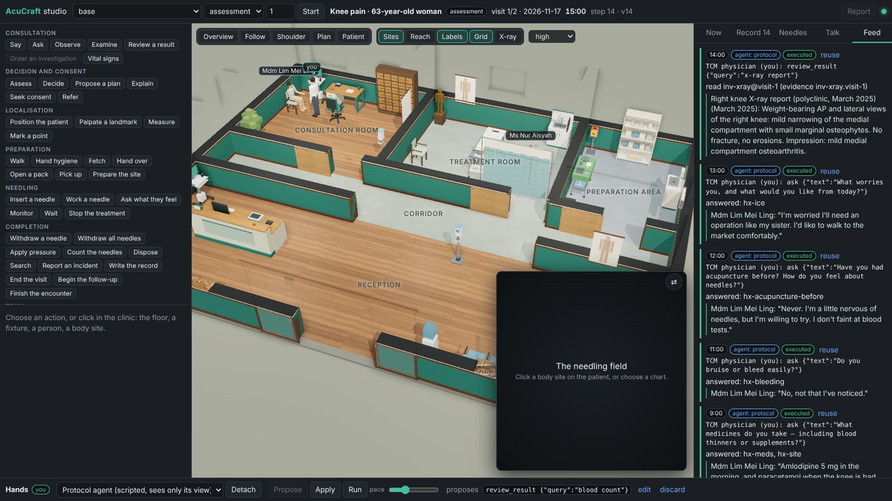
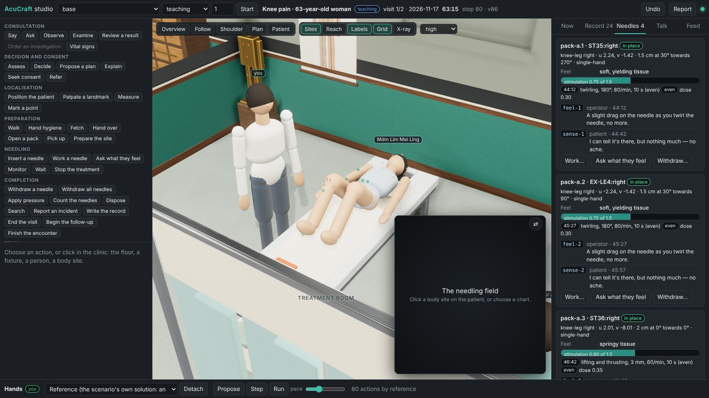
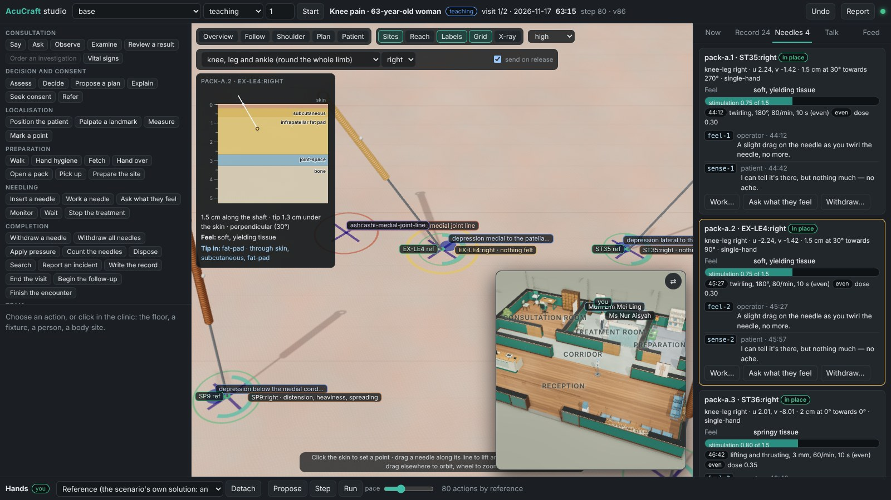
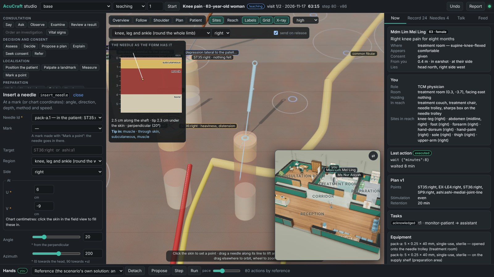

# The studio

One live encounter, in a real-time 3D clinic, that **a person and a language model drive through the same actions**.

```bash
npm run studio                                   # the first scenario, assessment mode → http://127.0.0.1:4173/
npm run studio -- sg-knee-oa/base --mode teaching
npm run studio -- sg-knee-oa/base --agent protocol --run     # watch a built-in agent work; take over at any step
```



The studio is three things over one session:

| | |
| --- | --- |
| **the session** (`packages/studio/src/session.ts`) | the only holder of the encounter state. `act` is the one way it changes: the operator's clicks, a built-in agent's turns, an HTTP client and the MCP bridge all end in the same call, in the same engine, under the same rules |
| **the server** (`server.ts`, `mcp.ts`) | the session as JSON over HTTP, every change pushed as a server-sent event, and the practitioner's three tools for any MCP client |
| **the page** (`src/client`) | the clinic and the needling field in 3D (three.js), a form for every action, the record as it grows, and the bar from which a model is attached, stepped, run and stopped |

The page holds no rule of its own. A click is a request; the engine answers; what is drawn is the snapshot that comes
back. The engine is not in the page at all: the bundler refuses any import from it but types.

## 1. What is on the page

**The clinic.** The building is drawn from the same facility the engine's collision, walking and reach rules are
computed from (docs/WORLD.md): the walls with their openings, floors, windows, sliding doors, and every fixture as
the boxes its catalog entry is made of — bevelled, with physically based materials. People stand where the engine has
them and walk the paths it planned. The patient sits or lies as they were positioned, on the couch they were put on,
and every needle the practitioner believes to be in place is on the body where its chart point lies.

- *Click the floor* to walk there; *a fixture* to walk to it or use it; *a person* to walk to them, speak, examine;
  *a body site* (the dots on the patient: green within arm's reach) to open its chart or walk to where it can be reached.
- Cameras: **Overview** (walls cut down to the dado so the rooms can be looked into), **Follow**, **Shoulder** (in the
  room, whole walls and ceiling), **Plan**, **Patient**. Drag to orbit, wheel to zoom.
- **Reach** draws the three rings round the practitioner: arm's reach (0.85 m), contact (1.5 m), earshot (3 m).



**The needling field.** One regional chart of this patient, close up, in centimetres: `u` across, `v` towards the
head, depth straight down — so a mark, an entry, an angle, a direction and a depth are drawn exactly where the engine
has them. Landmarks appear when they have been palpated, marks when they have been made, a needle's response as the
evidence obtained of it.

- *Click the skin* to set a point: it fills `at` in the open form, or offers to mark or insert there.
- While the **insert** form is open a ghost needle shows where the insertion would go, with its angle, direction and
  depth, and the section beside it shows the needle against a depth scale.
- *Take hold of a needle* and work it with the pointer: a drag **along** its line lifts and thrusts, a drag **across**
  it twirls. The gesture is measured — stroke, rate, which stroke was the quicker; arc, rate, or the whole turn and
  its direction — and sent as the `adjust_needle` it amounts to (docs/TECHNIQUE.md §6). Untick *send on release* to
  review it in the form first.
- Each needle shows the stimulation it has had as an arc (full circle at what a typical patient tolerates), and a
  bound needle says so.



**The forms.** Every action the engine accepts has a form, built from the catalogue the server derives from the
engine's schemas (`GET /api/session/actions`): each field with its range and default, nothing the engine would
refuse. Where a field names something of the encounter — a needle, a pack, a mark, a landmark of the chart, a
pattern, an item of evidence — it is chosen from what the view lists. Under the form is the action as JSON, exactly
as it will be sent; it can be edited there. `Ctrl+Enter` sends.

A refusal that names a walk (`move { "to": … }`) offers it as one button.

**The record.** *Now* (the patient, where you stand and what is in reach, the last result), *Record* (everything
obtained, each item with its evidence id), *Needles* (per needle: how it went in, what is felt, each working with its
dose and character, the evidence of its response, what is recorded), *Talk*, *Feed* (every action, by whom, with its
outcome; any of them can be loaded back into the form).

## 2. A person and a model on one session

The **Hands** bar says who is acting.

| | |
| --- | --- |
| **Attach** | a built-in agent: `protocol` (scripted, sees only its view), `reference` (the scenario's own solution — an oracle, for demonstration), `claude` (a live model; needs `ANTHROPIC_API_KEY`) |
| **Step** | one action of the agent |
| **Propose** | what the agent would do next, *without doing it*: **Apply** it, **discard** it, or **edit** it — the proposal is dropped and its action opens in the form as yours |
| **Run / Pause** | the agent acts on its own, at the pace set; **Pause** stops it after the action in hand |
| take over | while the agent runs, anything you send pauses it first |

An agent decides on the view it was shown. If someone acted in the meantime its action carries a stale version, the
engine says so (`stale-version`), and the agent sees that in its next view — nobody's action is silently dropped or
silently applied to a state it was not decided on.

The log (`GET /api/session/log`) is the whole encounter — the requests in order, with who sent each (`meta.via`) —
and replays to the same state whoever took each step.

### From outside: HTTP

Bound to `127.0.0.1` unless `--host` says otherwise. JSON bodies only; requests from another origin are refused.

| | |
| --- | --- |
| `GET /api/session` | the snapshot: session, agent status, the practitioner's **view**, the stage, the feed |
| `GET /api/session/view` | the view alone (what a model is shown) |
| `POST /api/session/act` | `{ "action": { "type": …, … }, "expectedVersion"?: n, "takeover"?: true }` → the outcome and the new snapshot |
| `GET /api/session/events` | server-sent events: every change, with the snapshot |
| `GET /api/session/actions` | the action catalogue (`?format=text` for the compact text a model is given) |
| `GET /api/session/library` | the public reference library (`?topic=point&id=ST36`, `techniques`, `pattern`, `deqi`, `floorplan` …) |
| `GET /api/session/scene` | the clinic as a renderer draws it |
| `POST /api/session/agent` | `{ "agent": "protocol" \| "reference" \| "claude" \| null, "run"?: true, "stepDelayMs"?: n }`; `/agent/step`, `/agent/propose`, `/agent/discard`, `/agent/run`, `/agent/pause` |
| `POST /api/session` | start again: `{ "scenario"?, "seed"?, "mode"? }` |
| `GET /api/session/log` · `/report` · `/review` | the replayable log (it names the variant), the evaluator's report (`?format=markdown`) and the review page — when the encounter has finished, or in teaching mode |
| `POST /api/session/undo` · `GET /api/session/teaching` | teaching mode only |

```bash
curl -s localhost:4173/api/session/view | jq .space.patient
curl -s -X POST localhost:4173/api/session/act -H 'content-type: application/json' \
  -d '{"action":{"type":"adjust_needle","needleId":"pack-a.1","technique":"lift-thrust","amplitudeMm":2,"frequencyPerMin":40,"durationSec":8,"emphasis":"thrust"}}'
```

### From outside: MCP

`acu mcp` is a Model Context Protocol server over stdio with the practitioner's tools — `act`, `view`, `lookup`
(and `report`) — and the practitioner's brief as its instructions. It is the interface the built-in model agent has.

```bash
npm run -s acu -- mcp sg-knee-oa/base                       # an encounter of its own
npm run -s acu -- mcp --attach http://127.0.0.1:4173        # the encounter the studio shows
```

```json
{ "mcpServers": { "acucraft": { "command": "npm", "args": ["run", "-s", "acu", "--", "mcp", "--attach", "http://127.0.0.1:4173"], "cwd": "/path/to/AcuCraft" } } }
```

Attached, the model's actions appear in the page as they are taken (`via: mcp`), and you can act between them.

## 3. What is shown, and to whom

The snapshot a client receives is the practitioner's **view** — built by the engine from its allow-list
(docs/ARCHITECTURE.md §7) — plus where people stand. In **assessment** mode nothing else leaves the server: no
tissue, no structure, no reference location, no needle response, no report before the end, no variant id; an action
cannot be taken back, and only the practitioner under test can be driven. A needle that fell out unseen is drawn
where it was placed until someone looks.

**Teaching** mode adds what a teacher would point at: reference locations with their tolerance, **X-ray** (the skin
turns translucent: vessels, nerves and tendons of the chart, the tissue zones, and under each needle a core of the
strata it stands in), the section beside the needle coloured by tissue, a probe of the path the insert form
describes before anything is inserted, the report at any time, **Undo**, and acting as another member of the team.



## 4. Rendering

three.js (r180), bundled with esbuild into `packages/studio/dist` when the studio starts (`npm run studio:build`
builds it alone). Nothing is downloaded at run time: materials are drawn in the page from seeded noise (wood with its
grain and joints, speckled vinyl, plaster, upholstery, skin with pores and fine lines).

| | |
| --- | --- |
| light | image-based lighting from a procedural studio environment, daylight with soft shadow maps, room lights, filmic (ACES) tone mapping |
| materials | physically based: metalness/roughness, clearcoat on lacquer and vinyl, sheen on cloth and skin, transmission for glass |
| post-processing | ground-truth ambient occlusion (GTAO), a restrained bloom on what glows, depth of field in the needling field |
| quality | `low` (no post-processing, no shadows, plain glass) · `medium` (shadows) · `high` (default: + AO, bloom, depth of field in the field) · `ultra` (more samples). A view that cannot hold 22 frames a second steps its own quality down and says so; `?quality=low` starts there |

**What this is not.** The people are articulated mannequins, plainly figures and not portraits; furniture is built
from each catalog entry's boxes; the skin in the needling field is the flat chart, not a sculpted limb. There are no
scanned assets, no motion capture, no hands on the needle. The aim is a clear, well-lit, physically shaded picture of
*exactly what the engine's state is* — not photorealism.

It has been checked here in a headless browser with a software renderer (which draws every frame correctly and
slowly); frame rates on a GPU were not measured.

## 5. Tests

`packages/studio/src/studio.test.ts` (part of `npm test`): the catalogue against the schema; the scene; the session
(acting, refusals and their hints, what assessment mode withholds, teaching mode, undo, an agent run with an operator
take-over, replay of the log); the HTTP interface (JSON only, own origin only, events); the MCP bridge on a studio's
session; the reading of a hand gesture; and that the client bundles without the engine in it.
