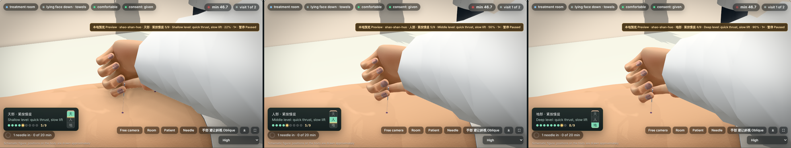

# The 36 needling techniques

AcuCraft has the 36 techniques a needle is worked with — the twenty-four single methods (揣爪循摄 · 摇盘捻搓 · 进退提插 ·
刮弹飞摩 · 动推颤弩 · 按扪搜拨), the ten compound methods (烧山火, 透天凉, the four that carry qi along the channel, and
the mixed ones) and reinforcing and reducing (补, 泻) — as one action, `perform_technique`, that a person at the
workspace and a language model call with the same bounded settings, and that the 3D stage plays with both hands.

There are two catalogues of them, and an encounter runs on one:

| | **operative** (new encounters) | **illustrative** (records made before) |
|---|---|---|
| what a performance is | the technique **done to the needle** | a performance shown and recorded |
| how it is described | a card for each technique — what it is for, what each hand does, the numbers, what to watch for — and its stages in order, with the level, the count, the tempo and the direction of each | a recipe of motion primitives |
| time | it takes the time it takes | none |
| the needle | stimulated by the technique's own dose; told to the hand as evidence; wound by one-way turning | unchanged |
| reading | reinforcing, reducing, mixed or even | none |
| where | the workspace, MCP, the CLI and the benchmark start encounters on it | a log that names no catalogue replays on it, to the digest it was saved with |

This page is about the operative catalogue first; the illustrative one, unchanged, is [described below](#the-illustrative-catalogue-records-made-before).

> **What this is, and is not.** The cards and stages are authored from the classical accounts — the eight methods of
> the 《针灸大成》, the fourteen of the 《针经指南》, the compound methods of the 《金针赋》 — the arrangement of
> twenty-four single methods taught after 陆瘦燕, and the textbook reading of reinforcing and reducing. They are **not
> reviewed by a practitioner**; the classical lines are given as commonly printed and were not collated against an
> edition; where sources differ, one common reading was chosen and the card says so. Forces and tissue mechanics are
> not modelled. Doses are a teaching simplification that makes "how much stimulation" a quantity. It is a teaching
> aid, not a clinical standard, and nothing here is a claim that a method has an effect on a patient.



## 1. What a technique is made of

**Stages.** One performance is a sequence of stages. A *counted* stage repeats a stroke a number of times (`天部 ·
紧按慢提 ×9`); a *move* takes the needle from one level to the next (`进至人部`); a *hold* waits (`候气`). The stage
under way is shown on the 3D view: its name, the repetition of how many, the level, and the breath where the method
names one.

**Levels.** 天, 人 and 地 — shallow, middle and deep — are **thirds of the depth the needle already stands at**. That
depth was set by `insert_needle` or `adjust_needle` and checked against this patient's anatomy; every level is a
shallower place on the same approved path. No technique takes the tip deeper, and none redirects it inside the
patient: every sway, lean, bow and "direction" is of the shaft *outside the skin*. To leave a needle at another depth
afterwards, use `adjust_needle`. A method that works between levels needs a needle deep enough for them (6 mm for
three levels, 8 mm for 子午捣臼 and 苍龟探穴): on a shallower one it is refused, as it would be unsuitable at a point
with thin tissue.

**Counts.** Nine is the yang number of a reinforcing stage, six the yin number of a reducing one. Each technique
names what its counts are (`lookup techniques`: `counts`). `cycles` sets the count of a method that has one, or of
every counted stage of a compound; `phaseCycles` sets each count of a compound that has several, in order. Without
a `durationMs` a performance takes the time its counts take at the tempo the method is taught at.

**Tempo.** 紧按慢提 — quick thrust, slow lift — reinforces; 紧提慢按 — quick lift, slow thrust — reduces. In the
sampler a stroke is outward from its level and back; the *slow* half is the longer part of it.

**Direction.** Thumb forward (左转) is clockwise seen from the handle and reinforces; thumb backward (右转) reduces.
This is the modern textbook rule; the classical one also turns on the side of the body, the sex of the patient and
the time of day, which the simulation does not model.

**The hands.** Thumb and index hold the handle (`grip: two-finger`); 弩 takes a three-finger hold, the middle finger
on the shaft. 刮 and 弹 have their own hands: the thumb on the tail and the index nail on the handle; the index
loaded behind the thumb and let go. In 飞 the fingers leave the handle completely after each run of twirls. 循 and
摄 travel along the channel on the skin (`travelMm`), and named with a retained needle they keep clear of its entry.
The pressing hand touches the skin only when `support` is set — touching a prepared site undoes its preparation.

## 2. What a technique does

Done to a retained needle on the operative catalogue (`packages/core/src/engine/operation.ts`, `encounter.ts`):

- **Time.** The clock advances by the performance (a 烧山火 of 9/9/9 is about 24 seconds).
- **Stimulation.** The needle's stimulation grows by the technique's dose: its own at the method's counts and default
  amplitude, scaled by the square root of each ratio (twice the count is not twice the stimulus), at most 1. The
  response model is the one of [EVIDENCE.md](EVIDENCE.md): tissue at the tip × stimulation (capped) × the patient's
  sensitivity. So the lesson holds for every technique — **depth, not force**: a tip short of the tissue that answers
  is not helped by working it harder, and past what the patient tolerates more only hurts.
- **Evidence.** A hand that holds the needle in the tissue is told how the tissue holds it: a `needle-feel` item, as
  for `adjust_needle`. A touch on the handle (刮, 弹, 飞, 摩) tells the hand nothing; the patient may still speak.
- **Reading.** Each performance reads as reinforcing, reducing, mixed or even (`effect.reading` in the record, and on
  the needle's own history). It is the *form* that is read — a traditional reading of how the needle was worked — not
  an effect.
- **Winding.** Rolling one way (搓; or `adjust_needle` rotating `clockwise` or `counterclockwise`) winds the tissue
  round the shaft. From half a turn the needle is **held**: that is what 搓 is for (守气), but a held needle's grip is
  the winding's, not the tissue answering — the evidence says so, and it is not deqi. From a turn and a half it is
  **stuck** (滞针): it hurts, and nothing that works the needle is accepted until it is freed — rolled back the other
  way, the channel stroked (循) or nipped (摄), the handle flicked (弹) or scraped (刮). A stuck needle pulled out by
  force comes out, hurts, bleeds, and is recorded as the unsafe act `stuck-needle-forced`.
- **Warmth and coolness.** 烧山火 is done for warmth and 透天凉 for coolness. Some patients feel it and others do not
  — fixed per patient and site like the rest of their response — and only while the needle has its response. A
  patient who feels it says so, and names it when asked (`check_sensation`).
- **The hole.** 扪 on the hole of a needle withdrawn in this visit closes it and stops bleeding there.

A technique of the pressing hand named with a retained needle (循, 摄, 按 with `needleId`) is done beside that
needle, for it: a small stimulus without taking hold of it, and what it lets go of a wound needle. 揣 and 爪 are for
the point before the needle goes in, and leave a needle alone.

`adjust_needle` on the operative catalogue is the act it always was when no excursion, rate or time is stated. With
them, its dose follows what is stated, the form asked for is read (`bu`, `thrust` or a clockwise turn reinforce;
`xie`, `lift` or a counterclockwise turn reduce), and turning one way winds.

## 3. The catalogue

`lookup { "topic": "techniques" }` lists all 36 with what one performance of each is; with an id (`nian`, `烧山火`,
`shao-shan-huo`) or a group (`channel`, `turning`, `levels`, `handle`, `shaft`, `closing`, `compound`, `bu-xie`) it
gives each technique in full: how it is done step by step, the line it is taught by and where that is from, its
stages with their levels and counts, its controls and defaults, what to watch for, and what the simulation does and
leaves out. The operator's panel shows the same card beside the controls.

The tables below are written from the catalogue (the dose is the stimulation one performance adds; an inserted needle
starts at 0.45, the response is complete at 1, and a typical patient tolerates 1.5).

### 揣爪循摄 · On the skin and along the channel

The pressing hand finds and prepares the point, and calls or frees the qi along the channel.

| | id | what it is for | one performance | dose | reads as |
|---|---|---|---|---|---|
| **揣** Palpating for the point | `chuai` | Find where the point actually is on this patient, and what lies under it, before the skin is cleaned. | 按定 → 揣揉 ×3 → 寻按 → 定穴 · 5.4 s | — | — |
| **爪** Pressing with the nail | `zhua` | Fix the point, part the qi and blood so that the prick is less felt, and give the needle an edge to enter against. | 爪切 ×2 → 定穴 · 3.5 s | — | — |
| **循** Stroking along the channel | `xun` | Bring the qi to a needle that has not found it, or carry it along the channel; it also eases a needle the tissue has seized. | 循按 ×3 · 4.8 s · loosens 120° | 0.05 | — |
| **摄** Nipping along the channel | `she` | Free qi that has stagnated at a needle: the remedy for a needle that will not turn or lift. | 摄切 ×4 · 3.6 s · loosens 240° | 0.05 | — |

### 摇盘捻搓 · Turning the handle

The needle hand rocks, circles, twirls or winds the needle about its own entry.

| | id | what it is for | one performance | dose | reads as |
|---|---|---|---|---|---|
| **摇** Rocking the needle | `yao` | Move the qi; and, as the needle comes out, widen the hole so that what is to be reduced can leave. | 摇针 ×6 · 4.2 s | 0.15 | — |
| **盘** Circling the needle | `pan` | Spread and harmonise the sensation at soft, thick sites — classically the abdomen. | 盘针 ×5 · 5.5 s | 0.2 | — |
| **捻** Twirling | `nian` | The basic rotating manipulation: it obtains the qi and regulates it, and its direction and force carry reinforcing or reducing. | 捻转 ×6 · 3.0 s | 0.3 | even |
| **搓** Winding | `cuo` | Hold the qi the needle has found and strengthen the sensation, by letting the fibres lightly take hold of the shaft. | 搓针 ×3 → 守气 · 3.5 s · winds the needle | 0.35 | — |

### 进退提插 · Along the shaft

The tip travels between the shallow, middle and deep levels, or is lifted and thrust within one.

| | id | what it is for | one performance | dose | reads as |
|---|---|---|---|---|---|
| **进** Advancing by levels | `jin` | Take the needle to its depth in steps, waiting for the qi at each: the slow way in that reinforcing uses. | 退至天部 → 候气 → 进至人部 → 候气 → 进至地部 → 候气 · 4.7 s · needs ≥ 6 mm | 0.2 | reinforcing |
| **退** Withdrawing by levels | `tui-withdraw` | Bring the needle back in steps before it comes out, or to change what is being done: the slow way out that reducing uses. | 退至人部 → 少停 → 退至天部 → 少停 → 复原 · 4.3 s · needs ≥ 6 mm | 0.15 | reducing |
| **提** Lifting | `ti` | The lifting half of lifting and thrusting: quick, forceful lifts with slow thrusts reduce. | 紧提慢按 ×6 · 5.4 s | 0.3 | reducing |
| **插** Thrusting | `cha` | The thrusting half of lifting and thrusting: quick, forceful thrusts with slow lifts reinforce. | 紧按慢提 ×6 · 5.4 s | 0.3 | reinforcing |

### 刮弹飞摩 · Light work on the handle

A fine vibration is sent down the needle without moving its tip.

| | id | what it is for | one performance | dose | reads as |
|---|---|---|---|---|---|
| **刮** Scraping the handle | `gua` | Hasten or spread the sensation without turning the needle: for a patient who bears twirling badly. | 刮柄 ×8 · 4.4 s · loosens 60° | 0.1 | — |
| **弹** Flicking the handle | `tan` | Hasten the qi with a quiver of the shaft. | 弹柄 ×6 · 4.8 s · loosens 60° | 0.08 | — |
| **飞** Flying | `fei` | Hasten the qi and carry it on. | 一捻一放 ×3 · 4.5 s | 0.2 | — |
| **摩** Rubbing the handle | `mo` | Keep a sensation going with the finest of stimuli. | 摩柄 ×6 · 3.6 s | 0.05 | — |

### 动推颤弩 · Small movements of the shaft

The needle is stirred, pushed, trembled or bowed to move the qi it has found.

| | id | what it is for | one performance | dose | reads as |
|---|---|---|---|---|---|
| **动** Stirring | `dong` | Set moving a qi that will not move. | 伸提动摇 ×4 · 3.2 s | 0.15 | — |
| **推** Pushing | `tui-push` | Drive on the sensation the needle has found. | 推针 ×3 · 4.2 s | 0.15 | — |
| **颤** Trembling | `chan` | Hasten the qi and strengthen the sensation. | 震颤 ×12 → 少停 → 震颤 ×12 · 4.5 s | 0.2 | — |
| **弩** Bowing the needle | `nu` | Send the sensation one way, toward where it is wanted. | 弩针 ×2 · 4.8 s | 0.2 | — |

### 按扪搜拨 · Pressing, closing, searching, levering

The channel is pressed, the hole closed, the response looked for, a tight band released.

| | id | what it is for | one performance | dose | reads as |
|---|---|---|---|---|---|
| **按** Pressing the channel | `an` | Close the channel on one side of the needle so that the qi goes the other way. | 按压 · 3.0 s · loosens 60° | 0.03 | — |
| **扪** Closing the hole | `men` | Close the hole as the needle leaves it, so that what was reinforced does not leak: the reinforcing end of opening and closing (开阖补泻). It also stops oozing. | 扪闭 → 轻揉 ×3 → 按定 · 3.9 s | — | reinforcing |
| **搜** Searching | `sou` | Look for the sensation when it has not come in the first direction. | 退至浅层 → 向前探 → 退回 → 向后探 → 退回 → 向左探 → 退回 → 向右探 → 退回 → 复原 · 7.4 s · needs ≥ 4 mm | 0.25 | — |
| **拨** Levering | `bo` | Release a tight band or an adhesion beside the tip. | 拨针 ×4 · 4.4 s | 0.25 | — |

### 复式手法 · Compound methods

The single methods combined by level, count and direction: fire and coolness, the four that carry qi along the channel, and the mixed methods.

| | id | what it is for | one performance | dose | reads as |
|---|---|---|---|---|---|
| **烧山火** Setting the mountain on fire | `shao-shan-huo` | Bring warmth under the needle: for cold, numbness and deficiency. | 退至天部 → 天部 · 紧按慢提 ×9 → 进至人部 → 人部 · 紧按慢提 ×9 → 进至地部 → 地部 · 紧按慢提 ×9 → 紧闭插针 · 23.6 s · needs ≥ 6 mm; seeks warmth | 0.7 | reinforcing |
| **透天凉** Coolness through the heavens | `tou-tian-liang` | Bring coolness under the needle: for heat and excess. | 地部 · 紧提慢按 ×6 → 退至人部 → 人部 · 紧提慢按 ×6 → 退至天部 → 天部 · 紧提慢按 ×6 → 一进 · 17.2 s · needs ≥ 6 mm; seeks coolness | 0.6 | reducing |
| **青龙摆尾** The green dragon sways its tail | `qing-long-bai-wei` | Carry the qi along the channel toward where it is wanted: the first of the four methods of 飞经走气; reinforcing. | 提至天部 → 扳倒针身 → 一左一右 ×9 → 扶正 → 复原 · 12.3 s · needs ≥ 6 mm | 0.3 | reinforcing |
| **白虎摇头** The white tiger shakes its head | `bai-hu-yao-tou` | Carry the qi along the channel: the second of the four methods of 飞经走气; reducing. | 边摇边提 ×6 → 进圆 → 再摇再提 ×6 → 进圆 · 7.6 s · needs ≥ 6 mm | 0.4 | reducing |
| **苍龟探穴** The dark turtle probes its hole | `cang-gui-tan-xue` | Carry the qi into the deep channels: the third of the four methods of 飞经走气; reinforcing. | Four directions. Three steps in, one out, each time. · 11.6 s · needs ≥ 8 mm | 0.45 | reinforcing |
| **赤凤迎源** The red phoenix meets the source | `chi-feng-ying-yuan` | Carry the qi past the joints: the fourth of the four methods of 飞经走气; reducing. | Deep, then shallow, then the middle. Twirl and release to the four sides. · 14.8 s · needs ≥ 6 mm | 0.45 | reducing |
| **龙虎交战** Dragon and tiger do battle | `long-hu-jiao-zhan` | Stop pain: reinforcing and reducing by turns. | 龙 · 左转九 ×9 → 虎 · 右转六 ×6 → 龙 · 左转九 ×9 → 虎 · 右转六 ×6 · 15.0 s | 0.5 | mixed |
| **子午捣臼** Pounding the mortar | `zi-wu-dao-jiu` | Move water and qi that have gathered: for swelling and fullness. Reinforcing and reducing together. | Three steps in, two out. Left turn going in, right turn coming out. · 11.5 s · needs ≥ 8 mm | 0.6 | mixed |
| **阳中隐阴** Yin hidden in yang | `yang-zhong-yin-yin` | Reinforce first, then reduce: for cold followed by heat, deficiency holding excess. | 退至浅层 → 浅层 · 紧按慢提 ×9 → 进至深层 → 深层 · 紧提慢按 ×6 · 13.4 s · needs ≥ 4 mm | 0.55 | mixed |
| **阴中隐阳** Yang hidden in yin | `yin-zhong-yin-yang` | Reduce first, then reinforce: for heat followed by cold, excess holding deficiency. | 深层 · 紧提慢按 ×6 → 退至浅层 → 浅层 · 紧按慢提 ×9 → 复原 · 13.4 s · needs ≥ 4 mm | 0.55 | mixed |

### 补泻 · Reinforcing and reducing

The two bare forms: every contrast of the single methods taken one way.

| | id | what it is for | one performance | dose | reads as |
|---|---|---|---|---|---|
| **补** Reinforcing | `bu` | Every contrast of lifting-thrusting and twirling taken the reinforcing way. | 紧按慢提 · 拇指向前 ×9 · 8.1 s | 0.3 | reinforcing |
| **泻** Reducing | `xie` | Every contrast of lifting-thrusting and twirling taken the reducing way. | 紧提慢按 · 拇指向后 ×6 → 少停 → 紧提慢按 · 拇指向后 ×6 · 7.6 s | 0.45 | reducing |

## 4. Calling it

```json
{ "type": "perform_technique", "technique": "shao-shan-huo", "needleId": "pack-a.1" }
```

performs 烧山火 as the catalogue has it. Settings are optional:

```json
{
  "type": "perform_technique",
  "technique": "shao-shan-huo",
  "needleId": "pack-a.1",
  "motion": { "phaseCycles": [9, 9, 9], "strokeMm": 2, "hand": "right" }
}
```

For an LLM or MCP tool call, omit `type` and use the tool name `perform_technique` (MCP also needs `session_id`).
Unknown keys, non-finite values and out-of-range inputs are refused before anything is recorded; so are counts that
do not fit the method, a needle too shallow for its levels, and a stuck needle. The result carries the engine's
observations: what was performed, what the hand felt (with its evidence id), a change in how the needle is held, and
anything the patient said.

| Setting | Range | On the operative catalogue |
|---|---|---|
| `cycles` | 1–12 | the count of a method that has one, or of every counted stage of a compound; omitted: the method's own |
| `phaseCycles` | 1–12 each | one count for each of a compound's counts, in the order `lookup` lists them |
| `durationMs` | 400–30000 | the time the performance takes on the clock; omitted: the method's own tempo |
| `strokeMm` | 0–3 mm | the stroke of a lift and thrust, outward from its level (compressed on a shallow needle) |
| `rotationDeg` | 0–180° | the arc of a twirl, or of one roll of 搓 |
| `lateralMm`, `tiltDeg` | 0–4 mm, 0–8° | excursion and tilt of the shaft outside the skin |
| `direction` | `alternating`, `clockwise`, `counterclockwise` | 捻, 搓 and 盘: which way (clockwise from the handle is thumb forward) |
| `tempoBias` | 0.2–0.8 | 捻, 提 and 插: the share of a stroke spent on its outward half |
| `travelMm` | 0–60 mm | 循, 摄, 按: how far along the channel the hand travels, or presses from a needle |
| `grip`, `gripStyle`, `wristElevationDeg`, `idleFingerPose`, `gripApertureMm`, `support`, `hand`, `contactIntensity` | as below | the hands, as on the illustrative catalogue |

The record keeps every accepted performance (`view.performances`) with its resolved settings, its provenance
(`operative`, `acucraft-operative-techniques-v2`, `unreviewed`, forces `not-modelled`) and what it did
(`effect`: minutes, dose, reading, winding added, winding let go). How the needle is held now, and how the tissue
answered, are not in the view: they are felt and asked, like everything else about the patient.

## 5. Choosing the catalogue, and old records

An encounter is started on a catalogue and stays on it: `start_encounter { techniques: "operative" | "illustrative" }`
over MCP and in the workspace's API, `--techniques` for `acu run`, `play`, `show` and `bench`. The default is
operative. The log records it (`"techniques": "operative"`); a log that names none was made on the illustrative
catalogue and replays on it, to the digest it was saved with, whatever the default is. The baseline benchmark is
the same on either: the reference and protocol agents work a needle with `adjust_needle` as before.

Sampling for a renderer is one function for both: `sampleManipulation(model, id, elapsedMs, settings, { depthMm })`
(`@acucraft/core`). On the operative catalogue the sample carries the stage (`stage`: name, count, level, breath),
the level as a fraction of the standing depth (`depthFraction`, already included in `withdrawalMm`), what one-way
rolling has left on the needle (`windingRad`), and where a travelling hand is (`travelMm`, `offsetMm`).

---

# The illustrative catalogue (records made before)

What follows describes `adjust_needle`'s presentation settings and the illustrative catalogue, as they were and
are: an encounter started with `techniques: "illustrative"`, and every record made before the choice existed, runs
on it.

## Manipulation gestures in the simulator


`adjust_needle` accepts `lift`, `thrust`, `lift-thrust`, `twist`, `rotate`, `bu` and `xie`, as well as `none` for a depth change without manipulation. Existing `lift-thrust` and `rotate` actions and saved trajectories retain their meaning. Insertion remains `insert_needle`; withdrawal remains `remove_needle`.

Every name uses the same engine path: an inserted needle, the actor's reach and permission, the patient's consent and condition, and the requested depth are checked before any state change. The action records the gesture and produces evidence of what the operator felt. `lift`, `thrust`, `bu` and `xie` use the existing lift-thrust simulation stimulus; `twist` uses the existing rotation stimulus. Bu (tonification) and xie (sedation) receive no special efficacy multiplier or score. Their opposite timing is an illustrative visual convention, not expert-reviewed clinical instruction.

An action may include optional presentation settings:

```json
{
  "type": "adjust_needle",
  "needleId": "pack-a.1",
  "technique": "bu",
  "motion": { "cycles": 3, "durationMs": 2400, "strokeMm": 1.5, "rotationDeg": 90 }
}
```

| Setting | Unit | Range | Default |
|---|---|---|---|
| `cycles` | displayed cycles over the whole animation | 1–8, integer | 3 |
| `durationMs` | milliseconds for the whole animation | 400–8000, integer | 1800 |
| `strokeMm` | outward travel from the approved depth | 0–3 mm | 1.5 mm |
| `rotationDeg` | maximum displayed twist amplitude | 0–180° | 90° |

These settings tune playback, not clinical dosing: one action remains one simulation manipulation. They do not change the retained depth, tissue response or simulated duration of the action. A different depth must be requested with `depthCm` and passes the anatomy guard. Settings are retained in the action log so presentation can be replayed.

`techniqueMotion(technique, elapsedMs, motion?)` is the shared pure sampler for the browser and 3D authoring. It returns `withdrawalMm` (outwards along the shaft), `rotationRad`, `durationMs` and `complete`. A renderer must clamp the outward stroke to the currently retained depth, so the needle neither leaves the skin nor travels deeper than its approved path. Every cycle starts and ends at the resting pose with smooth phase transitions; rotation also returns to its original orientation. `resolveNeedleMotion` exposes the defaults and bounds.

These legacy gestures do not provide a reviewed model of tissue deformation, force, shaft elasticity, haptic feedback or therapeutic effects. Clinical findings and the patient's response continue to come from the deterministic encounter model, independently of the visual animation.

## The 36-entry performance catalogue

[观看 36 种针法实录 · Watch all 36 Studio recordings](STUDIO-RECORDINGS.md)

`perform_technique` adds a separate, presentation-only action for the revised working vocabulary: 24 named maneuvers, 10 compound demonstrations, and bu/xie. Operator controls, the server's GPT/MiniMax/Claude loop, and MCP clients all use this action and the same strict parameter schema. It records an accepted performance without changing the retained depth, needle lifecycle, tissue response, evidence ledger, or clinical clock. Use `insert_needle`, `adjust_needle.depthCm`, and `remove_needle` for actual encounter state changes.

`lookup { "topic": "techniques" }` returns the catalogue, per-technique defaults, available controls, the motion schema and parameter descriptors. Each entry includes Chinese and English labels, an operating context, an explicit phase recipe, and an authored, unreviewed provenance. These are reproducible demonstrations, not a claim that all traditional variants or GB/T procedures have been clinically validated.

| Context | Catalogue IDs | Required target |
|---|---|---|
| Surface contact | `chuai` 揣, `zhua` 爪, `xun` 循, `she` 摄, `an` 按 | A current mark, explicit regional chart coordinates, or a needle's recorded site |
| Retained needle | `yao` 摇, `pan` 盘, `nian` 捻, `cuo` 搓, `jin` 进, `tui-withdraw` 退, `ti` 提, `cha` 插, `gua` 刮, `tan` 弹, `fei` 飞, `mo` 摩, `dong` 动, `tui-push` 推, `chan` 颤, `nu` 弩, `sou` 搜, `bo` 拨 | A needle actually retained in this visit |
| Post-removal contact | `men` 扪 | A needle withdrawn in this visit; its recorded entry anchors the surface contact |
| Compound demonstrations | `shao-shan-huo`, `tou-tian-liang`, `qing-long-bai-wei`, `bai-hu-yao-tou`, `cang-gui-tan-xue`, `chi-feng-ying-yuan`, `long-hu-jiao-zhan`, `zi-wu-dao-jiu`, `yang-zhong-yin-yin`, `yin-zhong-yin-yang` | A retained needle; the catalogue lists each authored phase |
| Bu/xie demonstrations | `bu` 补, `xie` 泻 | A retained needle |

Compound sequences reorganize the same deterministic motor primitives; their phase names and timing are visible in playback. Source-dependent names such as She, Dong, Nu, Sou and Bo retain their Chinese labels and explicit illustrative status instead of asserting one universally correct traditional definition.

```json
{
  "type": "perform_technique",
  "technique": "gua",
  "needleId": "pack-a.1",
  "motion": {
    "durationMs": 3200,
    "cycles": 4,
    "grip": "two-finger",
    "support": "none",
    "hand": "right",
    "gripApertureMm": 2,
    "contactIntensity": 0.4
  }
}
```

For an LLM/MCP tool call, omit `type` and use the tool name `perform_technique`; MCP also requires `session_id`. An operator's Execute button submits the same fields through the hub. Unknown keys, non-finite values and out-of-range inputs are rejected before they enter the action log.

| Motion setting | Allowed values / range | Meaning |
|---|---|---|
| `durationMs` | 400–30000, integer | Duration of the entire performance, not a clinical treatment duration |
| `cycles` | 1–12, integer | Movement cycles per primitive phase; `durationMs` still covers the whole performance |
| `phaseCycles` | One integer from 1 to 12 per compound phase | Optional repeat counts in catalogue phase order. These override `cycles` for that performance. |
| `strokeMm` | 0–3 mm | Outward axial displacement, additionally clamped to retained depth |
| `rotationDeg` | 0–180° | Peak angular excursion for Nian, Cuo, Bu and Xie |
| `lateralMm` | 0–4 mm | Surface tracing or external shaft/handle deflection |
| `tiltDeg` | 0–8° | External shaft/handle tilt, not internal-tip redirection |
| `tempoBias` | 0.2–0.8 | Relative timing of the two parts of a movement cycle |
| `direction` | `alternating`, `clockwise`, `counterclockwise` | Primary excursion viewed from the handle toward the tip. Each cycle returns to rest. |
| `grip` | `two-finger`, `three-finger` | Thumb/index holding by default; optional middle-finger support |
| `gripStyle` | `tip-pinch`, `side-pinch` | Compact terminal-pulp holding, or a more proximal index contact with its tip extending below the grip |
| `wristElevationDeg` | degrees, two-finger 35–70 / default 55; three-finger 44–51 / default 48; Gua/Tan 50–60 / default 55 | Actual hand/wrist elevation; use `handProfiles` and the technique's `parameterBounds`, independent of clinical insertion angle |
| `idleFingerPose` | `curled`, `relaxed` | Graduated poses of digits not participating in holding or nail work |
| `support` | `none`, `stabilize`, `stretch`, `pinch`, `press` | Supporting-hand contact pattern |
| `hand` | `auto`, `left`, `right` | Primary hand selection |
| `gripApertureMm` | 0–12 mm | Approach/release opening, with minimum disengagement clearance; for Gua, index-nail clearance from the handle while the thumb separately clears the tail |
| `contactIntensity` | 0–1 | Normalized cosmetic contact intensity; no unit of force |

Defaults and relevant controls differ by technique. Read them from the catalogue rather than assuming every setting visibly affects every primitive. None of these bounds is a clinical dose or an anatomical limit.

In the catalogue animation, alternating Nian and Cuo reach the requested angle on
both sides of neutral. A directional turn reaches that angle on its chosen side
and returns. Ti and Cha reach the requested outward excursion in each cycle,
subject to the retained-depth limit. The authored Bu and Xie combine the same
axial stroke with an earlier or later twist respectively. Pan follows a circle in
the plane perpendicular to the shaft. Its diameter equals the requested lateral
excursion before the exposed shaft's length constraint. Alternating Pan reverses
the path on successive cycles. Fei closes the thumb/index pair, rolls the handle while
the pads are engaged, and settles the handle before the fingers reopen.

For skin contact, Zhua uses the distal edge of the index nail with the other fingers
curled clear of the surface. She uses a short trace with that edge, following the
nail-scraping variant in the supplied reference. Changing the supporting hand
preserves the working digit and its path. With `support: "pinch"`, the other
hand brings the thumb and index together on the neighboring skin. The animation
tracks two points on the fingertips as the hand closes and the patient breathes.

Ordinary retained-needle holding defaults to the thumb/index pair. Choosing three-finger support explicitly adds middle volar-pulp support beside that pair; it does not replace the index finger. Fei and ordinary compound holding phases preserve the chosen grip. The authored nail-work variants have separate roles: Gua braces the needle tail with the thumb and scrapes the handle with the index nail edge; Tan prepares the index against the thumb, releases the thumb, and makes index-nail contact followed by recoil.

The reference-based hand uses a raised wrist and a curled index with a shorter,
broader thumb. `gripStyle` is advertised for ordinary holding; Gua/Tan keep their
fixed nail-work roles. The **手部 Grip** camera cycles through complete hand views
for checking the palm, thumb origin and needle together. See
[the reference-pose guide](REFERENCE-POSES.md) for the image groups and controls.

For a compound performance, the catalogue divides its total duration into stages. In **Set repeat counts by phase**, an operator can set each stage independently. For **阳中隐阴** (`yang-zhong-yin-yin`), `"motion": { "durationMs": 6000, "phaseCycles": [1, 3] }` animates one Bu cycle in the first three seconds and three Xie cycles in the last three. Omitting `phaseCycles` uses the shared `cycles` value throughout. Rotation settles at each stage boundary.

## Admission, records and replay

The engine checks permission, current patient position, chart bounds, reach, target consistency and needle lifecycle. Performances other than post-removal Men also require current-plan consent and a patient whose condition permits continued treatment. Men remains available as aftercare following withdrawal of consent or an interruption; it does not reinsert or reuse the removed needle.

Surface contact uses the existing contact semantics: it soils the actor's hands and invalidates the prepared skin at the touched region/side. A later insertion still has to satisfy the normal hygiene and site-preparation rules. Choosing a supporting hand is not a shortcut around those checks.

Accepted performances appear in `view.performances` (the latest 64) with their resolved parameters, site, patient position, actor, visit, request ID and provenance. The request ID ties playback to the correct timeline event when several actors act quickly. Refused gestures do not append a performance. The authoritative action log retains all accepted requests for deterministic replay. The optional history is created only by the new action, so historical trajectories without performances retain their previous digest and can still be restored.

The provenance says `kind: illustrative`, `source: acucraft-authored-demonstration-v1`, `review: unreviewed`, and `forces: not-modelled`. It contains executed chart coordinates, not hidden anatomical findings, inferred therapeutic effects or measured force values.

## Preview and fine 3D control

The manipulation panel selects a target and technique, exposes the applicable parameters, and keeps edits as an operator draft. Preview changes only local animation; Execute records an action after engine validation. Preview requires a compatible visible body site or retained needle, and does not create a performance, alter patient state, or advance the clinical clock.

Local playback supports pause, speed adjustment and preview seeking. Valid parameter edits update an active preview in place while retaining its normalized progress, pause state and speed; changing the target or technique cancels that preview. Recorded performances retain their accepted parameter values; their clinical record is not rewound by playback controls. A newer authoritative state cancels an obsolete preview, and a recorded gesture takes precedence over starting a new local preview.

The hand controller uses the Blender rig's moving pad/nail anchors, separate finger poses, grip changes and supporting-hand contacts. During ordinary needle holding, the opposing thumb/index pads meet the actual handle surface; `gripApertureMm` controls opening during approach and release. An explicitly chosen three-finger grip adds middle volar-pulp support. Gua's opening controls the index nail's release gap from the handle, with at least 1.5 mm clearance; the thumb separately clears the needle tail by 1.5 mm. Tan uses thumb/index skin contact during preparation and a separate index-nail contact/recoil cycle, and does not advertise an aperture control.

The pure `sampleTechnique` output separates `gripEngagement` (local thumb/index contact, independent of approach/release) from the legacy `grip` envelope. A renderer that already supplies approach, grasp, release and retreat timing applies its envelope once and uses `gripEngagement` only for intentional local changes such as Fei. Normal holding remains engaged at motion endpoints and compound phase boundaries, avoiding an extra open/close jump as the manipulation starts or stops.

Needle axial strokes remain within the executed depth. Lateral motion and bending affect the exposed shaft/handle geometry only; they do not move the skin entry or redirect the internal needle tip. The display does not claim to solve tissue deformation, internal shaft elasticity, contact force or haptics.

These bounds describe `perform_technique` and legacy `motion` presentation settings. Explicit top-level `adjust_needle` stroke, frequency, rotation and duration parameters use the separately checked clinical envelope described in [CHARACTER-CONTROL.md](CHARACTER-CONTROL.md). The two APIs retain their own units and timing semantics, and both use the same articulated hands.

Insertion remains a clinical `insert_needle` action. Its optional `presentation` field selects `durationMs` (400–8000), `grip`, `support`, `hand` and `gripApertureMm` (0–12) for the approach/grip/insertion animation. Angle, azimuth and depth remain the existing validated clinical inputs, and the renderer uses the executed result when insertion is partial. The Studio **Skin contact** slider sets when the tip first touches skin during that movement (20–80%, default 45%). Models send the same value as `presentation.skinContactFraction` (0.2–0.8). The clock starts once the practitioner has approached and secured the needle. During insertion the tip meets the moving skin at the chosen fraction, then settles at the recorded endpoint. On a breathing torso, the nail used for Zhua or She follows the same point on the skin as the torso moves.

[Studio insertion at 70% contact](img/studio-insertion-contact.png) · [Compound Studio playback](img/technique-compound-studio.mp4) · [Studio phase controls](img/technique-compound-controls.png) · [Validation measurements](TECHNIQUE-MOTION-VALIDATION.json)
