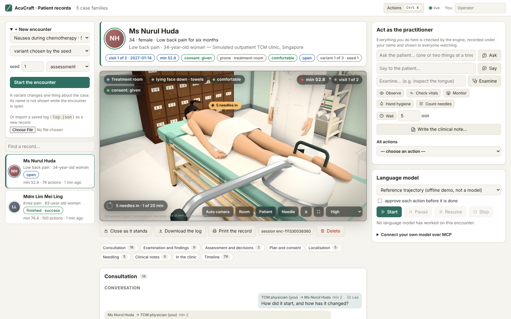
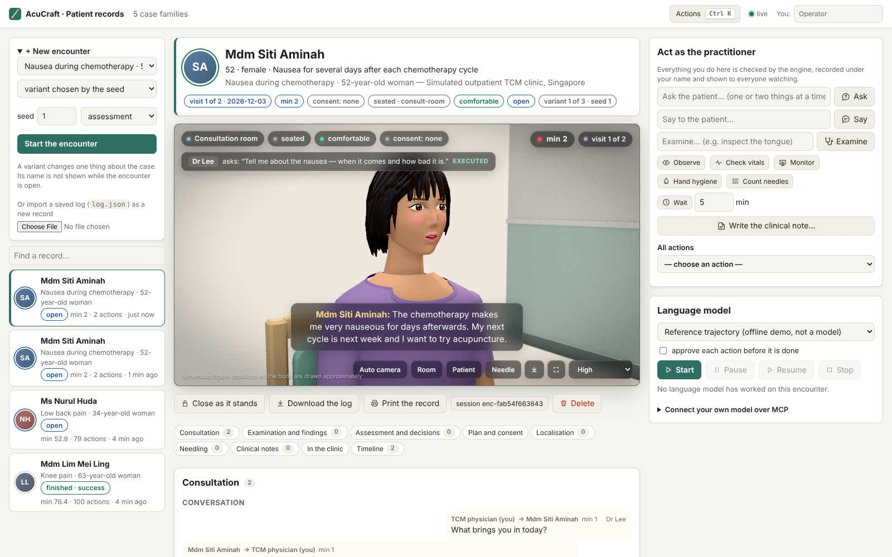

# Patient records in the browser, live (`acu serve`)

`npm run acu -- serve` opens a workspace in the browser where a person and a language model keep the same
acupuncture patient records at the same time. Every record is a simulated encounter run by the AcuCraft engine: the
operator works it from the page, a language model run by the server works it from the same page, and any MCP client
(Claude Code, Claude Desktop) works it over HTTP. Whatever any of them does goes through the engine's one tool path,
is checked by it, recorded under who did it, written to disk, and appears in every open browser as it happens.



```bash
npm run acu -- serve                         # http://127.0.0.1:8787/ — records kept in runs/web
ANTHROPIC_API_KEY=… npm run acu -- serve     # the server's language model can be Claude
claude mcp add --transport http acucraft http://127.0.0.1:8787/mcp   # an MCP client on the same records
```

Options: `--port 8787`, `--host 127.0.0.1`, `--data DIR` (default `runs/web`) or `--in-memory`, `--token-file FILE`
(or `ACUCRAFT_TOKEN`), `--verbose` (one line per request). On start the server restores every record it finds in
the data directory by replaying its log.

## 1. The record

The page has the list of records (start an encounter of any family, choose its variant or let the seed choose, in
assessment or teaching mode; import a saved `log.json` as a new record), and one encounter's complete record:

| part | what it shows |
|---|---|
| banner | the patient, the visit and its date, the simulated minute, consent, where the patient is and how, how they look, who is watching |
| **the 3D view** | the encounter as it stands (§4): the room, the patient in their position with the marks and needles on their skin, the practitioner beside them |
| consultation | the conversation — what the patient said, with the practitioner's own questions put back in from the timeline — and the history taken |
| examination and findings | examination, records and results reviewed, the latest vital signs and observations, site conditions and tender points found |
| assessment and decisions | the assessment on record with the findings it rests on (each evidence id explained), red flags, the decision and its rationale, referrals |
| plan and consent | the plan's latest version (points, retention, stimulation, method, rationale, alternatives, follow-up), consent and what was explained |
| localisation | a chart per region with its landmarks, the measurements and the practitioner's marks (and, in teaching mode, the reference locations) |
| needling | each needle with its target, whether it is in, how often it was worked, the evidence of its response and what was recorded; counts, packs, sharps |
| clinical notes | every note written (`document`) in full |
| in the clinic | where everyone is, the equipment, the rooms |
| timeline | every action of the encounter: when, by whom (operator, language model, MCP client), what, how the engine answered |
| evaluation | once the encounter is finished or closed as it stands: the primary endpoint, the tracks, critical errors, the debrief (with the hidden truth) and the log |

What is new since the page last drew it is marked as it arrives, so a person watching sees the record being
written. The record prints as a document (the controls and the 3D view are left out).

### Acting on it

"Act as the practitioner" offers the quick acts of a consultation (ask, say, examine, observe, vital signs,
monitor, hand hygiene, count needles, wait) and every other tool of the practitioner as a form generated from the
tool's own JSON Schema — with the record's own ids and the public library's points, regions, patterns and signs as
suggestions, required choices left blank until chosen. "Write the clinical note…" opens `document` drafted from
facts already on the record (it claims no needle response). The answer is shown as the engine gives it: executed,
partial or refused, with what was observed and what changed.

### From the keyboard

**Ctrl+K** (⌘K on a Mac), or "Actions" in the header, opens the command palette: every tool of the practitioner (it
opens that tool's form), the record's commands (write the note, download the log, print, copy the session id for an
MCP client, pause or stop the language model), starting an encounter of any family, and going to any record — found
by typing a few letters. **/** puts the cursor in "Ask the patient…".

### The language model

The "Language model" panel starts a model on the open record: **Claude** through the Messages API (model and
effort chosen on the page; needs `ANTHROPIC_API_KEY` on the server), or the **reference trajectory** — the
scenario's reference actions spoken through the same loop, offline, as a demonstration (not a model). The
operator can pause it (its next action is held), resume it, stop it, or run it supervised: each action then waits
for the operator's approval, and a refusal — with a reason — is told to the model, which goes on. Its transcript
(what it said, what it read, each action and how the engine answered) streams into the panel.

### Working together

There is no lock: everyone acts on the record as it is now. What protects each actor from acting on a stale
picture is what it is told: each answer names what `changed` since that actor last looked, and the model (whether
the server's or an MCP client) is also told what others did `meanwhile` — "operator Ann Tan: examine …" — and its
current batch of actions is cut short when someone else acted, so its next decision is made on the record as it
now stands.

## 2. How it works

`@acucraft/server` (`packages/server`):

- **The hub** (`src/hub.ts`) holds one `EncounterSession` per record. Every action from any actor goes through
  `toolsFor`'s tools — the same path the CLI, the benchmark and the MCP server use — and becomes a timeline entry:
  `{seq, at, by: {kind, name, id}, tool, input, status, code, message, observations, minute, version}`. The
  session's log (`acucraft/log@1`) stays the authority; the timeline adds who did what.
- **Records on disk**: `runs/web/<id>/record.json` (`acucraft/live-record@1`: the log, the timeline, family,
  variant, who started it), written atomically after every change. On start each is restored by replaying its
  log with the engine (`EncounterSession.fromLog`); a record whose replay does not reproduce its recorded digest,
  or whose timeline disagrees with its log, is skipped and reported, never half-loaded.
- **The language model** (`src/runner.ts`) runs `llmAgent` with the server as its host: it is given the record's
  view with its own last attempt, every action is applied through the hub the moment it is chosen, `approve`
  waits for the operator in supervised mode, and `meanwhile` reports the other actors' entries since its last look.
  Budget: 400 actions per run.
- **The event stream** (`GET /api/stream?encounter=<id>`, Server-Sent Events): `hello` (the list, and the record's
  snapshot), `summary` (a record's line in the list), `update` (the record's new view and the timeline entry),
  `agent` (the model's state and a transcript item), `closed` (the evaluation), `removed`. A ping every 15 s; the
  browser reconnects by itself.
- **The browser app** (`web/*.ts`): TypeScript modules transpiled one by one as they are served (types erased, no
  build step), DOM built from text nodes only — nothing the server or a model says is ever parsed as HTML. The
  3D view is the one bundle (§4).

### HTTP API

Every request that acts carries `by: {name, tab}`: the name the operator gave and the tab, for the timeline.

| method and path | |
|---|---|
| `GET /api/info` | version, the engine's revision, the families, whether a token is required, whether Claude and the 3D view are available |
| `GET /api/stream?encounter=<id>` | the event stream (above) |
| `GET /api/encounters` · `POST /api/encounters` | the records · start one (`family`, `variant`, `seed`, `mode`) |
| `POST /api/encounters/import` | a saved `log.json` as a new record (replayed; refused if it does not reproduce) |
| `GET /api/encounters/<id>` · `DELETE …` | the snapshot (summary, view, timeline, model, evaluation) · delete the record |
| `GET …/tools` | the practitioner's tools: name, read or act, stage of the encounter, description, input schema |
| `POST …/act` | `{tool, input}` → `{ok, output, entry}`; refused actions (and anything on a closed record) answer `ok: false` |
| `POST …/close` | `{abandon: true}`: close it as it stands; it is evaluated |
| `GET …/report` · `GET …/log` · `GET …/debrief` | the evaluation · the log as a file · the HTML debrief (409 while the encounter is open: it shows hidden truth) |
| `GET …/stage` | what the 3D view draws of the people beyond the view (§4) |
| `POST …/agent` · `POST …/agent/decision` | `{op: start\|pause\|resume\|stop, options}` · `{approve, reason}` |

### MCP over HTTP

`/mcp` speaks MCP over Streamable HTTP: `initialize` opens a session (`Mcp-Session-Id`), each JSON-RPC request is
answered with JSON, notifications with 202, `GET` with 405 (no server-initiated stream), `DELETE` ends the session.
The tools are those of `acu mcp` (docs/AGENT.md) on the workspace's records — an encounter an MCP client starts is
a record in every browser — plus `list_open_encounters`, with which a client joins a record someone else started
(its `session_id` is the record's id, shown on the page). The client's actions are attributed to it by the name it
gave in `initialize` (`mcp:claude-code`).

## 3. Security

The workspace is for one machine by default: it listens on `127.0.0.1` and answers only requests whose `Host` is a
loopback name (a page elsewhere cannot reach it by rebinding a domain to 127.0.0.1), and refuses cross-origin
requests outright. To listen beyond loopback it needs a token (`--token-file`, `ACUCRAFT_TOKEN`; if neither is
given it makes one up and prints the address with it): the API and `/mcp` then require it as `Authorization:
Bearer`, or once in the address (`/?token=…`), which the server turns into an `HttpOnly`, `SameSite=Strict` cookie
and removes from the address bar. Every page is served with a strict Content-Security-Policy (`script-src 'self'`,
`style-src 'self'`, `connect-src 'self' blob:` — `blob:` only for the models' embedded textures, which the page
unpacks itself), `nosniff` and no referrer; the debrief page runs no script at all.

What the browser is given is what the practitioner's view allows (`AgentView`, an allow-list): no variant's name,
no hidden diagnosis, no reference location outside teaching mode. The debrief — which shows the hidden truth — is
refused until the encounter is over. The 3D view is given how the patient looks and how tall they are (what anyone
in the room sees), and nothing else beyond the view.

## 4. The 3D view



The view draws the encounter as the record has it, in step with it:

- **The set** is the clinic's own: the treatment couch, the needle trolley with its sharps box, the heat lamp, the
  herb cabinet, the meridian chart and the bronze meridian figure, the patient's chairs and the pulse cushion —
  the pack's models, built in Blender (docs/MODELS.md), loaded from `content/world/assets/models` — in a treatment
  room and a consultation room with a window, blinds, a privacy curtain and a desk.
- **The people** are drawn with ClinicalCraft's figure kit — the same figures as its 3D world — from the
  bundle of the pinned engine: the patient as their case describes them (skin, hair, build, clothes; a variant may
  change how they look, never say its name) and built to their height, in the position on the record — seated at
  the desk, standing, or on the couch on their back, face down or on one side, bare under towels; the practitioner
  in a white coat, beside the couch on the side being needled, or across the desk. They breathe and blink; the
  patient's lips move while they speak; a patient who feels faint is drawn pale and clammy.
- **The practitioner's marks and the needles** are placed on the skin from the record: a mark at its chart
  coordinates, a needle at its mark (or at the place given with it) at the recorded angle, direction and depth,
  of the pack's length, with a steel shaft and spiral handle. A needle slides in when it is inserted and out when
  it is withdrawn, moves with lift-thrust or turns with rotation when worked, and a recorded deqi glows once
  round it. Each needle carries its label; picking one in the view highlights its row in the record.
- **From chart to skin** (`web/stage/sites.ts`): each regional chart's origin is found on the figure by
  proportional measurement, as `tools/figure-fit.mts` does for the needling stations — the lower border of L4 13 cm
  above the hip joints, the knee chart from the lower pole of the patella, the forearm from the wrist crease, the
  scalp from the anterior hairline — and the place is found by casting a ray onto the drawn skin from the side
  the chart is seen from; the trunk charts are unrolled round the figure's own sections, the limb charts round
  the limb. **This is a drawing aid, schematic like the pack's anatomy:** the figure is not the patient's anatomy
  model, and a point may be drawn a centimetre or two from where the engine has it. The view says so on screen.
- **Heads-up display**: the room and the patient's position, how they look and their consent; the simulated
  clock, the visit, the language model at work; subtitles of what is said; a caption for each action with who
  did it; the needles in place with a retention ring against the plan's retention time.
- **The camera** is directed by default: an establishing shot, the patient's face while they speak, a close view of
  each needle as it goes in or each mark as it is made, a new shot when the patient moves. Dragging or scrolling
  takes it (free camera); "Auto camera" gives it back. "Room", "Patient" and "Needle" are shots on demand; the
  picture button saves a PNG; full screen is offered.
- **Rendering**: physically based materials lit by an image of a room, a low sun through the window with soft
  shadows (and the blinds' stripes), the ceiling panel as an area light, ground-truth ambient occlusion, a shallow
  depth of field on close shots, a touch of bloom, a filmic grade and vignette; on skin seen close, a fine grain
  filtered by pixel size. Quality follows the frame rate (high → medium → low by itself) or is fixed with
  `?quality=high|medium|low` in the address.
- **The bundle**: `/app/stage.js` is built by the server with esbuild from `web/stage/` and the pinned
  ClinicalCraft checkout (`.deps/clinicalcraft`, `npm run bootstrap`), when first asked for and again when a source
  changes, and served gzipped. Without the checkout, or in a browser without WebGL, the page says so and the record
  is complete without it.

## 5. Status

| | |
|---|---|
| operator and language model on the same record, live in every browser | done (§1, §2) |
| Claude through the Messages API; the reference trajectory offline; supervised approvals; pause, resume, stop | done |
| MCP over Streamable HTTP, joining an open record | done; no server-initiated stream (a client polls with its tools) |
| records kept, restored by replay, imported from a log | done |
| the 3D view: the clinic's models, the people as the 3D world draws them, marks and needles on the skin, the directed camera | done; the chart-to-figure placement is schematic (§4) |
| several operators at once | done (each tab is attributed by its name); no accounts, no roles per operator |
| a patient voiced by a language model; Mandarin | not yet (the patient answers from the case's authored facts; English) |

The tests are `packages/server/src/hub.test.ts` (the hub: attribution, the timeline, closing, the language model
supervised, paused and stopped, an MCP client joining, persistence and restore) and `http.test.ts` (the app, its
modules and the models; acting over the API; the debrief withheld while open; Origin and Host checks; the event
stream; MCP over HTTP; the token and its cookie; loopback only without a token; where a needle went in and how it is
labelled), `bundle.test.ts` (the 3D view's bundle builds from the pinned engine) and `web.test.ts` (the conversation
with the practitioner's questions put back in, the note's draft made of facts on the record only, the palette's
ranking). The page itself was checked in Chromium: two tabs on one record, the operator acting, a supervised and a
free run of the language model, and the 3D view through four families' treatments.
