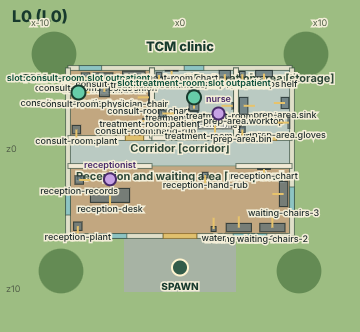
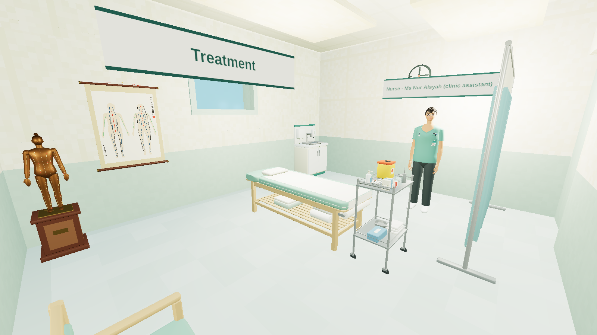
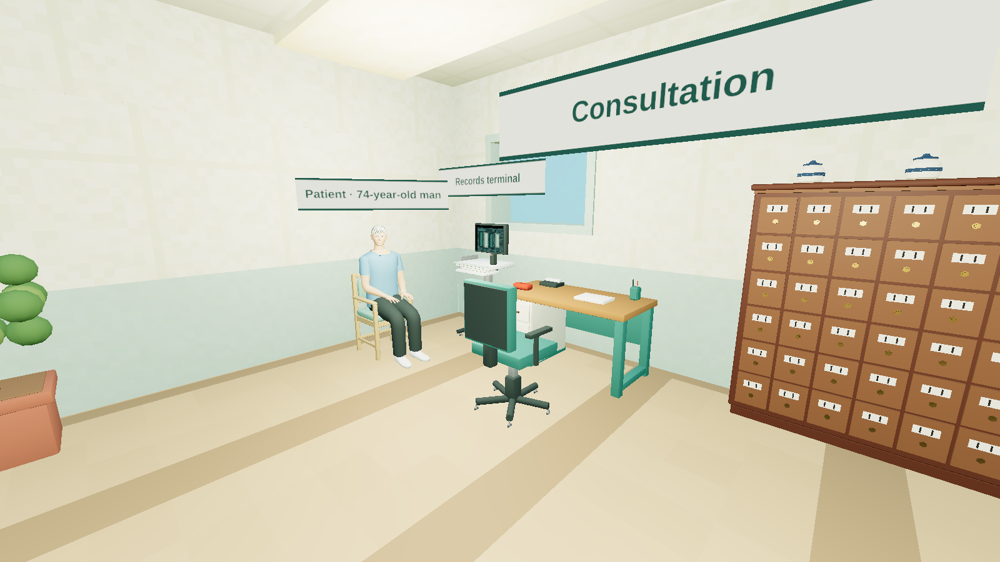

# The clinic as a walkable world

> Status: the contract for `engine/world.ts` and `engine/space.ts`. If the code and this page disagree, fix one of
> them in the same change. The floor plan, like all content of this release, is unreviewed.

The practitioner has a body. The clinic is a building with rooms, walls, doors and furniture; everyone in an encounter
stands somewhere in it, and an act can only be done from where it can be reached. Asking a question needs the patient
within earshot, hand hygiene a sink within reach, a needle at the patient's left knee a place to stand beside that
knee — and a point on the far side of the couch means walking round it. Nothing is teleported and nothing walks for the
practitioner: an act out of reach is refused, and the refusal names the walk that makes it possible.

## 1. The floor plan is a ClinicalCraft facility

The clinic's building is authored in ClinicalCraft's own formats and compiled by ClinicalCraft's own code:

| file | format | what it holds |
|---|---|---|
| `content/world/facilities/sg-tcm-outpatient.json` | `clinicalcraft/facility@1` | the building (16 × 12 m), the reception and the corridor, three placed room templates, doors and windows, a receptionist, the spawn |
| `content/world/templates/acu-*.json` | `clinicalcraft/room-template@1` | the consultation room, the treatment room (couch, needle trolley with its sharps box, chair, sink, screen) and the preparation area (supply shelf, sink, sharps box, worktop) — and the skills room, which is not part of the clinic |
| `content/world/catalogs/acucraft-tcm.json` | `clinicalcraft/equipment-catalog@1` | the pack's materials and eleven equipment types, each with a model: treatment couch, patient chair, needle trolley, supply shelf, herb cabinet, meridian chart, meridian model, pulse cushion, heat lamp, and two needling stations |
| `content/world/assets/models/*.glb` | glTF | the models the world draws the equipment from ([MODELS.md](MODELS.md)) |
| `content/world/facilities/sg-tcm-skills-room.json` | `clinicalcraft/facility@1` | a skills room with the two needling stations: beside the clinic's floor plan, not in it — no encounter is played there and the engine plans no walk in it |
| `content/sg/clinic.json` | `acucraft/clinic@1` | which facility the clinic is, each room's `home` spot, and for every fixture the engine knows (`couch-1`, `trolley-1`, `shelf` …) the facility `placement` it stands on |

`tools/content/clinic_world.py` writes all of them but the models (`tools/blender/build.py`). The loader
(`@acucraft/bench`) parses and compiles the facilities with `parseFacility`, `compileFacility`, `checkFacility`,
`checkCatalogs` and `checkRoomTemplate` of `@clinicalcraft/core`, together with the pinned engine's built-in catalogs
and templates.

**The clinic's solid furniture is the floor plan.** Every reference walk was planned round it, so nothing solid is
added to, moved in or taken from the clinic's three rooms without planning those walks again
(`packages/bench/src/models.test.ts` holds the list). How the clinic looks — its models, finishes and people — changes
nothing of where one can stand: a model is drawn inside its type's footprint, which stays the collider, and people are
never obstacles.

AcuCraft then builds ClinicalCraft's static world layer from it, headless (`@clinicalcraft/world`, pure — no renderer,
no clock): the collision model, the semantic registry (rooms, doors, every piece of equipment with its footprint and
reach), the navigation grid and the occlusion model. `buildClinicWorld` does this once per clinic and checks that the
plan holds together: every room and fixture of `clinic.json` is on the facility, every `home` is a free spot in its
own room, and every fixture and room can be walked to. A plan that fails any of these does not load.

People are not obstacles — staff walk round each other — so the world does not depend on the encounter's state: the
same world serves every state, and a replay plans the same walks.

**Units and directions.** Metres on the floor plan; `+x` is east and `+z` is south; a facing (`yaw`) of 0 looks north.
`npm run acu -- map sg-knee-oa/base` prints the plan as text, with the fixtures and where everyone starts.

## 2. Standing somewhere

Every member of the cast and the patient have a stance in the encounter state: `at { x, z, yaw }`. An actor's
`location` is the room that stance lies in. The patient is either on a fixture (`support`: a chair or the couch) or
standing at a spot. A stance changes only through a walk the world planned; every walk is kept (`state.walks`: who,
from, to, the path corner by corner, metres, minutes, whether the patient walked alongside).

### Walking: `move`

`move { to, withPatient? }`. `to` is a room id, or one of:

| target | where the walk ends |
|---|---|
| `{ "room": id }` | the room's home spot (nothing happens if you are already in the room) |
| `{ "fixture": id }` | where the fixture can be used: within its reach, in sight of it, facing it |
| `{ "person": id }` | beside that person — a member of the team, or `"patient"` |
| `{ "region": id, "side": "left" \| "right" \| "midline" }` | where that body site is within an arm's reach, as the patient lies or sits now, squarely beside it |
| `{ "x": n, "z": n }` | that point of the floor (the nearest free spot) |

The path is planned on ClinicalCraft's navigation grid (0.5 m cells; a cell can be stood on when its centre is 0.38 m
clear of every wall and solid footprint), round walls and furniture and through doors. A walk takes the time its path
takes: 72 m a minute alone, 48 m a minute with the patient. A target that is already within reach costs nothing: the
actor turns to it. `withPatient: true` (to a room) walks the patient there at the actor's side and seats them on the
room's chair; they must be able to walk — not faint, no needles in — and be within earshot to be asked.

`position_patient` moves the patient within the room: lying positions onto the room's couch, sitting onto a chair.

## 3. Reach

| what | range | acts that need it |
|---|---|---|
| **a body site within arm's reach** | 0.85 m to the site, in sight | `identify_landmark`, `measure`, `mark_point`, `prepare_site`, `insert_needle`, `adjust_needle`, `remove_needle`, `apply_pressure` |
| **at the patient's side** | 1.5 m to the couch or chair they are on, in sight | `examine`, `check_vitals`, `position_patient`, `search`, `remove_all_needles` (which then walks from needle to needle) |
| **earshot** | 3 m, in sight | `ask`, `explain`, `seek_consent`, `check_sensation`; speech is never refused, but the patient hears and answers only from here |
| **in view** | 8 m, in sight | `observe`, `monitor` |
| **a fixture within its reach** | the equipment's own reach (1–1.5 m of its footprint), in sight | `hand_hygiene` (a sink or hand-rub dispenser), `fetch` (where the item is kept), `open_pack` (onto a trolley or worktop), `pick_up` (the tray's trolley; a fallen needle, by the couch it fell near), `dispose` (a sharps container), `review_result` (a records terminal — or with the patient, for the reports they brought), `prepare_couch` (the couch being cleaned and made up) |
| **another member of the team** | 1.5 m, in sight | `handover` |

Walls and closed doors block sight: nobody monitors a patient through a wall.

`count_needles` is never refused, but only a count made where the needles are reconciles them (`observed`): in the
patient's room with the patient in sight while any needle is in place, and in the room of every tray that holds
opened needles. From anywhere else it reads the record (`read`), which verifies nothing.

A refusal for where the actor stands has the code `not-at-patient` or `not-in-reach` (`no-route` when there is no way
there) and a message with the distance and the walk that fixes it, for instance — standing beside the right knee:
*"The left knee, leg and ankle on the treatment couch is 0.9 m from where you stand: out of arm's reach (0.85 m). Stand
where you can reach it: move {"to":{"region":"knee-leg","side":"left"}}."*

## 4. The patient's body on the couch

`content/regions/body-map.json` (`acucraft/body-map@1`) says where each regional chart lies on the body: `axial`, the
fraction of the patient's height from the top of the head (scalp 0.02, lumbar 0.4, knee and leg 0.78, sole 0.99), and
`lateral`, metres from the midline (the lumbar chart 0.04, the forearm 0.26).

With the patient lying, `siteOf` lays the body along the couch from its head end, using the patient's own height:

- **supine**, head to the north: the patient's right is on the west side of the couch, their left on the east;
- **prone**: the sides swap — the patient's right is now on the east;
- **lying on one side**: the upper side is over the middle of the couch, reachable from either side;
- **seated or standing**: every site is at the body, reachable from beside it.

A site less than 5 cm from the midline (the lumbar chart, the midline of the abdomen) is within reach from either side
of the couch; a site 12 cm or more from it (a knee, a forearm, GB21) only from its own side. So a bilateral treatment
is done one side of the couch at a time, and the needle trolley at the foot of the couch is within reach from beside
the legs but not from beside the shoulders.

## 5. What the practitioner sees

The agent view carries `space`: where you stand and face; every fixture with its distance and whether it is within
reach; the patient — the room, what they are on, the distance, `inEarshot`, `atSide`, `inSight`, which way the head
points and which side of the couch their right is on, and the body sites the position gives access to, split into
those within reach from here and the others with their distance; and where the rest of the team is.

The public reference library has the floor plan (`clinic.floorPlan`: rooms with their rectangles, home spots and
doors, fixtures with position, size and reach, the ranges and the walking speeds). It is the same for every scenario
of the clinic: knowing the building gives nothing away about the patient.

The support team walks too: the assistant's policy goes to the shelf to fetch, to the patient to watch over them, to
the sharps container to dispose.

## 6. In the evaluation

Walking is part of efficiency, reported apart from the tracks: the walks the practitioner made, the metres covered,
and the acts refused for where they stood (`report.efficiency.walks`, `walkedMetres`, `outOfReach`; suite rows "metres
walked" and "refused for where the practitioner stood"). A refusal is not unsafe and costs no simulated time; it is a
wasted action. The HTML viewer (`acu view`) draws the floor plan with every walk on it.

## 7. Tools

```bash
npm run acu -- map sg-knee-oa/base
```

In `play`: `go <room | fixture | patient | region:side>` walks, `where` says what is in reach, `map` draws the plan
with everyone on it.

Authoring a reference trajectory does not need the floor plan: the helper in `tools/content/lib.py` walks the
practitioner to wherever each act is done, and `tools/finish-solutions.ts` replays the result on the engine and drops
the walks that covered no ground (see [CONTENT.md](CONTENT.md)).

## 8. In ClinicalCraft's own front-ends

`content/world/` is laid out as a ClinicalCraft content directory (`facilities/`, `templates/`, `catalogs/`), and
`.clinicalcraft/settings.json` lists it under `contentDirs` beside the exported cases (`npm run export:clinicalcraft`).
ClinicalCraft's tools read the clinic as they read their own facilities. Checked against the pinned revision, with a
ClinicalCraft checkout whose `contentDirs` names this folder:

- `clinicalcraft facilities list` shows `sg-tcm-outpatient` (5 rooms, 2 patient slots, 32 pieces of equipment) and
  `sg-tcm-skills-room` (2 rooms, no patient slot, 20 pieces) beside the engine's own facilities, and `clinicalcraft
  facilities validate` passes both facilities, the catalog and the four room templates with no error. Its only
  warnings are about the engine's own built-in cases, which this clinic cannot complete (it has no imaging and no
  laboratory); the skills room has none;
- `clinicalcraft assets inspect <model> --type <id>` passes each of the pack's eleven models with no error and no
  warning ([MODELS.md](MODELS.md));
- the floor-plan preview draws it — `node scripts/preview/render.mjs facility --facility
  <AcuCraft>/content/world/facilities/sg-tcm-outpatient.json --catalogs <the engine's catalogs>,<AcuCraft>/content/world/catalogs/acucraft-tcm.json --out plan.png`
  (`tools/preview-sheets.py` runs it):

  

- the 3D world draws it — the rooms, the pack's models, the staff as the world's figures, a patient of the world on
  the couch or the chair — and its autopilot walks it: from the corridor, through the door, into the treatment room
  beside the couch (the world's own walk ends within a metre of the spot asked for). The world's QA page bundles
  `packages/content` when it is built or served, so the pack's folders are copied there first and its models served
  from a home directory; then `world-harness.html?facility=sg-tcm-outpatient`. `tools/world-shots.mjs` does all of
  that and takes the pictures on these pages:

  

  

AcuCraft itself uses only the static layer, as above: the encounter engine stays a pure function of the scenario, the
state and the request, and an encounter is not yet played inside the 3D renderer — the renderer shows the building the
engine reasons about. The needling stations of the skills room are a drill of ClinicalCraft's world, with nothing of
AcuCraft's evaluator attached ([MODELS.md](MODELS.md) §3).

## 9. Limits

- One level. The plan is a schematic clinic, not a survey of a real one; distances and reach are plausible, not
  measured.
- Reach is a distance to a point on the floor plan with a line of sight: there is no posture, no height of the couch,
  no left or right hand.
- People do not block each other, and furniture does not move: the trolley stays at the foot of the couch.
- The skills room is drawn, not played: no walk is planned in it and no encounter uses it.
- The body map places each chart at one point; a long chart (the whole leg) is reached from one standing place.
